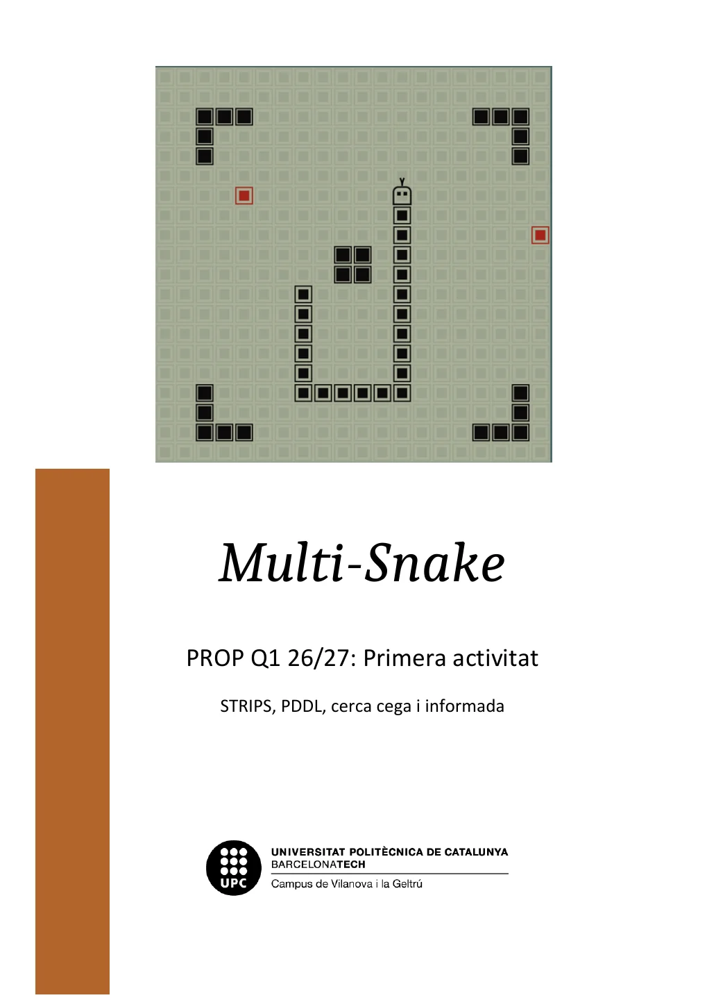
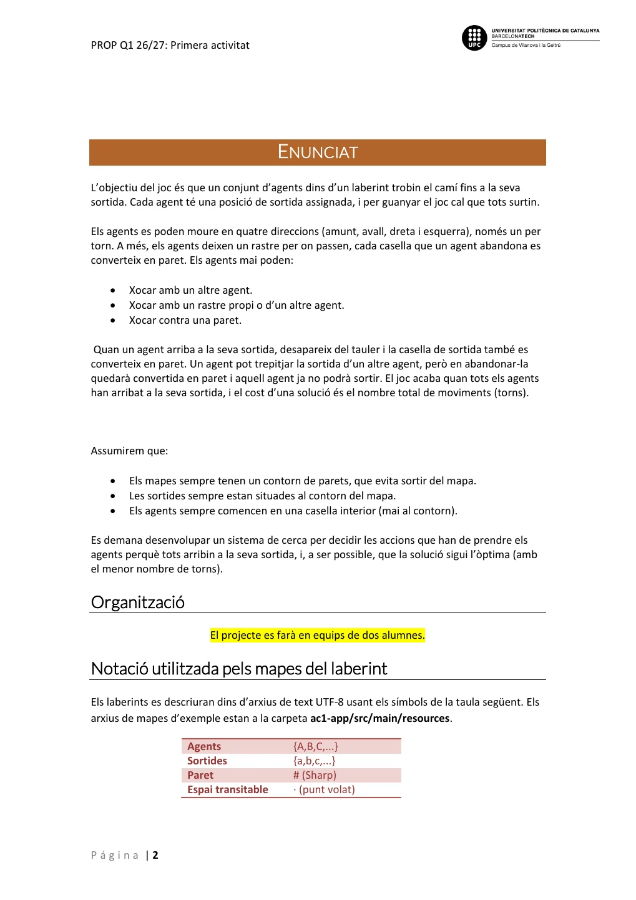
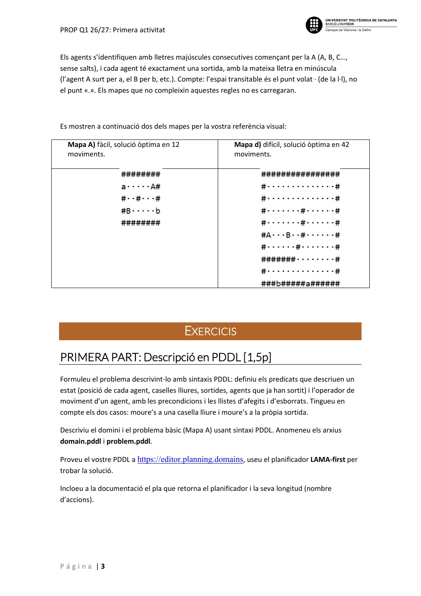
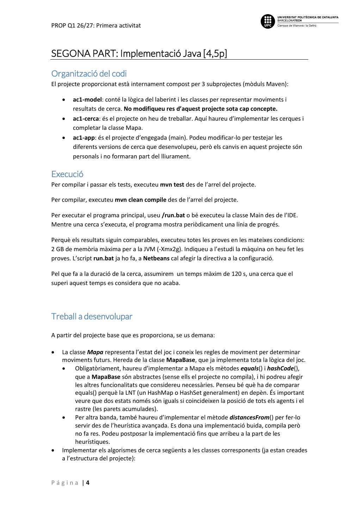
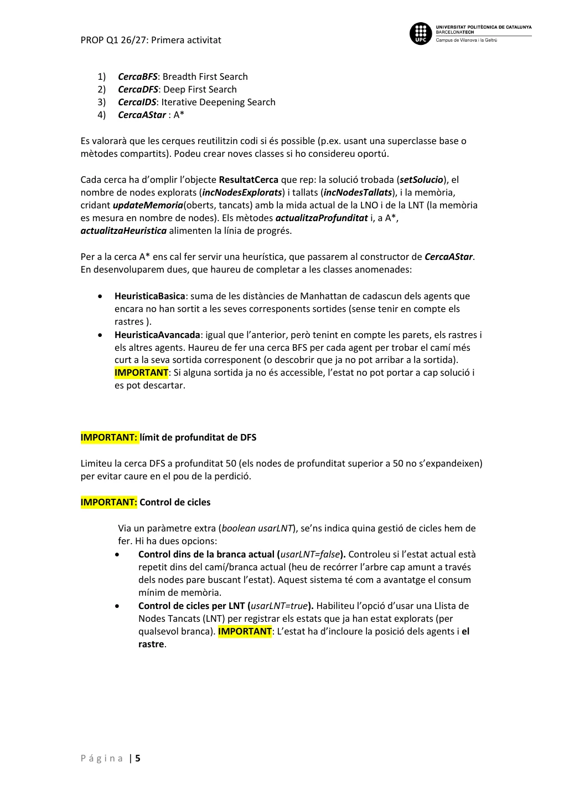
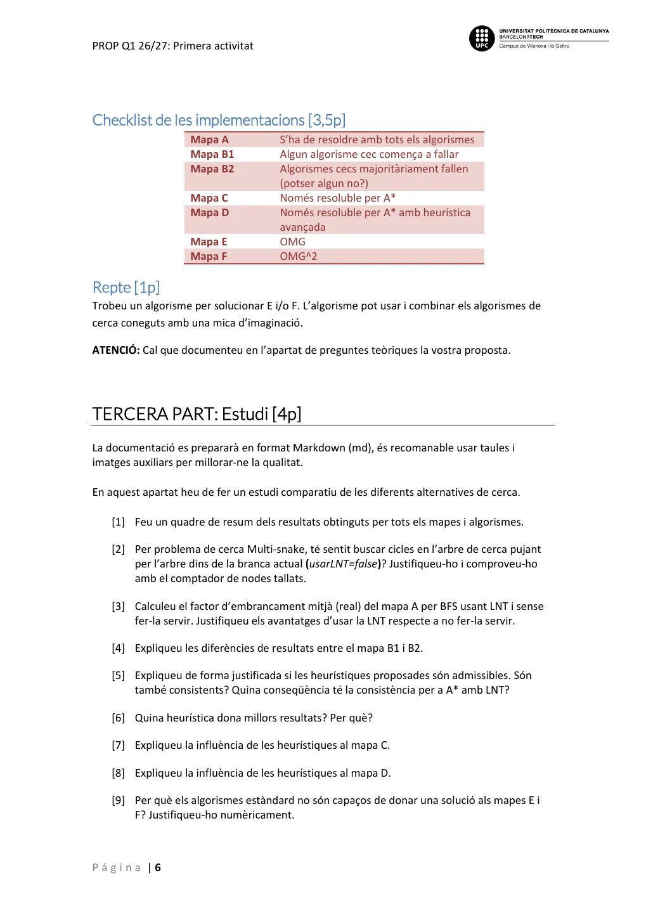
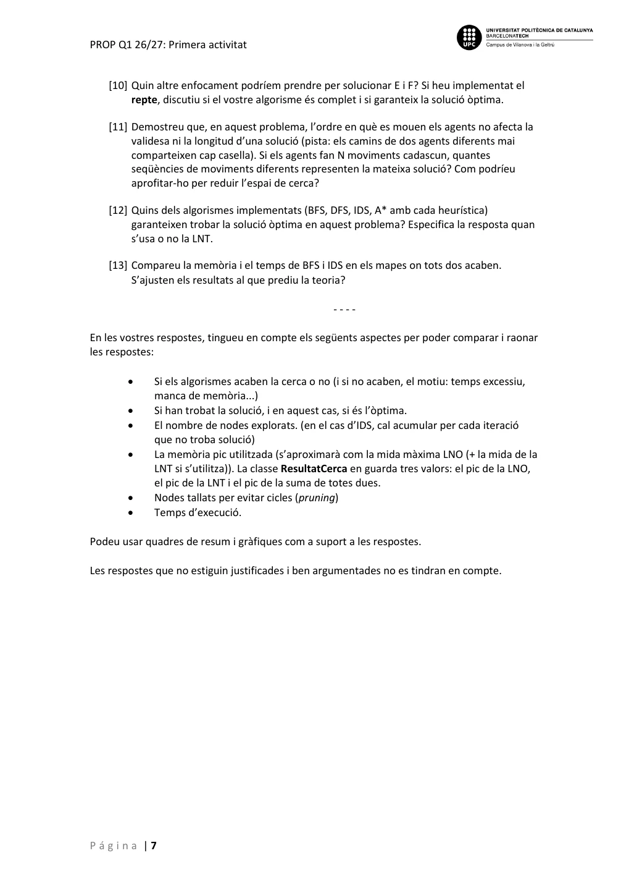
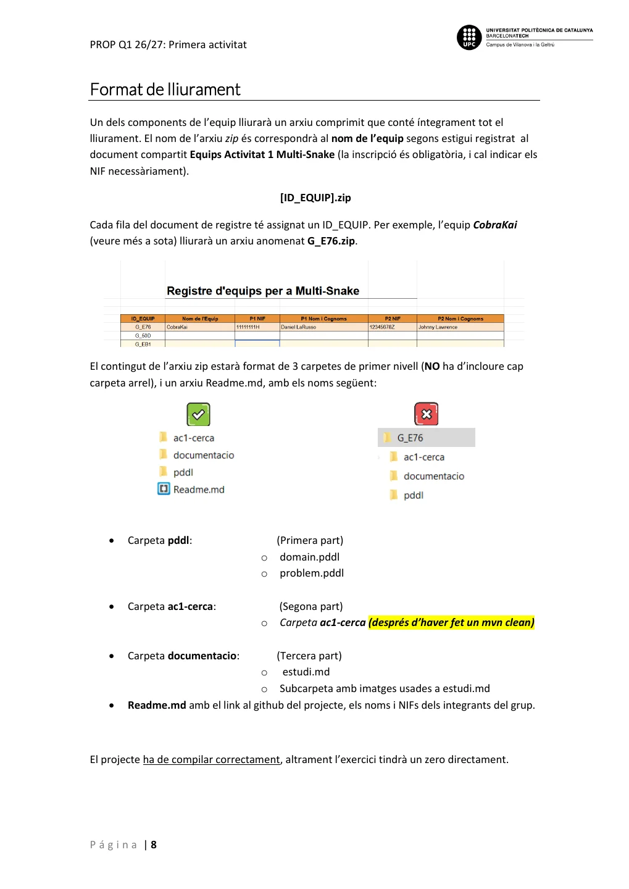
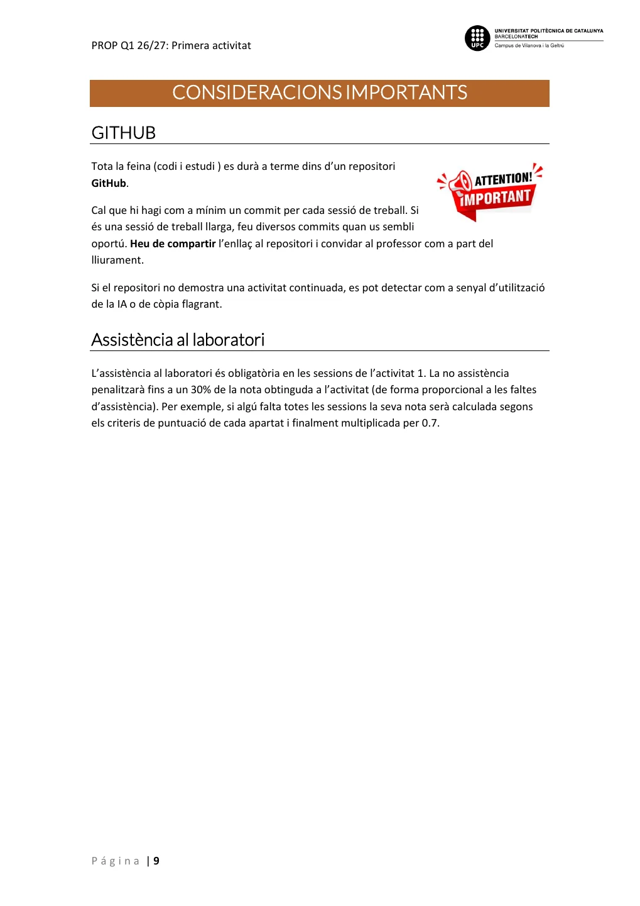

# Actividad 1: Multi-Snake

Fuente local: `Enunciat_Activitat 1_V1.0 (1).pdf`. Ámbito: Actividad anterior; sus límites no se trasladan a Bombardment.

Transcripción del texto disponible en el PDF, en su idioma original y por páginas. Los bloques de texto conservan ejemplos, símbolos y disposición sin reinterpretarlos. La vista original de cada página conserva diagramas, tablas, capturas y texto integrado en imágenes. La extracción automática puede contener errores de orden o caracteres; contrastar los detalles con esa vista.

[Índice de documentación](README.md)

## Página 1

```text
Multi-Snake


                      PROP   Q1  26/27:   Primera    activitat


                          STRIPS, PDDL, cerca cega i informada
```

<details>
<summary>Ver página original</summary>



</details>

## Página 2

```text
PROP Q1 26/27: Primera activitat


                                    ENUNCIAT


            L’objectiu del joc és que un conjunt d’agents dins d’un laberint trobin el camí fins a la seva
            sortida. Cada agent té una posició de sortida assignada, i per guanyar el joc cal que tots surtin.

            Els agents es poden moure en quatre direccions (amunt, avall, dreta i esquerra), només un per
            torn. A més, els agents deixen un rastre per on passen, cada casella que un agent abandona es
            converteix en paret. Els agents mai poden:

              -  Xocar amb un altre agent.

              -  Xocar amb un rastre propi o d’un altre agent.
              -  Xocar contra una paret.

            Quan un agent arriba a la seva sortida, desapareix del tauler i la casella de sortida també es
            converteix en paret. Un agent pot trepitjar la sortida d’un altre agent, però en abandonar-la
            quedarà convertida en paret i aquell agent ja no podrà sortir. El joc acaba quan tots els agents
            han arribat a la seva sortida, i el cost d’una solució és el nombre total de moviments (torns).


            Assumirem que:

              -  Els mapes sempre tenen un contorn de parets, que evita sortir del mapa.
              -  Les sortides sempre estan situades al contorn del mapa.
              -  Els agents sempre comencen en una casella interior (mai al contorn).


            Es demana desenvolupar un sistema de cerca per decidir les accions que han de prendre els
            agents perquè tots arribin a la seva sortida, i, a ser possible, que la solució sigui l’òptima (amb
            el menor nombre de torns).

            Organització

                           El projecte es farà en equips de dos alumnes.


            Notació utilitzada pels mapes del laberint

            Els laberints es descriuran dins d’arxius de text UTF-8 usant els símbols de la taula següent. Els
            arxius de mapes d’exemple estan a la carpeta ac1-app/src/main/resources.

                        Agents        {A,B,C,...}
                        Sortides      {a,b,c,...}
                        Paret         # (Sharp)
                        Espai transitable · (punt volat)


            P ágina | 2
```

<details>
<summary>Ver página original</summary>



</details>

## Página 3

```text
PROP Q1 26/27: Primera activitat


            Els agents s’identifiquen amb lletres majúscules consecutives començant per la A (A, B, C…,
            sense salts), i cada agent té exactament una sortida, amb la mateixa lletra en minúscula
            (l’agent A surt per a, el B per b, etc.). Compte: l’espai transitable és el punt volat · (de la l·l), no
            el punt «.». Els mapes que no compleixin aquestes regles no es carregaran.


            Es mostren a continuació dos dels mapes per la vostra referència visual:

             Mapa A) fàcil, solució òptima en 12 Mapa d) difícil, solució òptima en 42
             moviments.                       moviments.


                                    EXERCICIS


            PRIMERA   PART: Descripció en PDDL [1,5p]


            Formuleu el problema descrivint-lo amb sintaxis PDDL: definiu els predicats que descriuen un
            estat (posició de cada agent, caselles lliures, sortides, agents que ja han sortit) i l’operador de
            moviment d’un agent, amb les precondicions i les llistes d’afegits i d’esborrats. Tingueu en
            compte els dos casos: moure’s a una casella lliure i moure’s a la pròpia sortida.

            Descriviu el domini i el problema bàsic (Mapa A) usant sintaxi PDDL. Anomeneu els arxius

            domain.pddl i problem.pddl.

            Proveu el vostre PDDL a https://editor.planning.domains, useu el planificador LAMA-first per
            trobar la solució.

            Incloeu a la documentació el pla que retorna el planificador i la seva longitud (nombre
            d’accions).


            P ágina | 3
```

<details>
<summary>Ver página original</summary>



</details>

## Página 4

```text
PROP Q1 26/27: Primera activitat


            SEGONA   PART: Implementació  Java [4,5p]


            Organització del codi
            El projecte proporcionat està internament compost per 3 subprojectes (mòduls Maven):

              -  ac1-model: conté la lògica del laberint i les classes per representar moviments i

                 resultats de cerca. No modifiqueu res d’aquest projecte sota cap concepte.
              -  ac1-cerca: és el projecte on heu de treballar. Aquí haureu d’implementar les cerques i
                 completar la classe Mapa.
              -  ac1-app: és el projecte d’engegada (main). Podeu modificar-lo per testejar les
                 diferents versions de cerca que desenvolupeu, però els canvis en aquest projecte són

                 personals i no formaran part del lliurament.

            Execució
            Per compilar i passar els tests, executeu mvn test des de l’arrel del projecte.

            Per compilar, executeu mvn clean compile des de l’arrel del projecte.

            Per executar el programa principal, useu /run.bat o bé executeu la classe Main des de l’IDE.
            Mentre una cerca s’executa, el programa mostra periòdicament una línia de progrés.

            Perquè els resultats siguin comparables, executeu totes les proves en les mateixes condicions:
            2 GB de memòria màxima per a la JVM (-Xmx2g). Indiqueu a l’estudi la màquina on heu fet les

            proves. L’script run.bat ja ho fa, a Netbeans cal afegir la directiva a la configuració.

            Pel que fa a la duració de la cerca, assumirem un temps màxim de 120 s, una cerca que el
            superi aquest temps es considera que no acaba.


            Treball a desenvolupar

            A partir del projecte base que es proporciona, se us demana:

            - La classe Mapa representa l’estat del joc i coneix les regles de moviment per determinar

              moviments futurs. Hereda de la classe MapaBase, que ja implementa tota la lògica del joc.
              -  Obligatòriament, haureu d’implementar a Mapa els mètodes equals() i hashCode(),
                 que a MapaBase són abstractes (sense ells el projecte no compila), i hi podreu afegir
                 les altres funcionalitats que considereu necessàries. Penseu bé què ha de comparar
                 equals() perquè la LNT (un HashMap o HashSet generalment) en depèn. És important
                 veure que dos estats només són iguals si coincideixen la posició de tots els agents i el
                 rastre (les parets acumulades).
              -  Per altra banda, també haureu d’implementar el mètode distancesFrom() per fer-lo
                 servir des de l’heurística avançada. Es dona una implementació buida, compila però
                 no fa res. Podeu postposar la implementació fins que arribeu a la part de les
                 heurístiques.
            - Implementar els algorismes de cerca següents a les classes corresponents (ja estan creades
              a l’estructura del projecte):


            P ágina | 4
```

<details>
<summary>Ver página original</summary>



</details>

## Página 5

```text
PROP Q1 26/27: Primera activitat


              1) CercaBFS: Breadth First Search
              2) CercaDFS: Deep First Search
              3) CercaIDS: Iterative Deepening Search
              4) CercaAStar : A*

            Es valorarà que les cerques reutilitzin codi si és possible (p.ex. usant una superclasse base o
            mètodes compartits). Podeu crear noves classes si ho considereu oportú.

            Cada cerca ha d’omplir l’objecte ResultatCerca que rep: la solució trobada (setSolucio), el
            nombre de nodes explorats (incNodesExplorats) i tallats (incNodesTallats), i la memòria,
            cridant updateMemoria(oberts, tancats) amb la mida actual de la LNO i de la LNT (la memòria
            es mesura en nombre de nodes). Els mètodes actualitzaProfunditat i, a A*,
            actualitzaHeuristica alimenten la línia de progrés.

            Per a la cerca A* ens cal fer servir una heurística, que passarem al constructor de CercaAStar.

            En desenvoluparem dues, que haureu de completar a les classes anomenades:

              -  HeuristicaBasica: suma de les distàncies de Manhattan de cadascun dels agents que
                 encara no han sortit a les seves corresponents sortides (sense tenir en compte els
                 rastres ).
              -  HeuristicaAvancada: igual que l’anterior, però tenint en compte les parets, els rastres i
                 els altres agents. Haureu de fer una cerca BFS per cada agent per trobar el camí més
                 curt a la seva sortida corresponent (o descobrir que ja no pot arribar a la sortida).
                 IMPORTANT: Si alguna sortida ja no és accessible, l’estat no pot portar a cap solució i
                 es pot descartar.


            IMPORTANT: límit de profunditat de DFS

            Limiteu la cerca DFS a profunditat 50 (els nodes de profunditat superior a 50 no s’expandeixen)
            per evitar caure en el pou de la perdició.

            IMPORTANT: Control de cicles


                 Via un paràmetre extra (boolean usarLNT), se’ns indica quina gestió de cicles hem de
                 fer. Hi ha dues opcions:
                 -  Control dins de la branca actual (usarLNT=false). Controleu si l’estat actual està
                    repetit dins del camí/branca actual (heu de recórrer l’arbre cap amunt a través
                    dels nodes pare buscant l’estat). Aquest sistema té com a avantatge el consum
                    mínim de memòria.
                 -  Control de cicles per LNT (usarLNT=true). Habiliteu l’opció d’usar una Llista de
                    Nodes Tancats (LNT) per registrar els estats que ja han estat explorats (per
                    qualsevol branca). IMPORTANT: L’estat ha d’incloure la posició dels agents i el
                    rastre.


            P ágina | 5
```

<details>
<summary>Ver página original</summary>



</details>

## Página 6

```text
PROP Q1 26/27: Primera activitat


            Checklist de les implementacions [3,5p]

                        Mapa A      S’ha de resoldre amb tots els algorismes
                        Mapa B1     Algun algorisme cec comença a fallar
                        Mapa B2     Algorismes cecs majoritàriament fallen
                                    (potser algun no?)
                        Mapa C      Només resoluble per A*
                        Mapa D      Només resoluble per A* amb heurística
                                    avançada
                        Mapa E      OMG
                        Mapa F      OMG^2

            Repte [1p]
            Trobeu un algorisme per solucionar E i/o F. L’algorisme pot usar i combinar els algorismes de

            cerca coneguts amb una mica d’imaginació.
            ATENCIÓ: Cal que documenteu en l’apartat de preguntes teòriques la vostra proposta.


            TERCERA   PART: Estudi [4p]

            La documentació es prepararà en format Markdown (md), és recomanable usar taules i
            imatges auxiliars per millorar-ne la qualitat.


            En aquest apartat heu de fer un estudi comparatiu de les diferents alternatives de cerca.

              [1] Feu un quadre de resum dels resultats obtinguts per tots els mapes i algorismes.

              [2] Per problema de cerca Multi-snake, té sentit buscar cicles en l’arbre de cerca pujant
                 per l’arbre dins de la branca actual (usarLNT=false)? Justifiqueu-ho i comproveu-ho
                 amb el comptador de nodes tallats.

              [3] Calculeu el factor d’embrancament mitjà (real) del mapa A per BFS usant LNT i sense
                 fer-la servir. Justifiqueu els avantatges d’usar la LNT respecte a no fer-la servir.

              [4] Expliqueu les diferències de resultats entre el mapa B1 i B2.

              [5] Expliqueu de forma justificada si les heurístiques proposades són admissibles. Són
                 també consistents? Quina conseqüència té la consistència per a A* amb LNT?

              [6] Quina heurística dona millors resultats? Per què?

              [7] Expliqueu la influència de les heurístiques al mapa C.
              [8] Expliqueu la influència de les heurístiques al mapa D.

              [9] Per què els algorismes estàndard no són capaços de donar una solució als mapes E i
                 F? Justifiqueu-ho numèricament.


            P ágina | 6
```

<details>
<summary>Ver página original</summary>



</details>

## Página 7

```text
PROP Q1 26/27: Primera activitat


              [10] Quin altre enfocament podríem prendre per solucionar E i F? Si heu implementat el
                 repte, discutiu si el vostre algorisme és complet i si garanteix la solució òptima.

              [11] Demostreu que, en aquest problema, l’ordre en què es mouen els agents no afecta la
                 validesa ni la longitud d’una solució (pista: els camins de dos agents diferents mai
                 comparteixen cap casella). Si els agents fan N moviments cadascun, quantes
                 seqüències de moviments diferents representen la mateixa solució? Com podríeu
                 aprofitar-ho per reduir l’espai de cerca?

              [12] Quins dels algorismes implementats (BFS, DFS, IDS, A* amb cada heurística)
                 garanteixen trobar la solució òptima en aquest problema? Especifica la resposta quan
                 s’usa o no la LNT.

              [13] Compareu la memòria i el temps de BFS i IDS en els mapes on tots dos acaben.
                 S’ajusten els resultats al que prediu la teoria?

                                            - - - -

            En les vostres respostes, tingueu en compte els següents aspectes per poder comparar i raonar
            les respostes:

                 -  Si els algorismes acaben la cerca o no (i si no acaben, el motiu: temps excessiu,
                    manca de memòria...)
                 -  Si han trobat la solució, i en aquest cas, si és l’òptima.

                 -  El nombre de nodes explorats. (en el cas d’IDS, cal acumular per cada iteració
                    que no troba solució)
                 -  La memòria pic utilitzada (s’aproximarà com la mida màxima LNO (+ la mida de la
                    LNT si s’utilitza)). La classe ResultatCerca en guarda tres valors: el pic de la LNO,
                    el pic de la LNT i el pic de la suma de totes dues.
                 -  Nodes tallats per evitar cicles (pruning)
                 -  Temps d’execució.

            Podeu usar quadres de resum i gràfiques com a suport a les respostes.

            Les respostes que no estiguin justificades i ben argumentades no es tindran en compte.


            P ágina | 7
```

<details>
<summary>Ver página original</summary>



</details>

## Página 8

```text
PROP Q1 26/27: Primera activitat


            Format de lliurament


            Un dels components de l’equip lliurarà un arxiu comprimit que conté íntegrament tot el
            lliurament. El nom de l’arxiu zip és correspondrà al nom de l’equip segons estigui registrat al
            document compartit Equips Activitat 1 Multi-Snake (la inscripció és obligatòria, i cal indicar els
            NIF necessàriament).

                                     [ID_EQUIP].zip

            Cada fila del document de registre té assignat un ID_EQUIP. Per exemple, l’equip CobraKai
            (veure més a sota) lliurarà un arxiu anomenat G_E76.zip.


            El contingut de l’arxiu zip estarà format de 3 carpetes de primer nivell (NO ha d’incloure cap

            carpeta arrel), i un arxiu Readme.md, amb els noms següent:


              -  Carpeta pddl:      (Primera part)
                                  o  domain.pddl
                                  o  problem.pddl


              -  Carpeta ac1-cerca:  (Segona part)
                                  o  Carpeta ac1-cerca (després d’haver fet un mvn clean)

              -  Carpeta documentacio: (Tercera part)

                                  o  estudi.md
                                  o  Subcarpeta amb imatges usades a estudi.md
              -  Readme.md amb el link al github del projecte, els noms i NIFs dels integrants del grup.


            El projecte ha de compilar correctament, altrament l’exercici tindrà un zero directament.


            P ágina | 8
```

<details>
<summary>Ver página original</summary>



</details>

## Página 9

```text
PROP Q1 26/27: Primera activitat


                      CONSIDERACIONS        IMPORTANTS


            GITHUB


            Tota la feina (codi i estudi ) es durà a terme dins d’un repositori
            GitHub.

            Cal que hi hagi com a mínim un commit per cada sessió de treball. Si
            és una sessió de treball llarga, feu diversos commits quan us sembli
            oportú. Heu de compartir l’enllaç al repositori i convidar al professor com a part del
            lliurament.

            Si el repositori no demostra una activitat continuada, es pot detectar com a senyal d’utilització
            de la IA o de còpia flagrant.


            Assistència al laboratori

            L’assistència al laboratori és obligatòria en les sessions de l’activitat 1. La no assistència

            penalitzarà fins a un 30% de la nota obtinguda a l’activitat (de forma proporcional a les faltes
            d’assistència). Per exemple, si algú falta totes les sessions la seva nota serà calculada segons
            els criteris de puntuació de cada apartat i finalment multiplicada per 0.7.


            P ágina | 9
```

<details>
<summary>Ver página original</summary>



</details>
