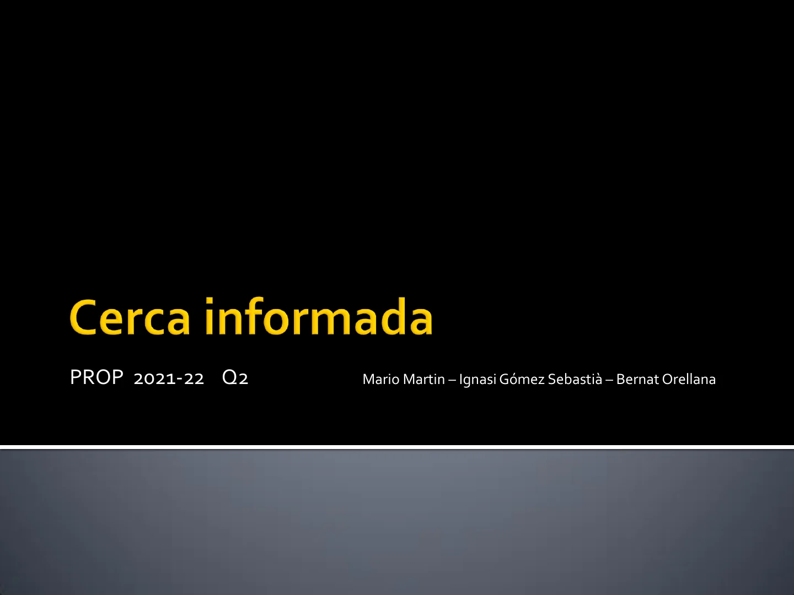
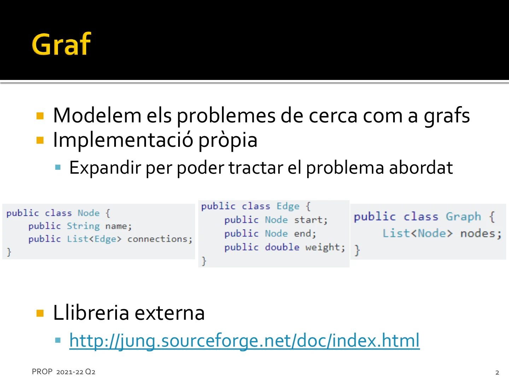
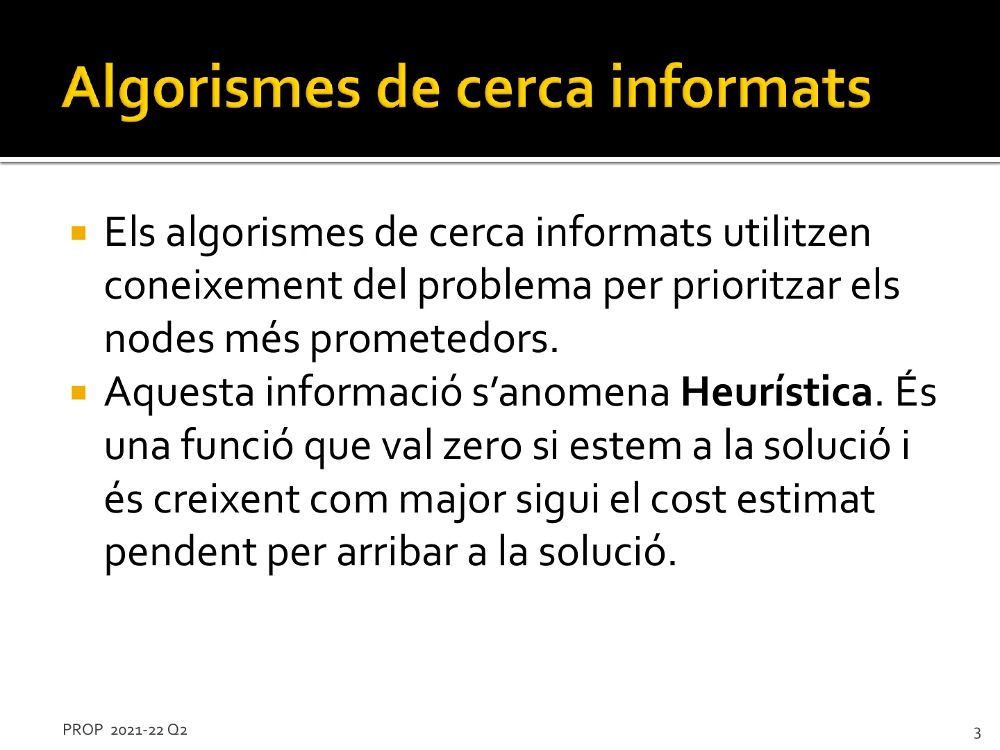
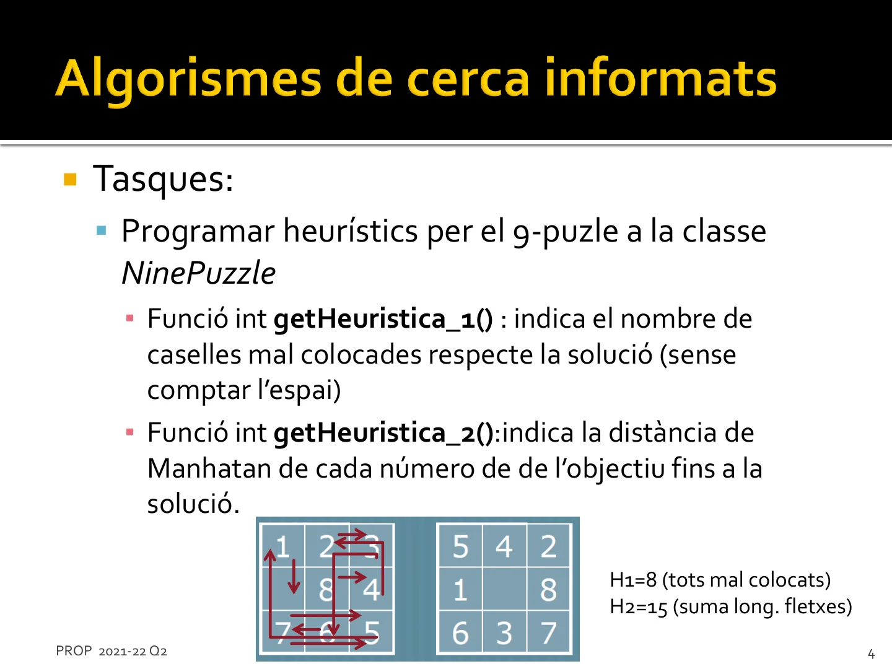
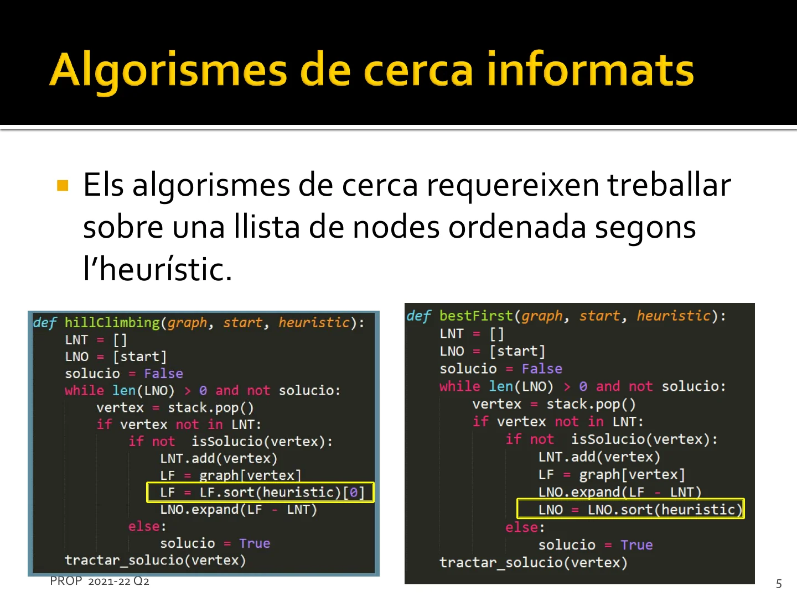
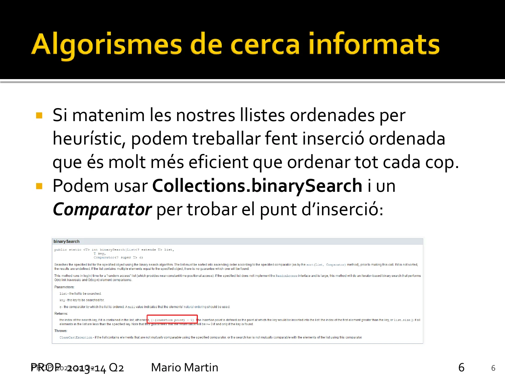
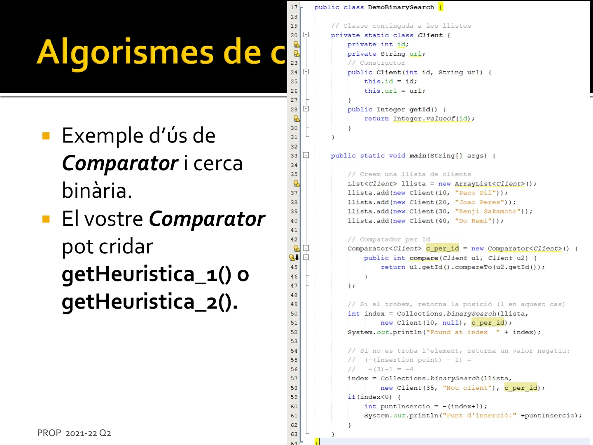
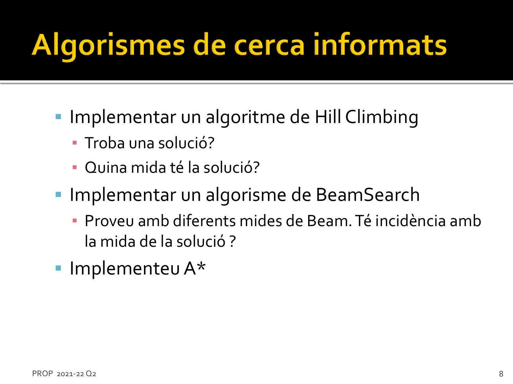

# Búsqueda informada

Fuente local: `CercaInformada.pdf`. Ámbito: Fundamentos de búsqueda.

Transcripción del texto disponible en el PDF, en su idioma original y por páginas. Los bloques de texto conservan ejemplos, símbolos y disposición sin reinterpretarlos. La vista original de cada página conserva diagramas, tablas, capturas y texto integrado en imágenes. La extracción automática puede contener errores de orden o caracteres; contrastar los detalles con esa vista.

[Índice de documentación](README.md)

## Página 1

```text
PROP    2021-22    Q2
                                             Mario Martin – Ignasi Gómez Sebastià – Bernat Orellana
```

<details>
<summary>Ver página original</summary>



</details>

## Página 2

```text
Modelem            els  problemes            de   cerca      com      a  grafs
       -

          Implementació                pròpia
       -

           -  Expandir      per   poder      tractar    el  problema        abordat


          Llibreria       externa
       -

           -  http://jung.sourceforge.net/doc/index.html


      PROP 2021-22 Q2                                                                            2
```

<details>
<summary>Ver página original</summary>



</details>

## Página 3

```text
Els   algorismes           de    cerca     informats          utilitzen
       -

          coneixement              del   problema           per    prioritzar       els


          nodes       més      prometedors.


          Aquesta         informació           s’anomena            Heurística.          És
       -

          una     funció      que     val   zero     si  estem       a  la  solució      i


          és   creixent        com      major      sigui     el  cost    estimat


          pendent         per    arribar      a  la  solució.


      PROP 2021-22 Q2                                                                            3
```

<details>
<summary>Ver página original</summary>



</details>

## Página 4

```text
Tasques:
       -

           -  Programar        heurístics      per   el  9-puzle      a la  classe


              NinePuzzle


              ▪ Funció    int getHeuristica_1()         : indica  el nombre      de

                caselles    mal  colocades      respecte    la solució   (sense

                comptar      l’espai)


              ▪ Funció    int getHeuristica_2():indica           la distància    de

                Manhatan       de  cada   número      de  de  l’objectiu   fins a  la


                solució.


                                                                    H1=8  (tots mal colocats)

                                                                    H2=15  (suma  long. fletxes)


      PROP 2021-22 Q2                                                                            4
```

<details>
<summary>Ver página original</summary>



</details>

## Página 5

```text
Els   algorismes           de    cerca     requereixen            treballar
       -

          sobre      una     llista   de    nodes       ordenada          segons


          l’heurístic.


      PROP 2021-22 Q2                                                                            5
```

<details>
<summary>Ver página original</summary>



</details>

## Página 6

```text
-  Si  matenim        les   nostres     llistes   ordenades         per

          heurístic,      podem       treballar     fent   inserció      ordenada


          que    és  molt     més    eficient     que   ordenar       tot  cada     cop.


       -  Podem       usar    Collections.binarySearch                  i un

          Comparator           per   trobar    el  punt    d’inserció:


      PPRROOP P20 221-0221 Q3-21 4 Q2 Mario Martin                                        6
                                                                                                 6
```

<details>
<summary>Ver página original</summary>



</details>

## Página 7

```text
-  Exemple        d’ús   de

          Comparator           i cerca


          binària.


       -  El  vostre     Comparator

          pot    cridar


          getHeuristica_1()             o

          getHeuristica_2().


      PROP 2021-22 Q2                                                                            7
```

<details>
<summary>Ver página original</summary>



</details>

## Página 8

```text
-  Implementar          un   algoritme       de   Hill  Climbing


              ▪ Troba    una   solució?

              ▪ Quina    mida    té la solució?


           -  Implementar          un   algorisme       de   BeamSearch


              ▪ Proveu     amb   diferents    mides    de  Beam.     Té  incidència    amb

                la mida    de  la solució   ?


           -  Implementeu           A*


      PROP 2021-22 Q2                                                                            8
```

<details>
<summary>Ver página original</summary>



</details>
