# Búsqueda no informada

Fuente local: `CercaNoInformada (1).pdf`. Ámbito: Fundamentos de búsqueda.

Transcripción del texto disponible en el PDF, en su idioma original y por páginas. Los bloques de texto conservan ejemplos, símbolos y disposición sin reinterpretarlos. La vista original de cada página conserva diagramas, tablas, capturas y texto integrado en imágenes. La extracción automática puede contener errores de orden o caracteres; contrastar los detalles con esa vista.

[Índice de documentación](README.md)

## Página 1

```text
Bernat  Orellana  – PROP   2021/22
```

<details>
<summary>Ver página original</summary>

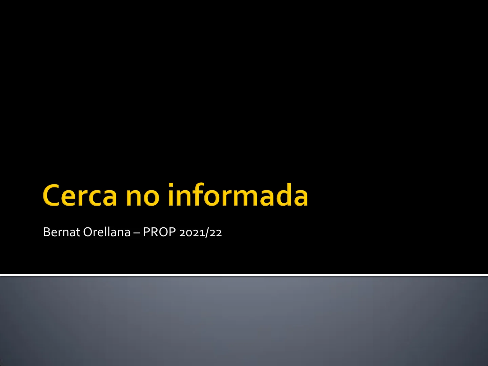

</details>

## Página 2

```text
Podem        utilitzar     grafs     per   anar
       -
          representant/emmagatzemant                            l’arbre


          d’exploració          de   l’espai    de   solucions.

          Podem        optar     per    una    implementació             pròpia
       -


          Generalment             és  recomanable            usar    una     llibreria
       -
          externa       (Jung)


           -  http://jung.sourceforge.net/doc/index.html
```

<details>
<summary>Ver página original</summary>

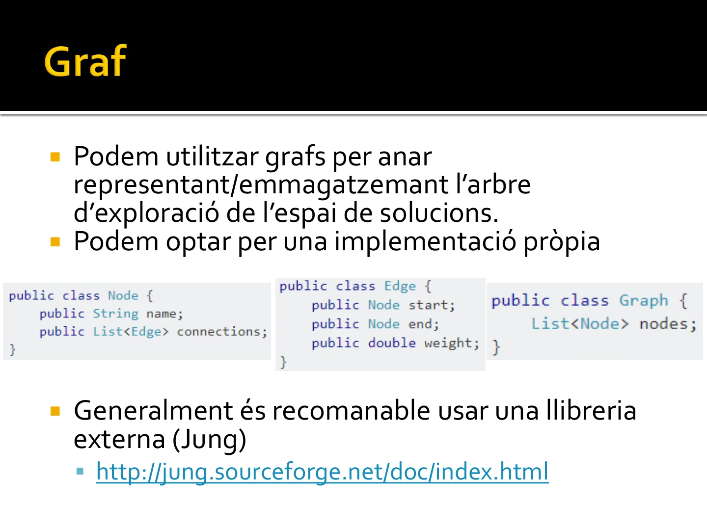

</details>

## Página 3

```text
Amplada
       -
```

<details>
<summary>Ver página original</summary>

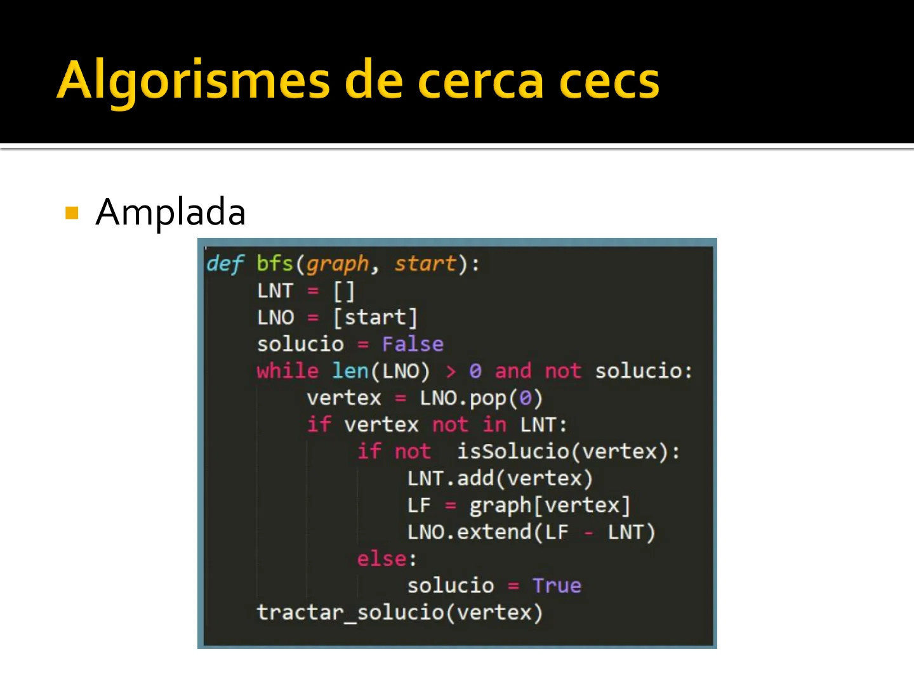

</details>

## Página 4

```text
Profunditat           i IDS
       -
```

<details>
<summary>Ver página original</summary>

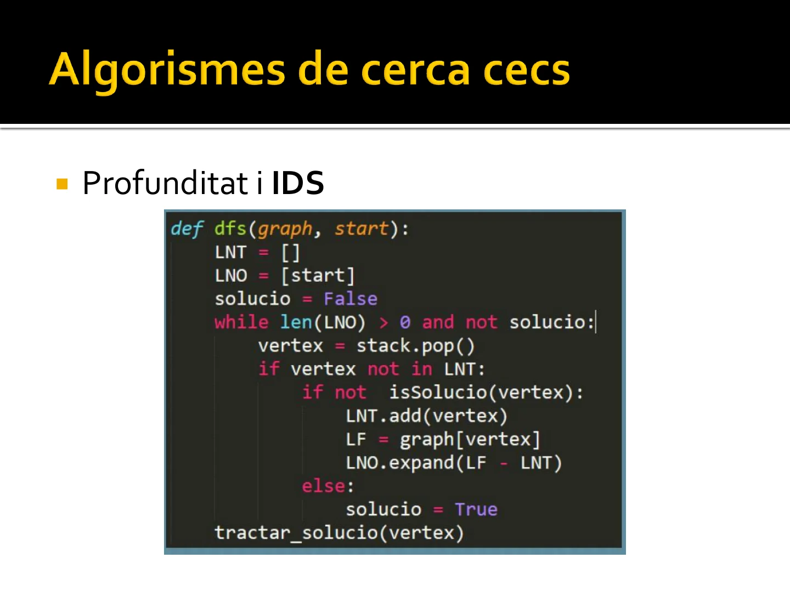

</details>

## Página 5

```text
Es   proposa        resoldre       el problema
       -

          de   nine-puzzle          amb      una    cerca     en

          amplada,         en   profunditat          i IDS.


          Es   proporciona           un   projecte       que
       -
          incorpora:


           -  Un   esquelet     de  classes    per


              representar      la  lògica   del  NinePuzzle        i

              els seus    moviments        (Dir)

           -  El projecte     ja duu    la llibreria   Jung


           -  La  funció    de  visualització      del  graf   i de

              la solució    ja està   implementada.
```

<details>
<summary>Ver página original</summary>

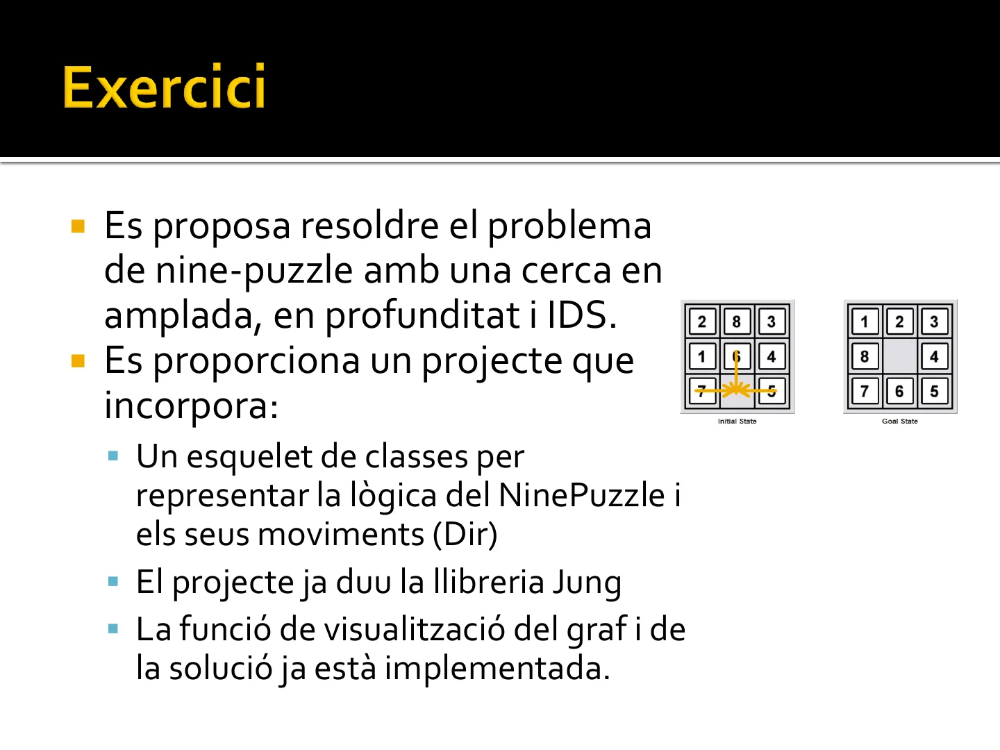

</details>

## Página 6

```text
Cal    que     implementeu              a  la  classe      Main      les
       -

          funcions:


           -  cercaNoInformadaBFS


           -  cercaNoInformadaDFS


           -  cercaNoInformadaIDS


          Han      de   retornar        l’estat     del   graf     d’exploració
       -

          en    el  moment          de    trobar      la  solució       i el  node


          solució.       Retornen          null    si  no   es   troba      la


          solució.
```

<details>
<summary>Ver página original</summary>

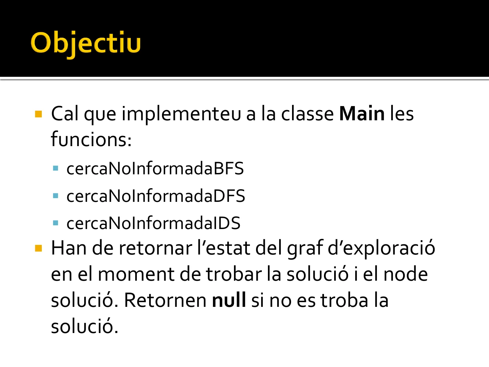

</details>

## Página 7

```text
-  Al  llarg  de  la exploració      és  crucial   evitar   cicles  (és  a  dir,

          tornar    a caure    en  una   configuració      de   tauler   que

          anteriorment        ja hem    fet)


       -  Hi  ha  dues    opcions    per   tallar  cicles:

           -  Usar  recorregut    cap  a dalt pel  graf des  del  node   actual  fins a

              l’arrel de l’arbre per  evitar  moviments      cíclics.

           -  Usar  LNT,  excloent    els nodes   ja processats    (veure  pseudocodi
              dels algorismes)

           -  Quines   avantatges/inconvenients         té cadascuna     de les dues

              opcions   ?


       -  Useu    la funció    comparaEstat()        per  comparar       dos   estats   de
          NinePuzzle
```

<details>
<summary>Ver página original</summary>

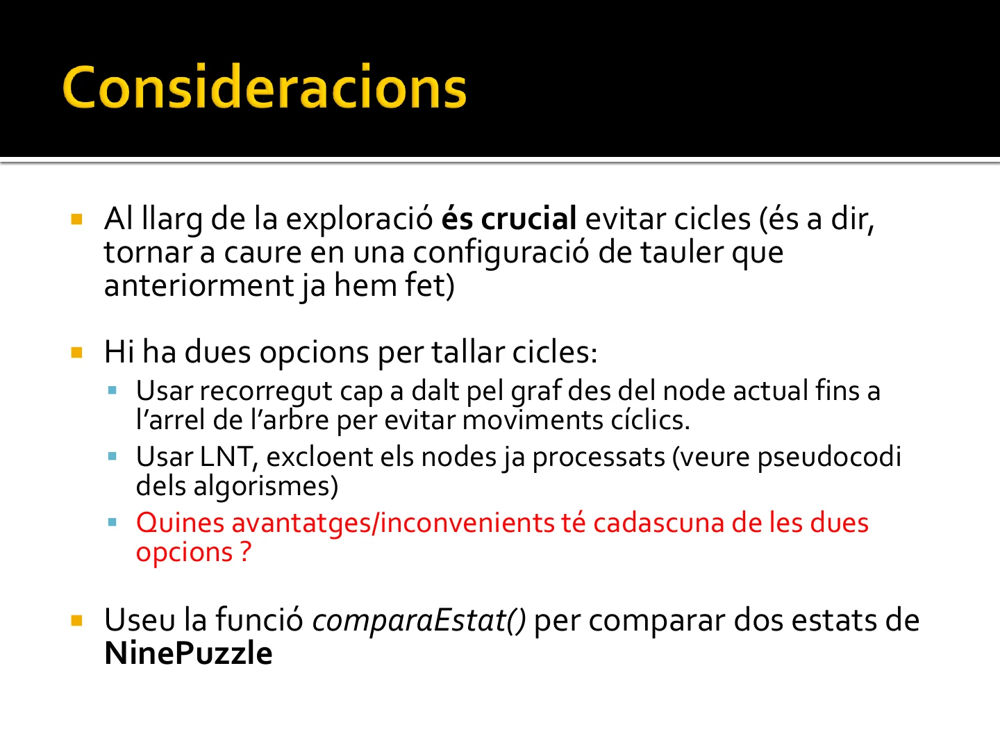

</details>

## Página 8

```text
Valoreu       quina      és  la  millor     classe     per   contenir       la
       -

          LNO      i la  LNT.     Recordeu         que    els   nodes      són    de

          tipus     NinePuzzle:


           -  ArrayList<NinePuzzle>


           -  LinkedList<NinePuzzle>


           -  Stack<NinePuzzle>

           -  Queue<NinePuzzle>


          Feu    un    recompte         de   nodes      explorats        en   cada     cas
       -

          i mostreu-lo          a  la sortida.
```

<details>
<summary>Ver página original</summary>

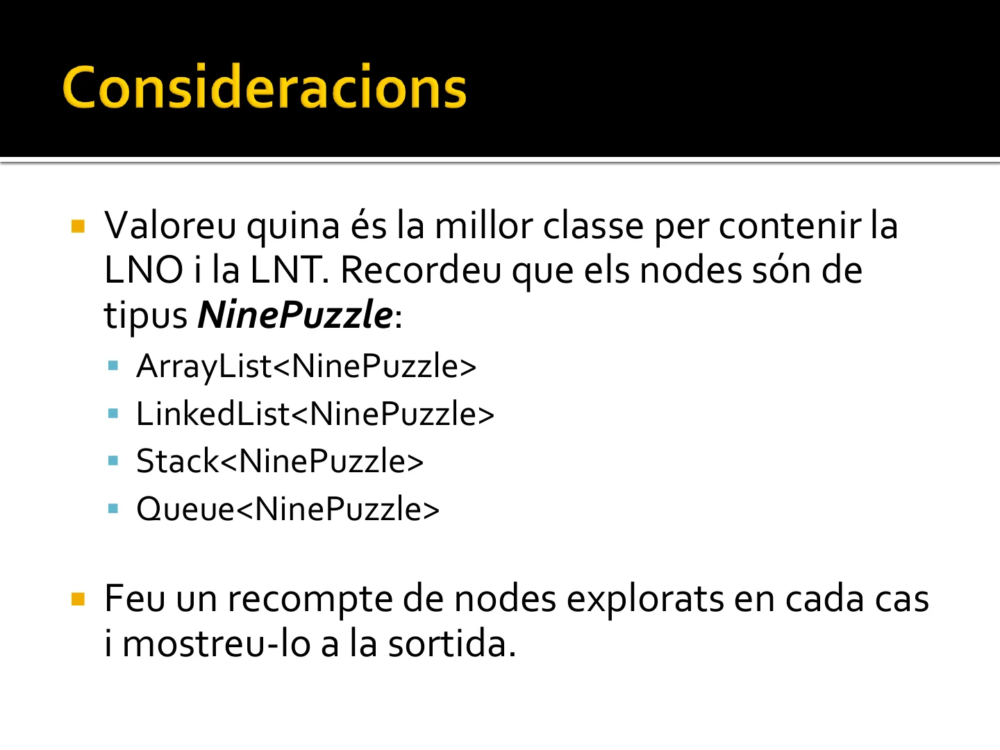

</details>

## Página 9

```text
Cerca      en   profunditat         (DFS)
       -


           -  Programeu-la         primer    sense    limitar    la profunditat

              màxima      i compareu       la  solució    que   ens   dona    respecte

              la cerca   en   amplada.


           -  Assegureu-vos         que   no   “acumuleu”        els  nodes    ja

              recorreguts      i que   no   estan    a la LNO.     Sinó,   en  memòria

              tindrem     el mateix     cost   que   una    BFS.


           -  Proveu     a implementar         DFS    usant    una   crida   recursiva.


           -  Limiteu     la profunditat       de  cerca    i feu  el IDS.   Verifiqueu
              el canvi   de   les solucions      trobades.
```

<details>
<summary>Ver página original</summary>

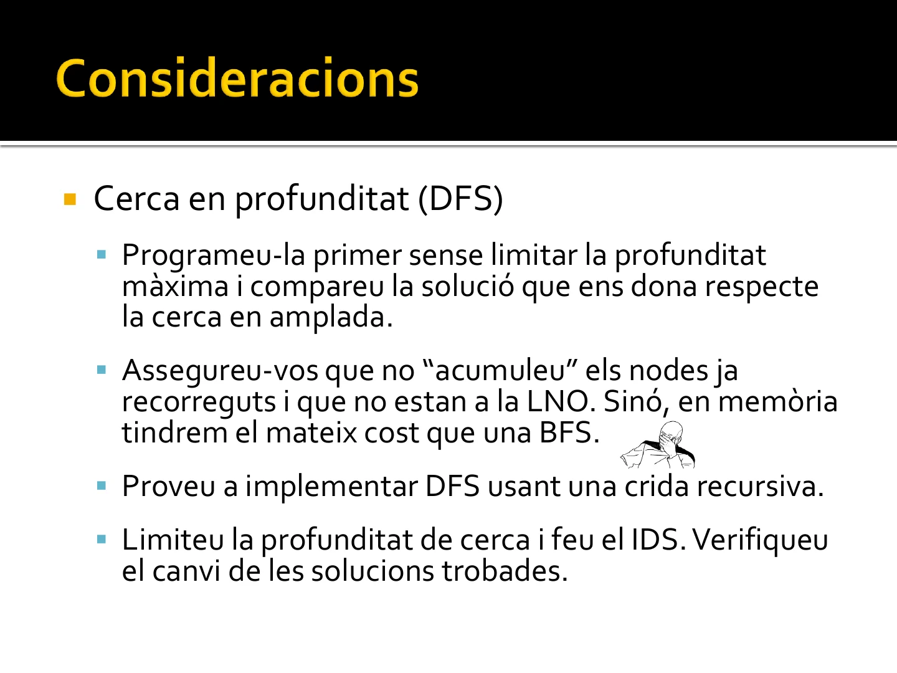

</details>

## Página 10

Esta página no contiene texto extraíble. Su contenido se conserva en la vista original.

<details>
<summary>Ver página original</summary>

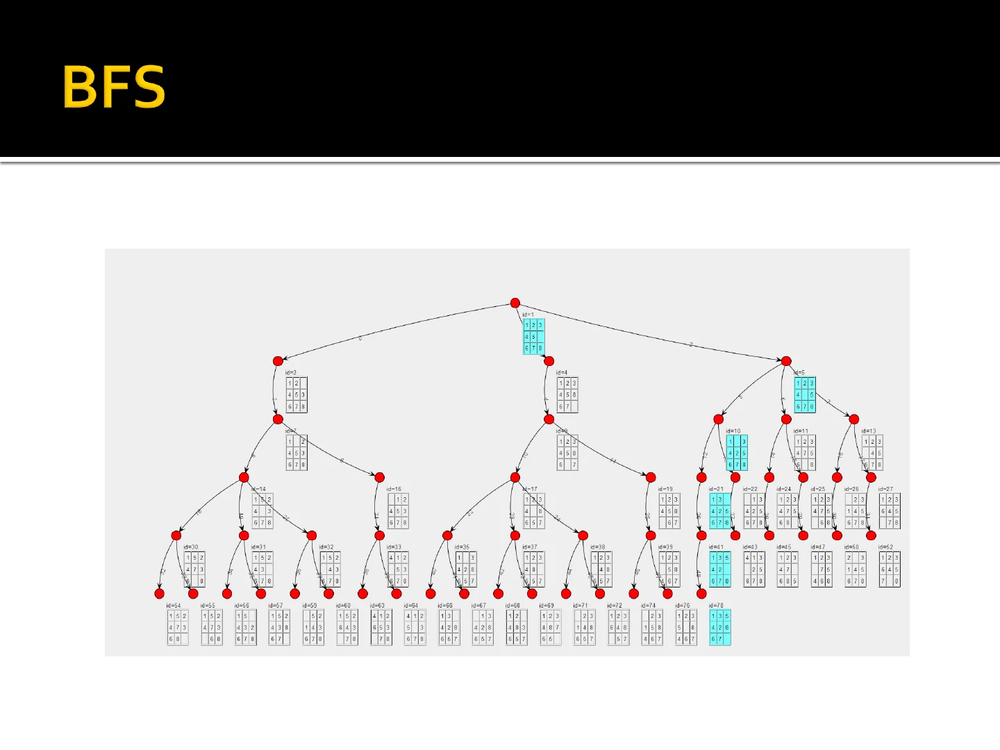

</details>

## Página 11

Esta página no contiene texto extraíble. Su contenido se conserva en la vista original.

<details>
<summary>Ver página original</summary>

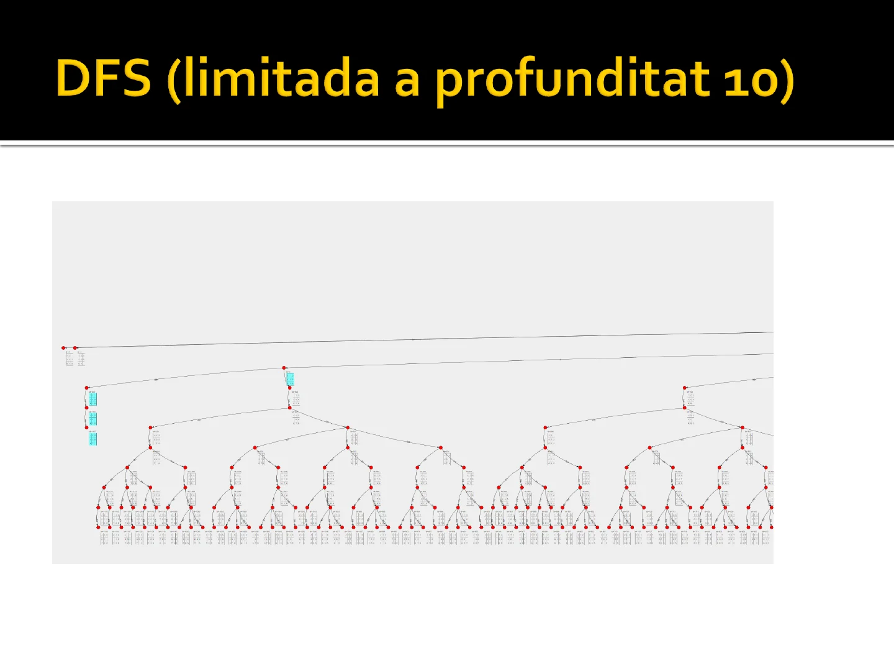

</details>

## Página 12

Esta página no contiene texto extraíble. Su contenido se conserva en la vista original.

<details>
<summary>Ver página original</summary>

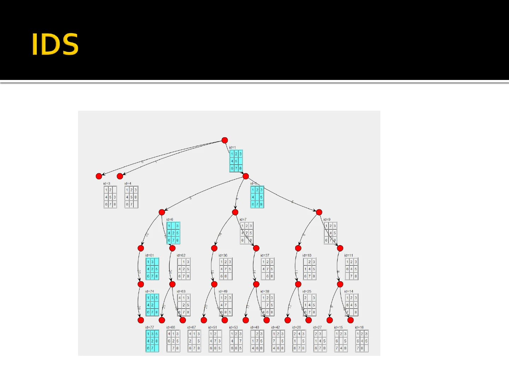

</details>
