# Git con NetBeans

Fuente local: `Git amb Netbeans.pdf`. Ámbito: Herramientas de trabajo.

Transcripción del texto disponible en el PDF, en su idioma original y por páginas. Los bloques de texto conservan ejemplos, símbolos y disposición sin reinterpretarlos. La vista original de cada página conserva diagramas, tablas, capturas y texto integrado en imágenes. La extracción automática puede contener errores de orden o caracteres; contrastar los detalles con esa vista.

[Índice de documentación](README.md)

## Página 1

Esta página no contiene texto extraíble. Su contenido se conserva en la vista original.

<details>
<summary>Ver página original</summary>


</details>

## Página 2

```text
PROP 2019-20 Q1         Mario Martin – Ignasi Gómez Sebastià - Bernat Orellana
```

<details>
<summary>Ver página original</summary>

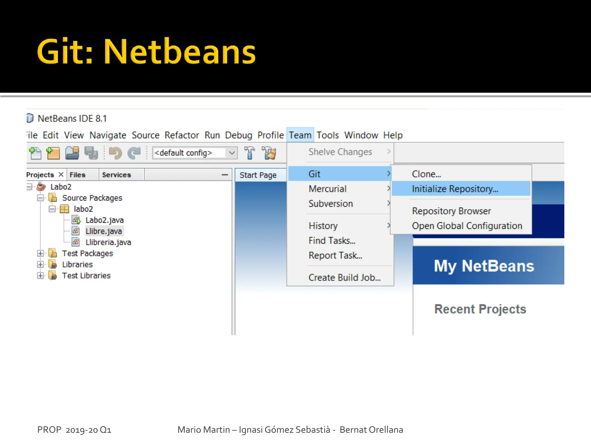

</details>

## Página 3

```text
PROP 2019-20 Q1         Mario Martin – Ignasi Gómez Sebastià - Bernat Orellana
```

<details>
<summary>Ver página original</summary>

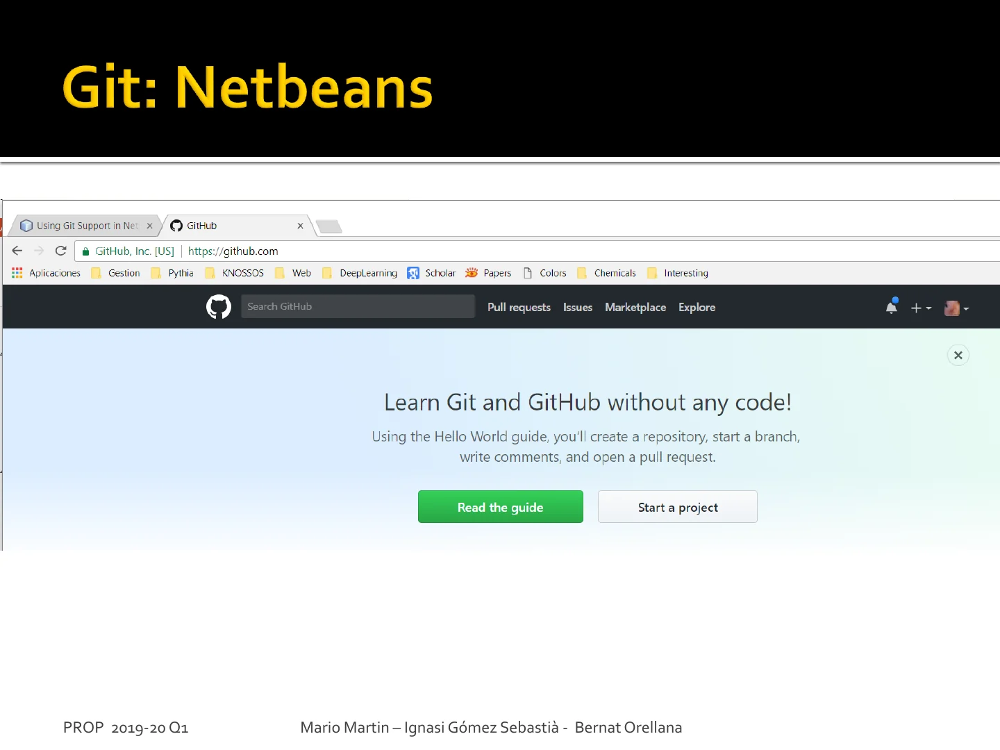

</details>

## Página 4

```text
PROP 2019-20 Q1         Mario Martin – Ignasi Gómez Sebastià - Bernat Orellana
```

<details>
<summary>Ver página original</summary>

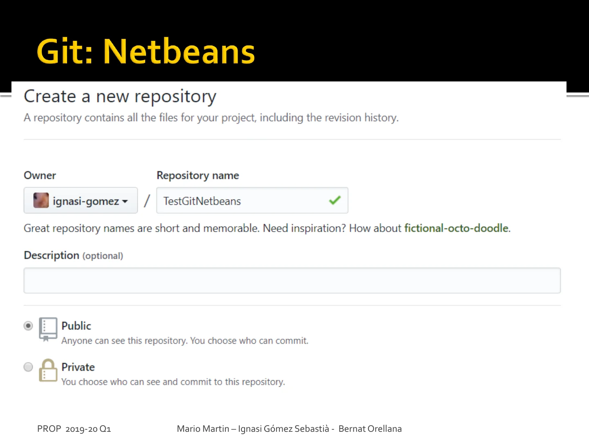

</details>

## Página 5

```text
PROP 2019-20 Q1         Mario Martin – Ignasi Gómez Sebastià - Bernat Orellana
```

<details>
<summary>Ver página original</summary>

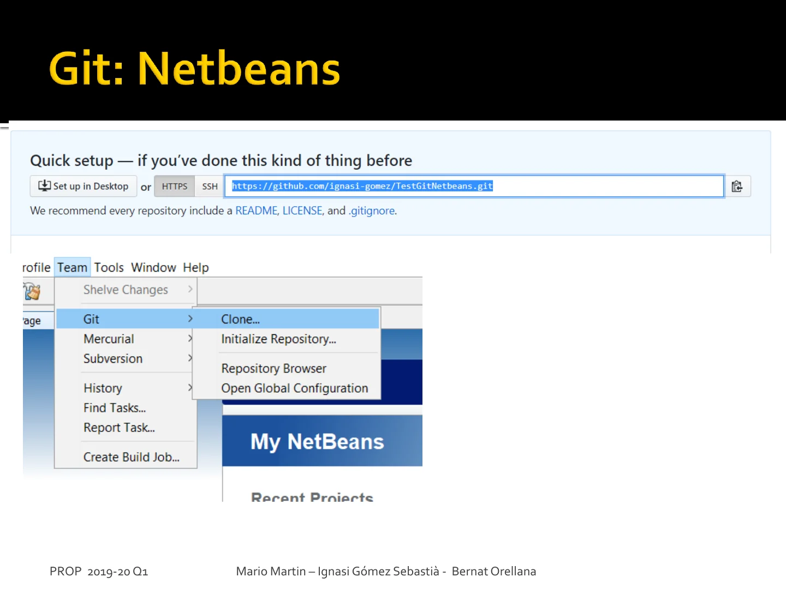

</details>

## Página 6

```text
PROP 2019-20 Q1         Mario Martin – Ignasi Gómez Sebastià - Bernat Orellana
```

<details>
<summary>Ver página original</summary>

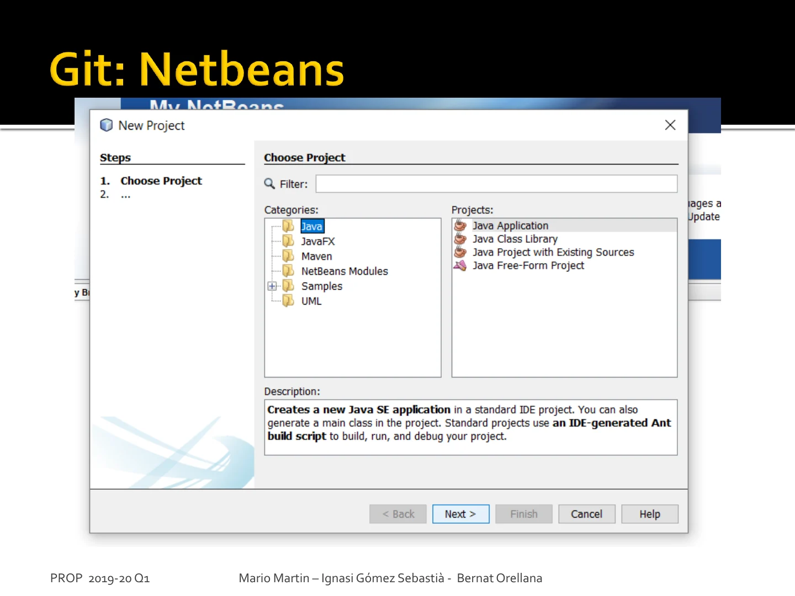

</details>

## Página 7

```text
PROP 2019-20 Q1         Mario Martin – Ignasi Gómez Sebastià - Bernat Orellana
```

<details>
<summary>Ver página original</summary>

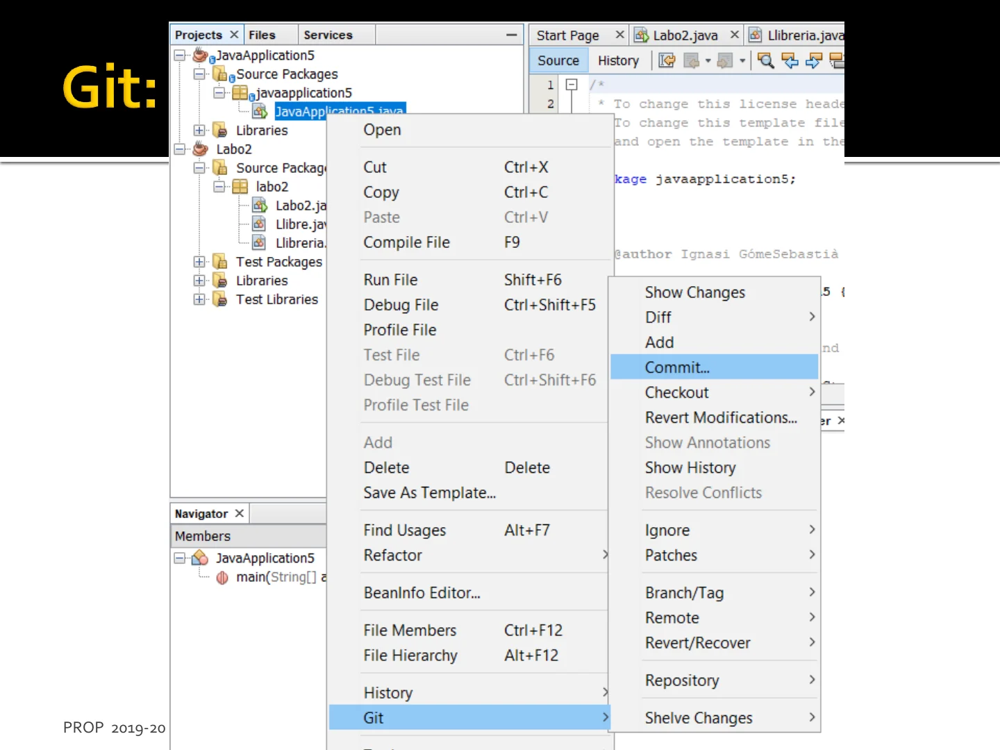

</details>

## Página 8

```text
PROP 2019-20 Q1         Mario Martin – Ignasi Gómez Sebastià - Bernat Orellana
```

<details>
<summary>Ver página original</summary>

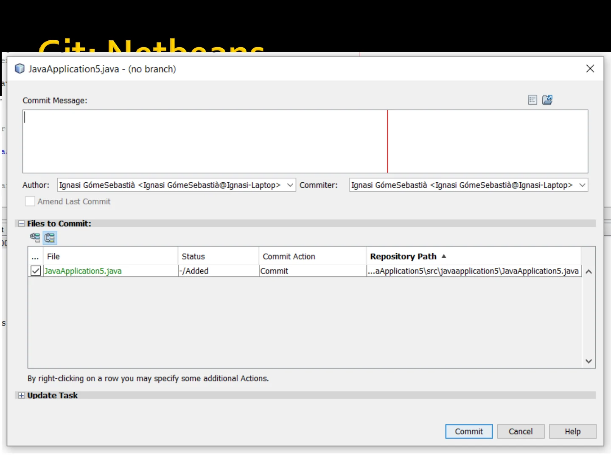

</details>

## Página 9

```text
PROP 2019-20 Q1         Mario Martin – Ignasi Gómez Sebastià - Bernat Orellana
```

<details>
<summary>Ver página original</summary>

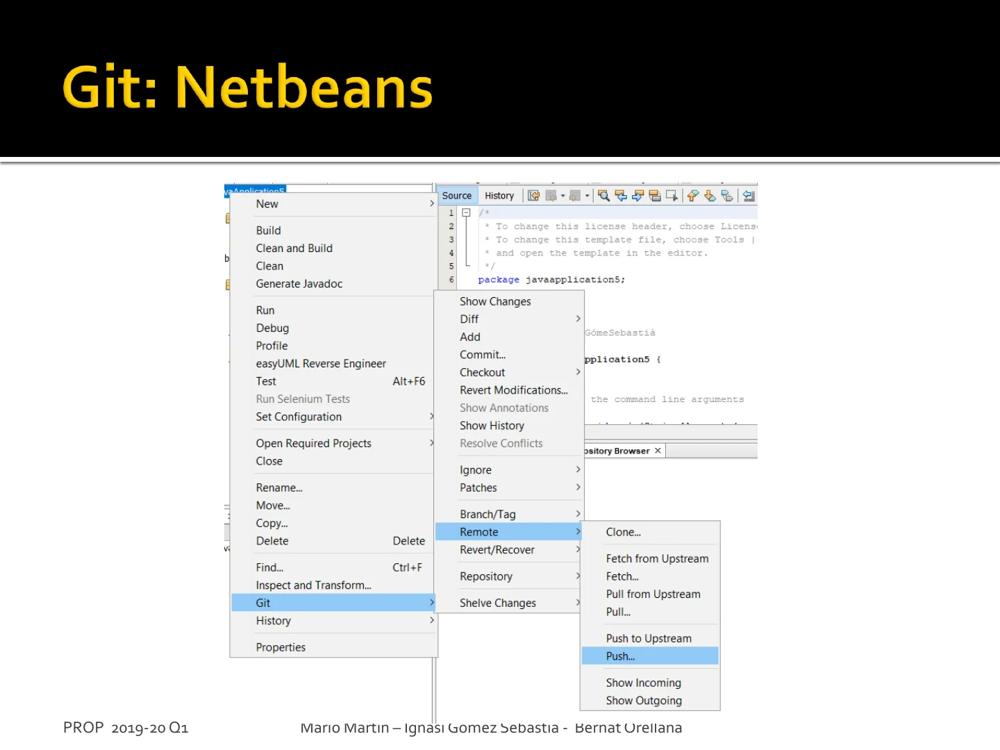

</details>

## Página 10

```text
PROP 2019-20 Q1         Mario Martin – Ignasi Gómez Sebastià - Bernat Orellana
```

<details>
<summary>Ver página original</summary>

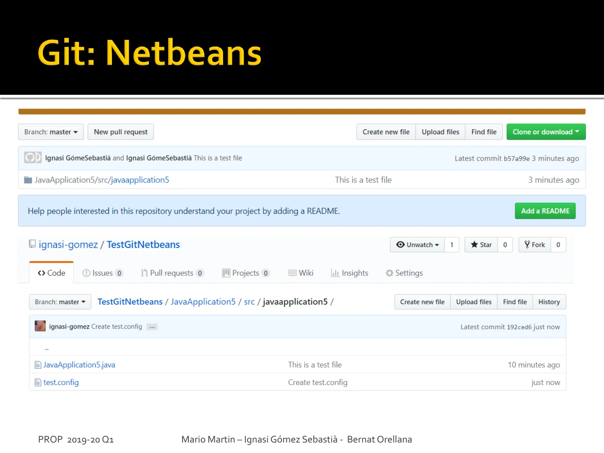

</details>

## Página 11

```text
PROP 2019-20 Q1         Mario Martin – Ignasi Gómez Sebastià - Bernat Orellana
```

<details>
<summary>Ver página original</summary>

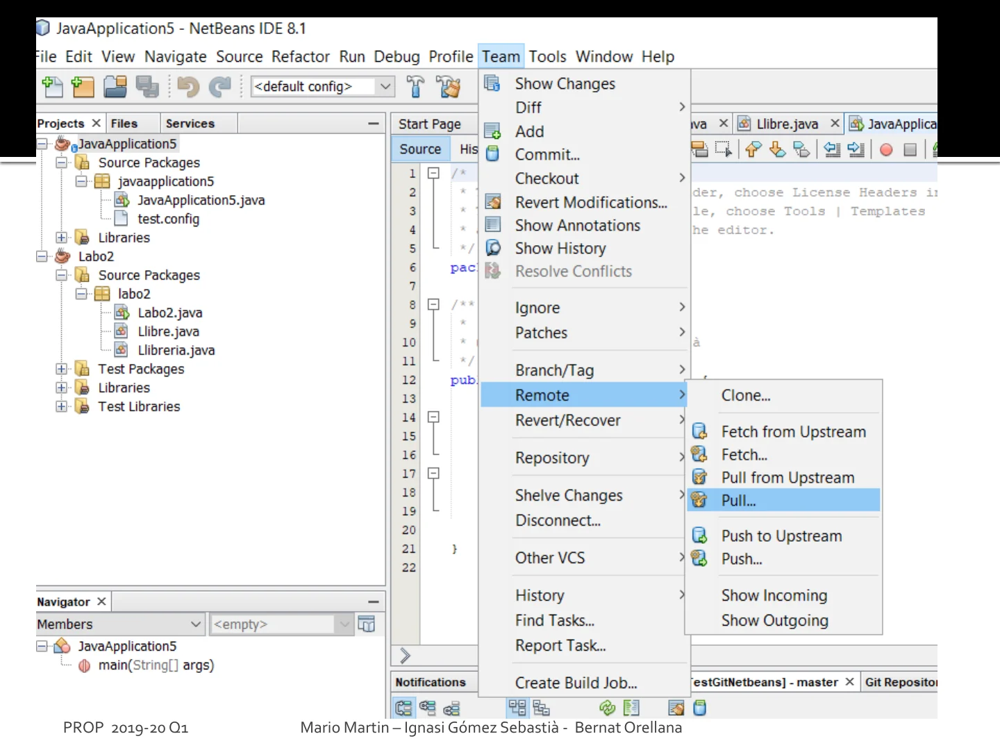

</details>

## Página 12

```text
PROP 2019-20 Q1         Mario Martin – Ignasi Gómez Sebastià - Bernat Orellana
```

<details>
<summary>Ver página original</summary>

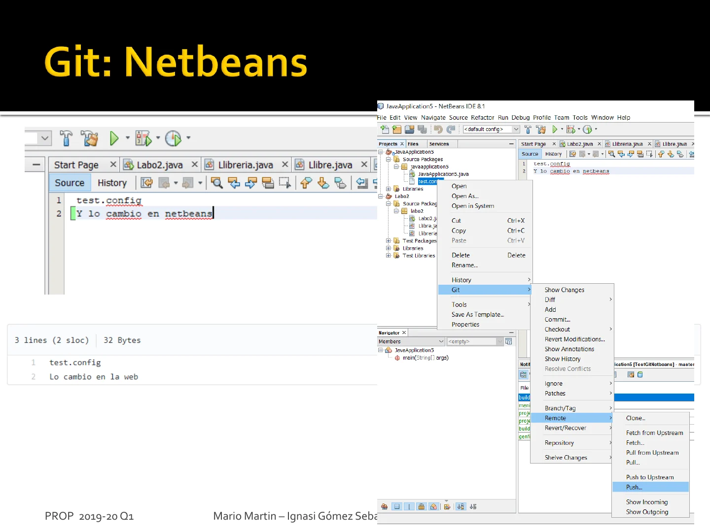

</details>

## Página 13

```text
PROP 2019-20 Q1         Mario Martin – Ignasi Gómez Sebastià - Bernat Orellana
```

<details>
<summary>Ver página original</summary>

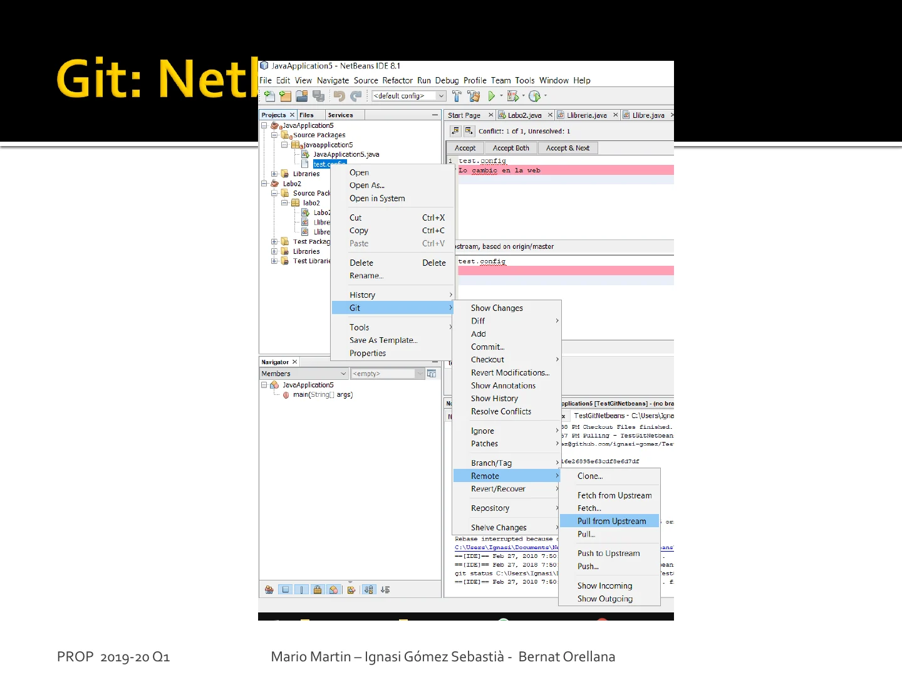

</details>

## Página 14

```text
PROP 2019-20 Q1         Mario Martin – Ignasi Gómez Sebastià - Bernat Orellana
```

<details>
<summary>Ver página original</summary>

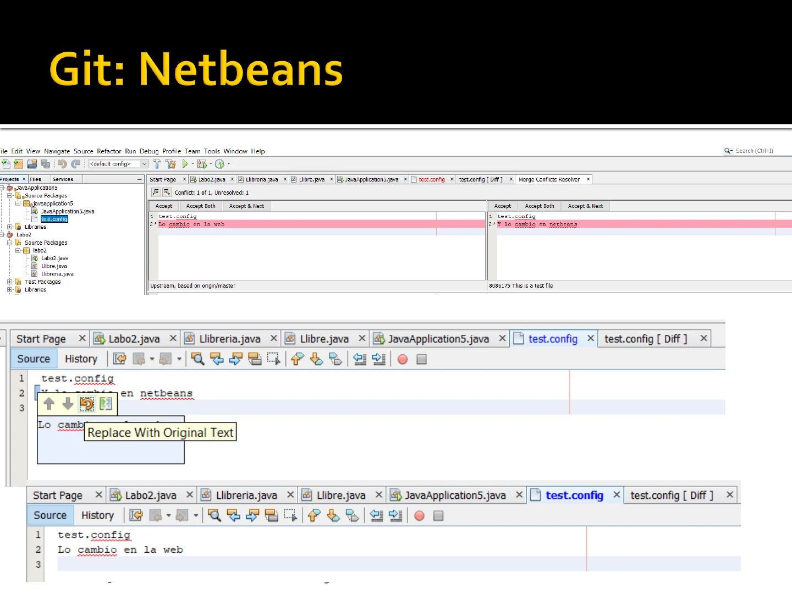

</details>

## Página 15

```text
-  Crear    projecte      a gitlab

       -  Afegir     col·laboradors

       -  Sincronitzar        amb    netbeans

       -  Crear    classe    java   Node      de  graf


           -  Atributs   adients

           -  Funcions    adients

       -  Crear    classe    java   Arc   de   graf

           -  Atributs   adients

           -  Funcions    adients

       -  Crear    classe    java   Graf    con   a  col·lecció     de  nodes     i arcs


           -  Atributs   adients

           -  Funcions    adients


      PROP 2019-20 Q1         Mario Martin – Ignasi Gómez Sebastià - Bernat Orellana
```

<details>
<summary>Ver página original</summary>

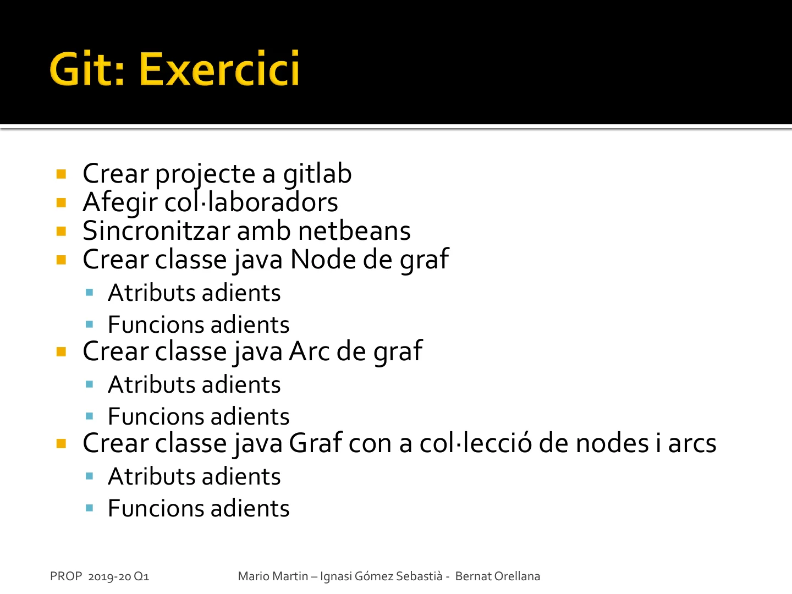

</details>
