# Guía rápida de Git

Fuente local: `Guia ràpida GIT.pdf`. Ámbito: Herramientas de trabajo.

Transcripción del texto disponible en el PDF, en su idioma original y por páginas. Los bloques de texto conservan ejemplos, símbolos y disposición sin reinterpretarlos. La vista original de cada página conserva diagramas, tablas, capturas y texto integrado en imágenes. La extracción automática puede contener errores de orden o caracteres; contrastar los detalles con esa vista.

[Índice de documentación](README.md)

## Página 1

```text
Git: Una guia ràpida                         Bernat Orellana Bech


                              GIT


               Una           Guia            ràpida!


            $   Usant        <Command           line>
```

<details>
<summary>Ver página original</summary>

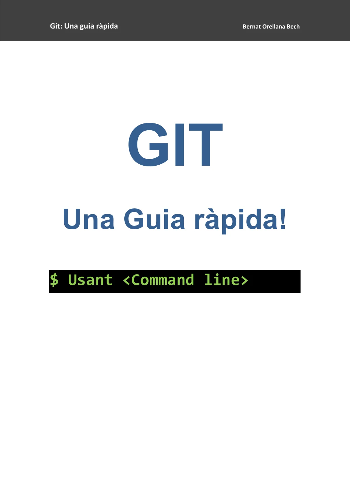

</details>

## Página 2

```text
Git: Una guia ràpida                         Bernat Orellana Bech


            Introducció a GIT


            Tipus de gestors de versions (Version Control System o VCS)
            Els sistemes de CVS tenen un “repositori” o magatzem de codi, on es guarda tota la història
            del nostre projecte.

            Els sistemes de CVS han evolucionat en el temps , passant de treballar amb el repositori en
            local (RCS) a treballar amb un repositori centralitzat (CVS o Subversion), on els clients es
            descarreguen una còpia local (sense història).


            Per contra, GIT és un gestor de versions distribuït. Cada usuari té un repositori propi de codi
            amb tota la història...el repte és sincronitzar totes les versions dels usuaris amb l’ajuda de

            repositori central remot.
```

<details>
<summary>Ver página original</summary>

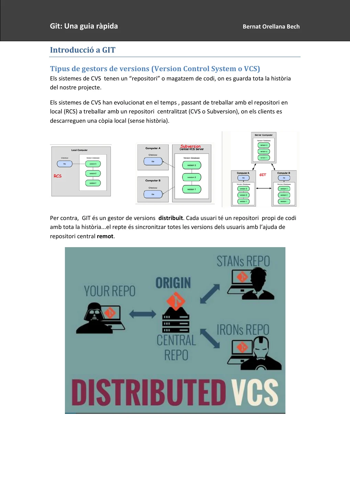

</details>

## Página 3

```text
Git: Una guia ràpida                         Bernat Orellana Bech


            Concepte de “commit” o versió
            La idea és simple, nosaltres treballem sobre el codi font de la forma habitual, creant,

            modificant o esborrant arxius. Quan hem fet uns quants canvis que tenen un “sentit”, desem
            una nova versió (commit). Internament GIT emmagatzema només les diferències respecte a la
            versió anterior. Cada versió o commit és una fotografia completa del nostre projecte en un
            instant.

            Les versions o commits tenen un identificador (és un codi hash SHA1) , i podem demanar a Git
            que passi en qualsevol moment d’una versió a una altra usant aquest identificador. A la figura
            es mostra la versió abreujada del hash d’un commit, el hash complet és força més llarg (40

            caràcters) però generalment n’hi ha prou amb donar els 7 primers caràcters del hash per
            identificar el commit..


            Les versions o commits també es poden identificar amb un tag o marca de versió que nosaltres

            li assignem, (p.ex. “V1.0” o “FiraMunich2019” ) i així poden ser recuperades amb més facilitat.
```

<details>
<summary>Ver página original</summary>

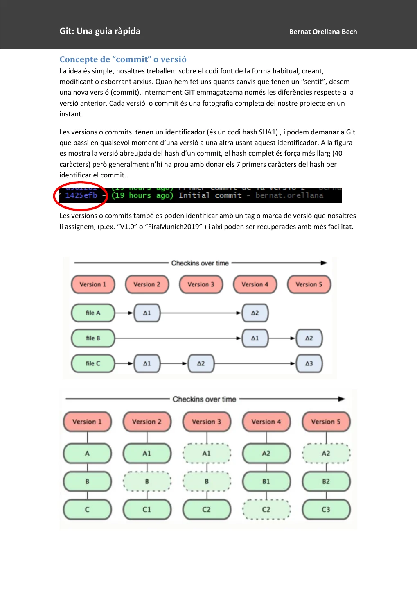

</details>

## Página 4

```text
Git: Una guia ràpida                         Bernat Orellana Bech


            Treballant només amb REPOSITORI LOCAL


            1. Instal·lació del client de línia de comandes GIT:
              -  Per Linux (easy as cake)

              $ sudo apt update

              $ sudo apt install git


              -  Per Windows: instal·leu el client https://git-scm.com/downloads

            2. Definició de credencials a GIT (ens identifiquen quan desem els canvis)

              git config --global user.name "John Doe"

              git config --global user.email johndoe@example.com


            3. Inicialització del repositori local (converteix la carpeta actual en un repositori git):

              git init


            4. Esquema d’Utilització de GIT local i remot
```

<details>
<summary>Ver página original</summary>

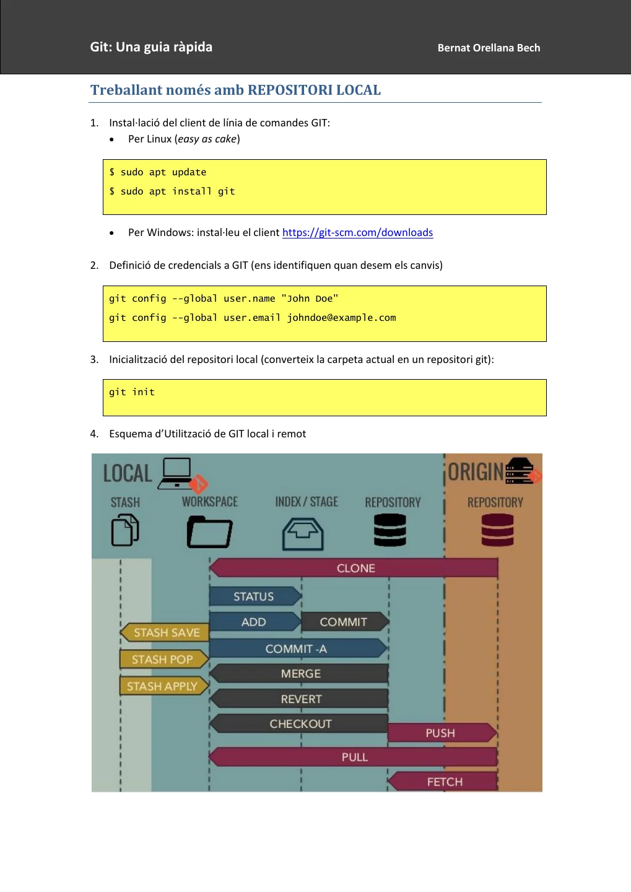

</details>

## Página 5

```text
Git: Una guia ràpida                         Bernat Orellana Bech


            Stash és la zona - arxius unstaged Stage area és on Commited
            de còpies   (modificats o s’han de posar accepta els canvis.
            ràpides quan esborrats)  els arxius per
            està la feina a - arxius untracked poder aceptar
            mitges i no es (nous)    els canvis
            pot fer un
            commit, però
            desitgem fer
            una operació
            amb el
            repositori local.


            5. Add i commit
              5.1. Passar a Staged els arxius nous, modificats i esborrats de la carpeta actual
                 (recusivament):

              git add .


            Passar a staged TOTS els arxius del repo nous/modificats/esborrats


              git add --all


              5.2. Commit :

              git commit –m ‘Missatge’
```

<details>
<summary>Ver página original</summary>

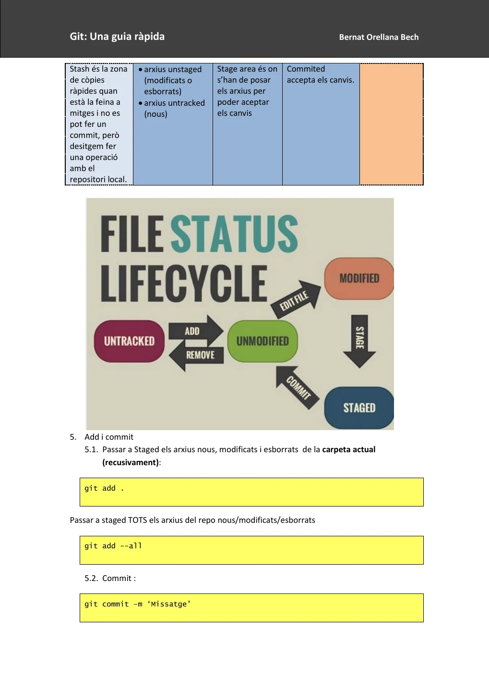

</details>

## Página 6

```text
Git: Una guia ràpida                         Bernat Orellana Bech


              5.3. Add+commit ( només arxius modificats, no arxius nous) :


              git commit –a –m ‘Missatge’

            6. Llistar tots els canvis respecte la última versió confirmada ( últim commit ):


              git diff


            7. Canvi de nom d’un arxiu

              git mv [nom_vell] [nom_nou]git


            8. SI L’HEM CAGAT . Operacions per arreglar destrosses:
              8.1. Desfer els canvis “staged” ( desfer git add ):

              git reset nom_arxiu


              8.2. Descartar tots els canvis respecte la última versió confirmada (fins últim commit ):


              // a partir de la carpeta actual, recursivament
              git checkout -- .

              // de tot l’arbre
              git reset -–hard HEAD


              8.3. Desfer l’últim commit ( desfà TOTS els canvis introduïts pel commit, i fa un altre
                 commit amb la versió “restaurada” )


              git revert HEAD


              8.4. Destruir tot fins una versió anterior
```

<details>
<summary>Ver página original</summary>

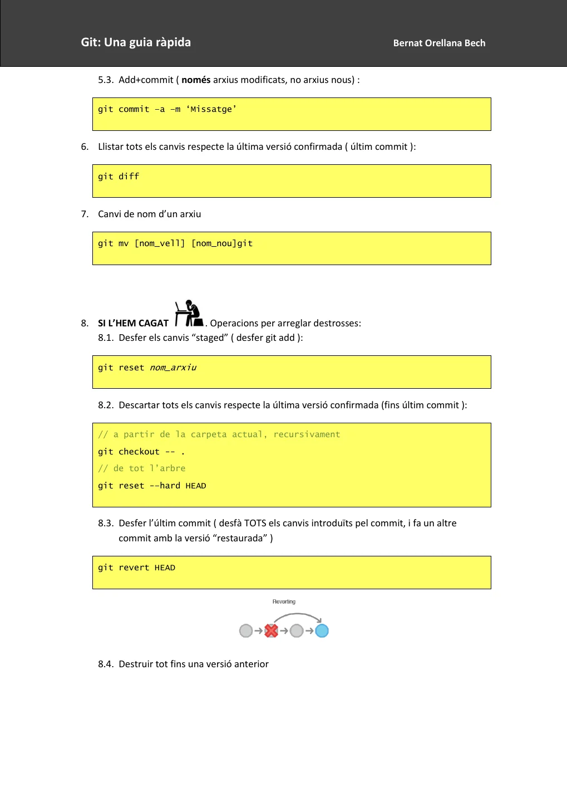

</details>

## Página 7

```text
Git: Una guia ràpida                         Bernat Orellana Bech


              git reset –-hard <version_id>


            9. Ignorant arxius: Crear un arxiu .gitignore a l’arrel del projecte. Es mostra un
              exemple a continuació dels seus continguts. Useu una plantilla existent

              https://www.gitignore.io/

              # Created by https://www.gitignore.io/api/java
              ### Java ###
              *.class
              # BlueJ files
              *.ctxt
              # Mobile Tools for Java (J2ME)
              .mtj.tmp/
              # Package Files #
              *.jar
              *.war
              *.ear
              # virtual machine crash logs, see

              http://www.java.com/en/download/help/error_hotspot.xml
              hs_err_pid*
              # End of https://www.gitignore.io/api/java

            10. Git log, ( és el Git Show History des de Netbeans ):


               git log


              10.1.   Per veure jerarquía:
```

<details>
<summary>Ver página original</summary>

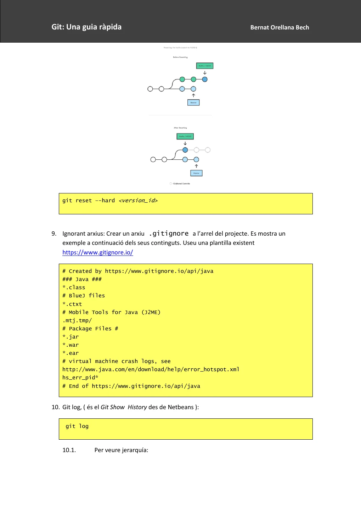

</details>

## Página 8

```text
Git: Una guia ràpida                         Bernat Orellana Bech


               git log –-graph --all


            11. Definició d’Àlies i millora gràfica del log:
            Editeu l’arxiu .gitconfig, el trobareu a ~/.gitconfig o a Windows dins de C:\Program

            Data\Git\config\gitconfig

            Afegiu les línies següents:


              [alias]
              lg1 = log --graph --abbrev-commit --decorate --date=relative --
              format=format:'%C(bold blue)%h%C(reset) - %C(bold green)(%ar)%C(reset)

              %C(white)%s%C(reset) %C(dim white)- %an%C(reset)%C(bold red)%d%C(reset)' -
              -all
              lg2 = log --graph --abbrev-commit --decorate --format=format:'%C(bold

              blue)%h%C(reset) - %C(bold cyan)%aD%C(reset) %C(bold
              green)(%ar)%C(reset)%C(bold red)%d%C(reset)%n''

              %C(white)%s%C(reset) %C(dim white)- %an%C(reset)' --all
              lg = !"git lg1"


            12. Concepte de ID de commit ( hash )

            Cada commit s’identifica únicament amb un codi Hash:


            13. Git checkout : permet tornar l’estat de tot el projecte complet a una versió indicada.
              13.1.   A un commit concret (usant HASH):


              git checkout {inici del hash del commit}
```

<details>
<summary>Ver página original</summary>

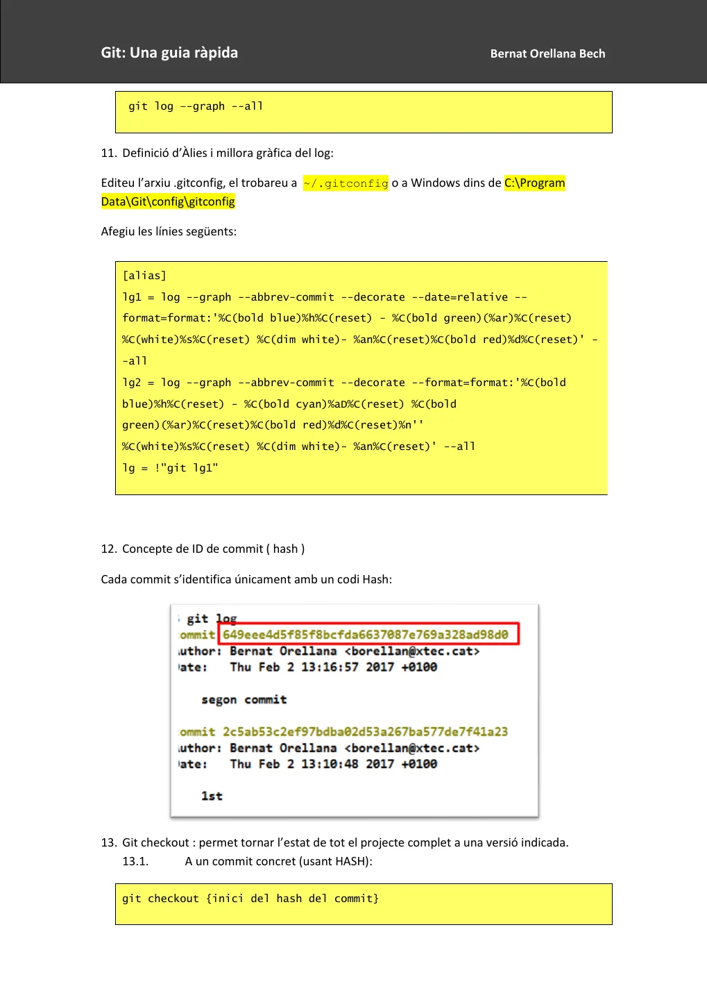

</details>

## Página 9

```text
Git: Una guia ràpida                         Bernat Orellana Bech


              13.2.   A l’última versió de la branca ( master) :


              git checkout master

            14. El paper de HEAD : HEAD representa la posició actual dins de l’arbre de versions.

            HEAD és un apuntador a la versió on actualment estem treballant. Actua com un apuntador a

            un identificador de commit concret. Quan feu git lg1 veureu la marca a la dreta, sobre el
            commit on actualment estigueu:


            15. El problema dels Detached HEAD: Si feu checkout a una versió anterior
              usant directament un id de commit, estare en mode “Detached
              HEAD”. Això significa que si feu canvis i els confirmeu estareu creant
              una “branca detached” de la branca principal.


            Si tornem a la branca master ( git checkout master ), les braques detached s’oculten. Les
            podem fer visibles usant la comanda git reflog:


            També podeu usar

              git log --graph --decorate $(git rev-list -g --all)
```

<details>
<summary>Ver página original</summary>

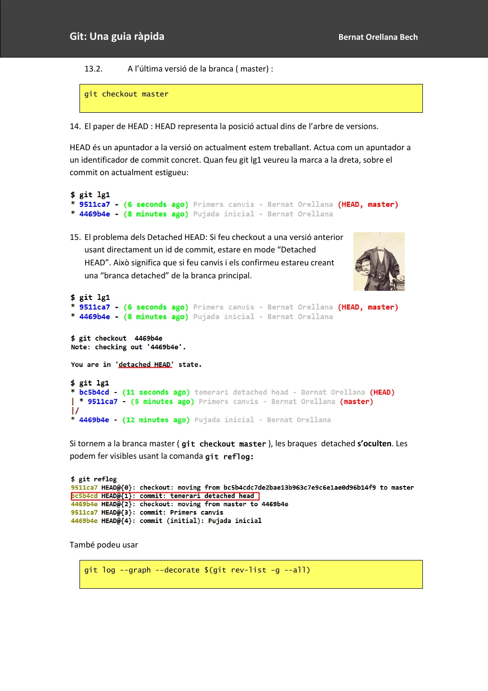

</details>

## Página 10

```text
Git: Una guia ràpida                         Bernat Orellana Bech


            16. Marques de versió ( TAGS! )
              16.1.   Llistar tags:


              git tag


              16.2.   Crear un tag:

               git tag {tagname}


              16.3.   Crear un tag anotat (per versions importants ): (


              git tag –a {tagname} –m {missatge de versió )


              16.4.   Compartir un tag a un repo remot:

              git push origin {nom_del_tag}


              16.5.   Veure dades d’un tag:

              git show {tagname}


              16.6.   Moure’s a la versió:


              git checkout tag


            IMPORTANT: després d’aquesta comanda estem en Detached HEAD: no podem fer commits si
            hem fet un checkout a un tag o a un commit concret !!

            17. Stash
              17.1.   Guardar a l’stash


              git stash


              17.2.   Recuperar l’últim l’stash

            18. git stash apply


              18.1.   Llistar stash

              git stash list
```

<details>
<summary>Ver página original</summary>

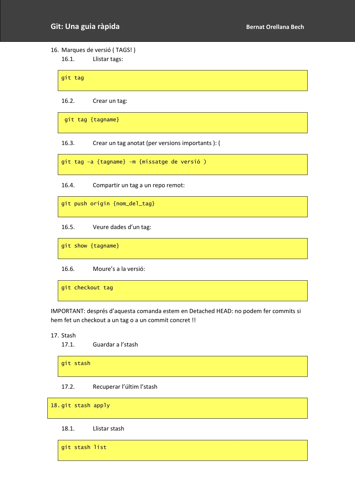

</details>

## Página 11

```text
Git: Una guia ràpida                         Bernat Orellana Bech


              18.2.   Recuperar l’stash per identificador ( en vermell)

              git stash apply stash@{0}


            19. Branques
              19.1.   Concepte de branca i organització interna de GIT

            Les branques són fonamentals per a l’organització i el treball en equip. A partir d’un commit,
            podem bifurcar la història de la branca principal en d’altres branques totalment independents.


            Les branques es poden fer servir de diferents maneres, per exemple:

              -  cada programador pot treballar “aïllat” a la seva branca,

              -  podem tenir branques dedicades a desenvolupar funcionalitats
              -  podem tenir branques per separar les versions a producció , a desenvolupament
              -  podem tenir branques per desar els “hotfixes”

            La forma en que ens organitzem ha d’estar ben definida i pactada entre tots els programadors.
            Hi ha diferents metodologies o workflows possibles.:

              -  Gitflow
              -  GitHub flow

              -  GitLab Flow
              -  OneFlow


            Es mostra a continuació el fluxe que recomana GitFlow:
```

<details>
<summary>Ver página original</summary>

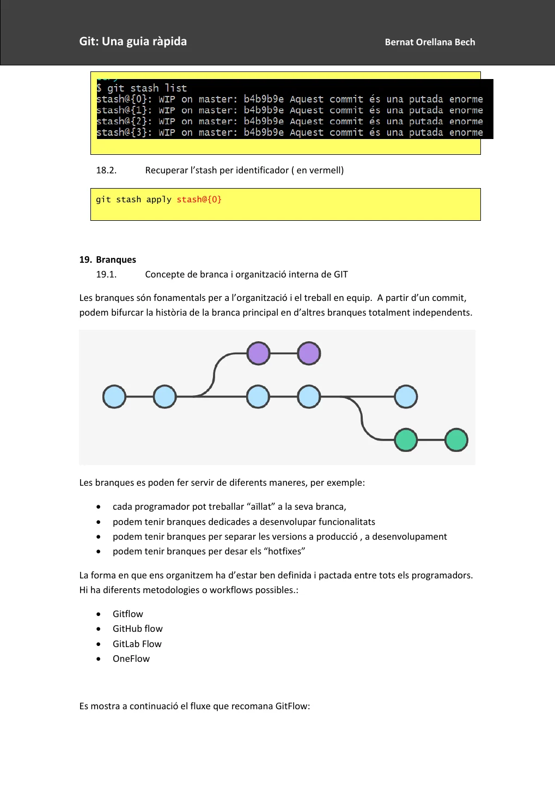

</details>

## Página 12

```text
Git: Una guia ràpida                         Bernat Orellana Bech


              19.2.   Creació de branques:

              git branch {branchname}


              19.3.   Moure’s a una branca :


              git checkout {branchname}


              19.4.   Merge de branques


              git checkout {branca_destí_del_merge}

              git merge {branca_origen_del_merge}
```

<details>
<summary>Ver página original</summary>

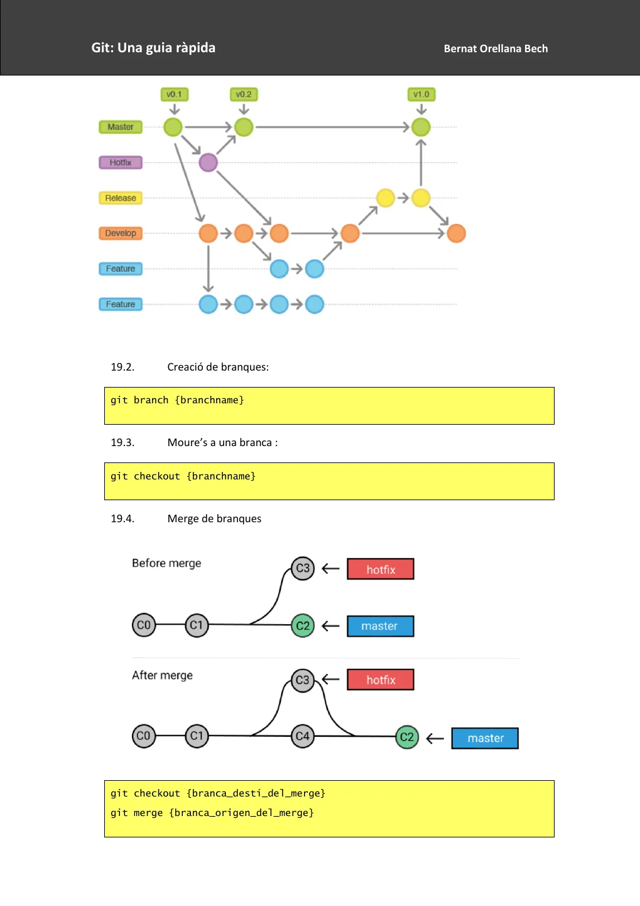

</details>

## Página 13

```text
Git: Una guia ràpida                         Bernat Orellana Bech


              19.5.   Conflictes de merge i la seva resolució.

            Sovint al fer merge ens trobem que hi ha conflictes, doncs Git no sap “barrejar” el codi font.
            Per solucionar el conflicte cal editar el codi i desar els canvis. Tot seguit hem de marcar com a
            resolt el conflicte mitjançant “add” i fer un commit.


              git add --all
              git commit –m “solució conflicte”


              19.6.   Rebase de branques

            Rebase serveix per a desplaçar una branca a un altre punt de partida, generalment la última
            versió de la branca master. Això és útil per fusionar branques sense deixar rastre de “merges”


              git rebase master {branca_origen}
```

<details>
<summary>Ver página original</summary>

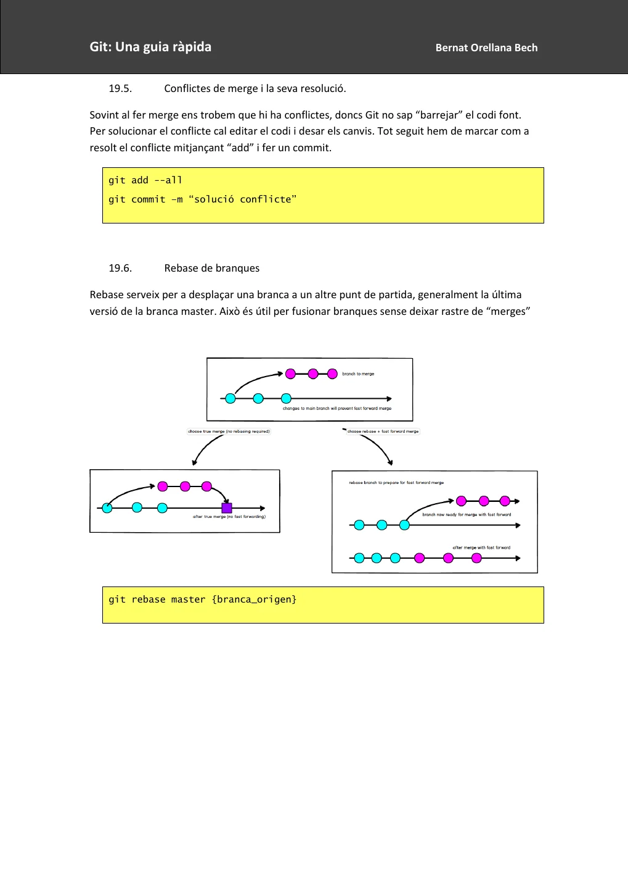

</details>

## Página 14

```text
Git: Una guia ràpida                         Bernat Orellana Bech


              19.7.   Rebase interactiu

            Ens permet passar tota la història d’una branca a una altra branca, concentrada en un únic
            commit. Això elimina molts commits insignificants que embruten la història del nostre

            projecte.

              git checkout feature
              git rebase -i origin/develop


            Treballant amb REPOSITORI REMOT


              1. Llista de repositoris remots:

              git remote


              2. Clonar un repositori remot ( per defecte s’anomenarà origin ):


              git clone {url} {opcional:nom del directori}


              # si no indiquem carpeta, crea una carpeta amb el nom de l’arxiu *.git. Per
              # exemple, la línia següent crea una carpeta GitTesting
              git clone https://github.com/xxxx/GitTesting.git
```

<details>
<summary>Ver página original</summary>

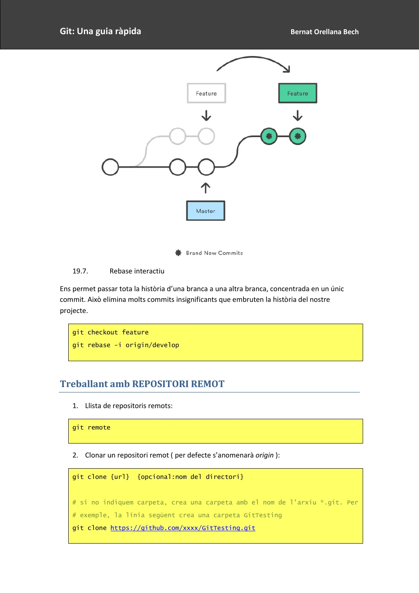

</details>

## Página 15

```text
Git: Una guia ràpida                         Bernat Orellana Bech


              #  la línia següent crea una carpeta GitTestingPaco
              git clone https://github.com/xxxx/GitTesting.git GitTestingPaco


            Si volem canviar el nom del repositori remot podem indicar-ho amb “-o”


              git clone –o otherorigin https://github.com/xxxx/GitTesting.git


              3. Pujar els canvis locals al repositori remot:

              git push {repo remot}

              git push


              4. Sincronitzar el nostre repositori amb el repositori remot ( sense barrejar canvis ¡ )

              git fetch {repo remot}
              git fetch origin


            git fetch descarrega els canvis del repositori remot que no teníem al local, però no barreja la
            nostra versió actual amb la última versió del servidor. Per tant, mai dona conflictes.

            Si volem a part d’actualitzar les dades de versions, barrejar la nostra versió amb la del servidor

            cal usar addicional la comanda merge:

              git merge origin/master


            Fer un fetch seguit d’un merge és tant freqüent, que s’ha condensat en una única comanda git
            pull:


              git fetch origin
              git merge origin/master
              #  la línia següent equival a les dues anteriors

              git pull origin


              5. Les branques són locals per defecte, i per tant no són compartides als repositoris
                 remots. Si volem fer-ho , cal fer un push explicit:
```

<details>
<summary>Ver página original</summary>

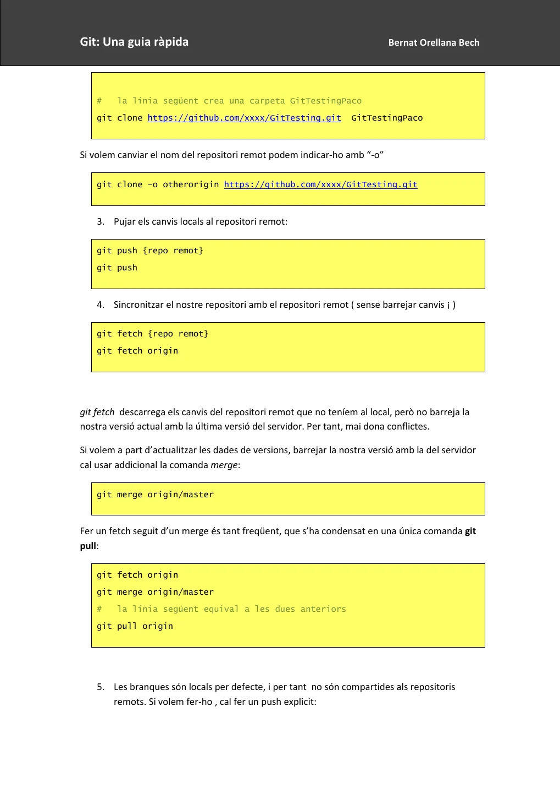

</details>

## Página 16

```text
Git: Una guia ràpida                         Bernat Orellana Bech


              git push {origin} {nom_branca}


              6. Llista de branques remotes


              git branch -r


              7. Seguir una branca remota:


                 git checkout -b refactoredLocal origin/refactored


            $ git checkout --track -b mv3.0 origin/mv3.0
            Branch mv3.0 set up to track remote branch mv3.0 from origin.
            Switched to a new branch 'mv3.0'
```

<details>
<summary>Ver página original</summary>

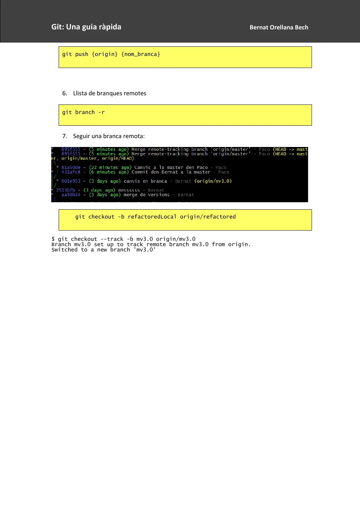

</details>
