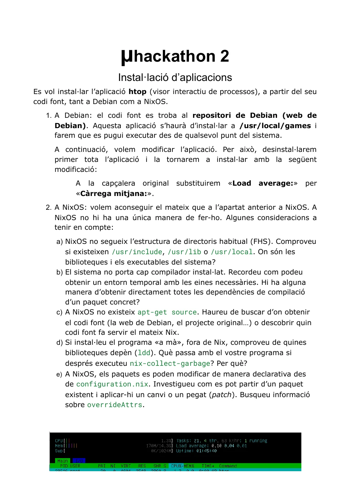
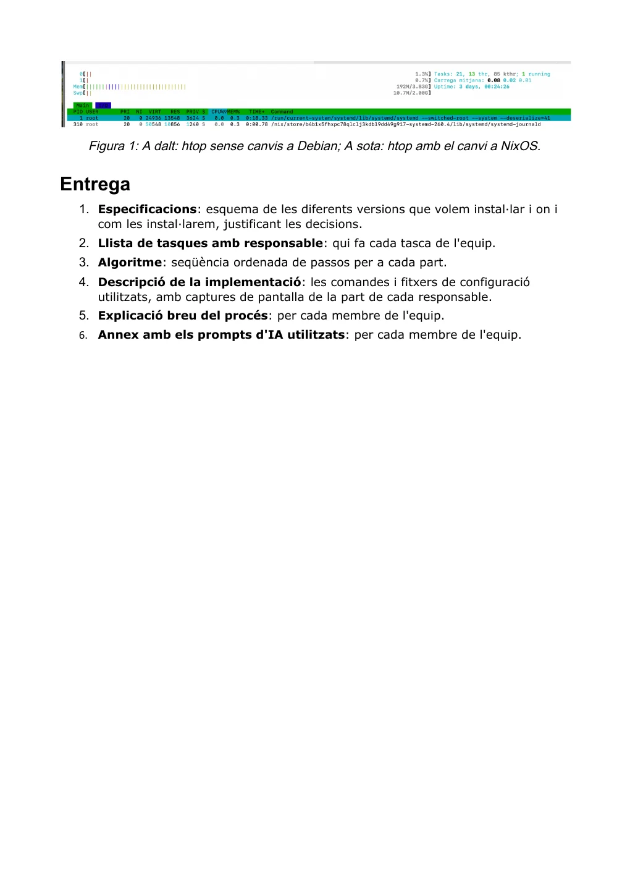

# Instalación de aplicaciones: htop

Fuente local: `HKT2.pdf`. Ámbito: Material externo al proyecto Bombardment.

Transcripción del texto disponible en el PDF, en su idioma original y por páginas. Los bloques de texto conservan ejemplos, símbolos y disposición sin reinterpretarlos. La vista original de cada página conserva diagramas, tablas, capturas y texto integrado en imágenes. La extracción automática puede contener errores de orden o caracteres; contrastar los detalles con esa vista.

[Índice de documentación](README.md)

## Página 1

```text
µ
                               hackathon            2

                            Instal·lació d’aplicacions


        Es vol instal·lar l’aplicació htop (visor interactiu de processos), a partir del seu
        codi font, tant a Debian com a NixOS.

           1. A Debian: el codi font es troba al repositori de Debian (web de
             Debian). Aquesta aplicació s’haurà d’instal·lar a /usr/local/games i
             farem que es pugui executar des de qualsevol punt del sistema.

             A continuació, volem modificar l’aplicació. Per això, desinstal·larem
             primer tota l’aplicació i la tornarem a instal·lar amb la següent

             modificació:

                  A  la capçalera original substituirem «Load average:» per
                  «Càrrega mitjana:».

           2. A NixOS: volem aconseguir el mateix que a l’apartat anterior a NixOS. A
             NixOS no hi ha una única manera de fer-ho. Algunes consideracions a
             tenir en compte:

             a) NixOS no segueix l’estructura de directoris habitual (FHS). Comproveu
               si existeixen /usr/include, /usr/lib o /usr/local. On són les

               biblioteques i els executables del sistema?
             b) El sistema no porta cap compilador instal·lat. Recordeu com podeu
               obtenir un entorn temporal amb les eines necessàries. Hi ha alguna

               manera d’obtenir directament totes les dependències de compilació
               d’un paquet concret?
             c) A NixOS no existeix apt-get source. Haureu de buscar d’on obtenir

               el codi font (la web de Debian, el projecte original…) o descobrir quin
               codi font fa servir el mateix Nix.
             d) Si instal·leu el programa «a mà», fora de Nix, comproveu de quines

               biblioteques depèn (ldd). Què passa amb el vostre programa si
               després executeu nix-collect-garbage? Per què?

             e) A NixOS, els paquets es poden modificar de manera declarativa des
               de configuration.nix. Investigueu com es pot partir d’un paquet
               existent i aplicar-hi un canvi o un pegat (patch). Busqueu informació
               sobre overrideAttrs.
```

<details>
<summary>Ver página original</summary>



</details>

## Página 2

```text
Figura 1: A dalt: htop sense canvis a Debian; A sota: htop amb el canvi a NixOS.


        Entrega

          1. Especificacions: esquema de les diferents versions que volem instal·lar i on i
             com les instal·larem, justificant les decisions.
          2. Llista de tasques amb responsable: qui fa cada tasca de l'equip.

          3. Algoritme: seqüència ordenada de passos per a cada part.
          4. Descripció de la implementació: les comandes i fitxers de configuració
             utilitzats, amb captures de pantalla de la part de cada responsable.

          5. Explicació breu del procés: per cada membre de l'equip.
          6. Annex amb els prompts d'IA utilitzats: per cada membre de l'equip.
```

<details>
<summary>Ver página original</summary>



</details>
