# Java: sesión 1

Fuente local: `Java_sessio1.pdf`. Ámbito: Java y programación orientada a objetos.

Transcripción del texto disponible en el PDF, en su idioma original y por páginas. Los bloques de texto conservan ejemplos, símbolos y disposición sin reinterpretarlos. La vista original de cada página conserva diagramas, tablas, capturas y texto integrado en imágenes. La extracción automática puede contener errores de orden o caracteres; contrastar los detalles con esa vista.

[Índice de documentación](README.md)

## Página 1

```text
PROP    2026-27   Q1
                                            Mario Martin – Ignasi Gómez – Jordi Urmeneta – Bernat Orellana
```

<details>
<summary>Ver página original</summary>

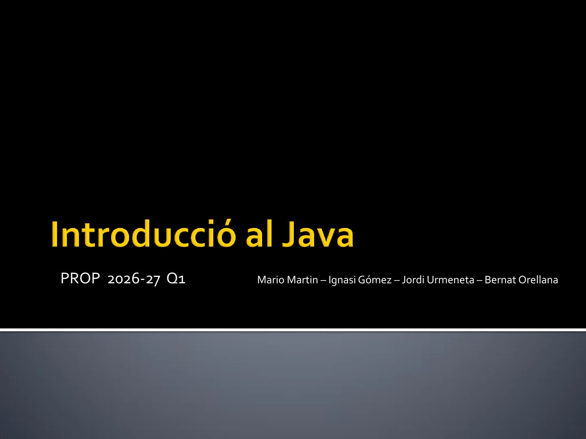

</details>

## Página 2

```text
Multiplataforma
       -

          Combina           compilació          i interpretació.
       -

          Sintaxi       procedural          similar      al  C
       -

          Orientat         a  Objectes
       -


      PROP                   Mario Martin – Ignasi Gómez – Jordi Urmeneta – Bernat Orellana    2
```

<details>
<summary>Ver página original</summary>

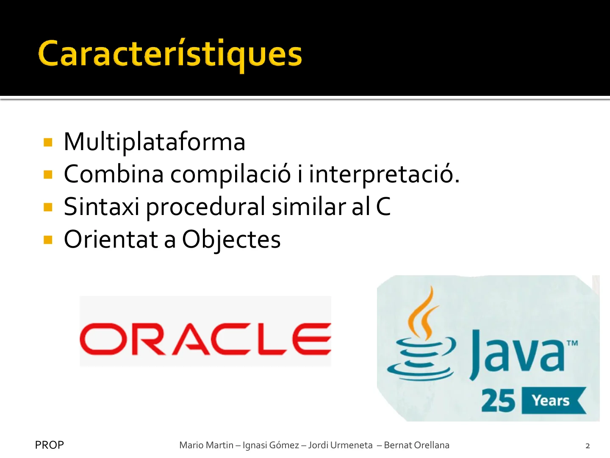

</details>

## Página 3

```text
Entorn        per    desenvolupar             aplicacions          en   Java
       -

          Eina     d’ajuda       que     minimitza          errors
       -

          Dona       documentació               de   les   classes
       -


          RECOMANABLE                     però     no    imprescindible
       -


      PROP                   Mario Martin – Ignasi Gómez – Jordi Urmeneta – Bernat Orellana    3
```

<details>
<summary>Ver página original</summary>

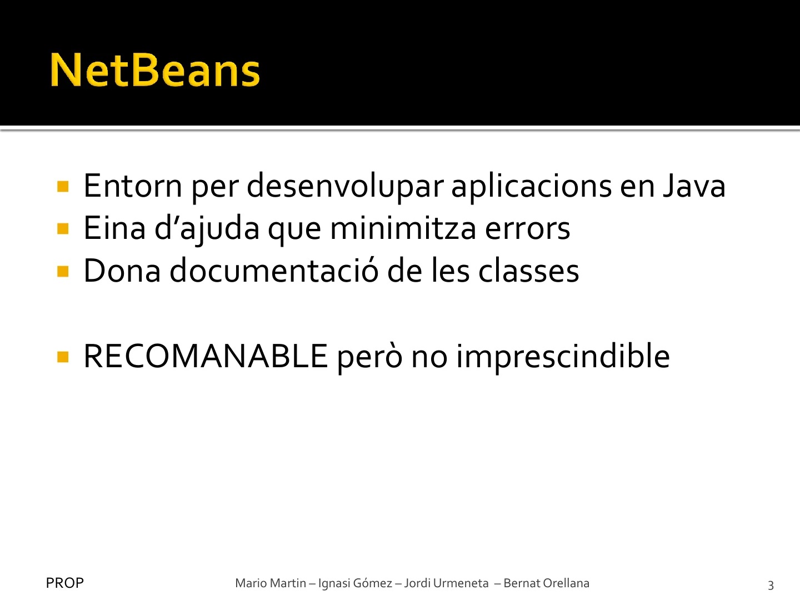

</details>

## Página 4

```text
Tot    en    Java    ha    de   pertànyer          a  una     classe.      Les
       -

          aplicacions          s’implementen               com      el  mètode


                        main       en   les   classes
          static

          Permet         execució        procedural           de   codi
       -


      PROP                   Mario Martin – Ignasi Gómez – Jordi Urmeneta – Bernat Orellana    4
```

<details>
<summary>Ver página original</summary>

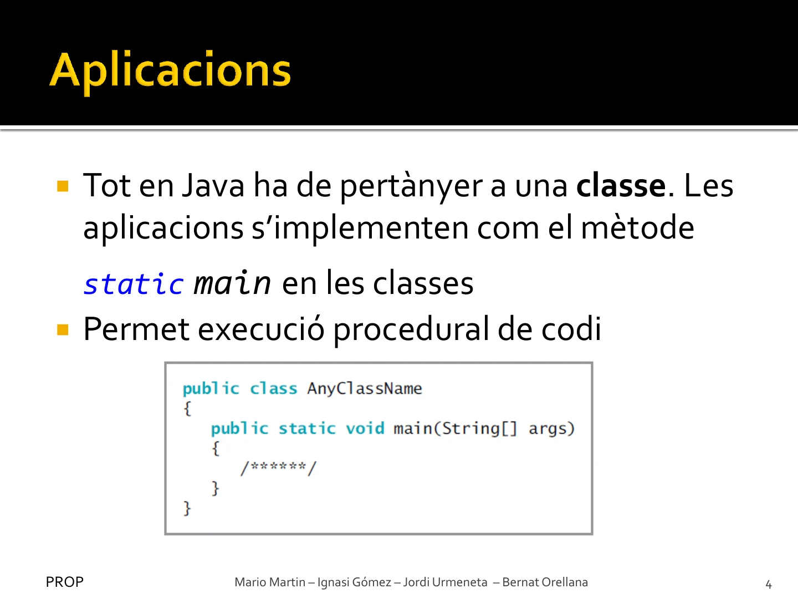

</details>

## Página 5

```text
/******/                  /


      PROP                   Mario Martin – Ignasi Gómez – Jordi Urmeneta                      5
```

<details>
<summary>Ver página original</summary>

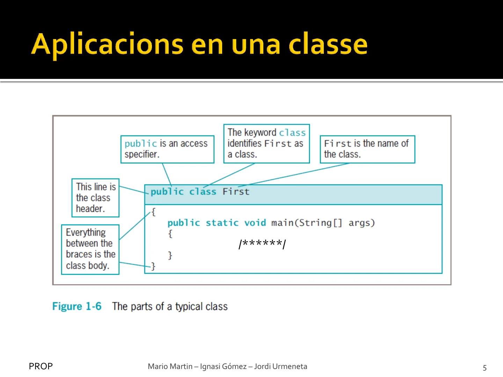

</details>

## Página 6

```text
static
     -

         -  Significa   que   (1) és  accessible    i usable   encara    que   no  existeixin

            objectes    de  la classe   i (2) no  es  lligat als  objectes    de  la classe.


         -  És  també    la  manera     de  declarar    funcions    no  lligades   a  classes

         void
     -

         -  Indica   que   el mètode     (main)    no  retorna    res.


      PROP                   Mario Martin – Ignasi Gómez – Jordi Urmeneta                      6
```

<details>
<summary>Ver página original</summary>

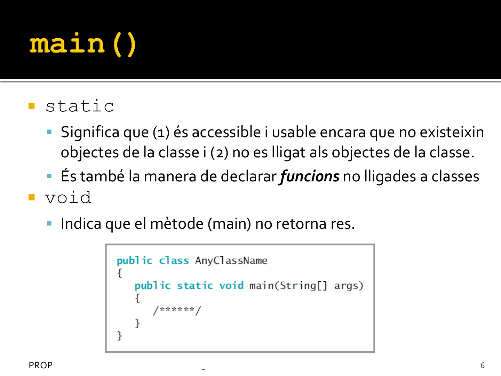

</details>

## Página 7

```text
public    class    First

     {
          public    static    void   main(String[]       args)

          {

              System.out.println("First             Java   application");

          }
     }


      PROP                   Mario Martin – Ignasi Gómez – Jordi Urmeneta – Bernat Orellana    7
```

<details>
<summary>Ver página original</summary>

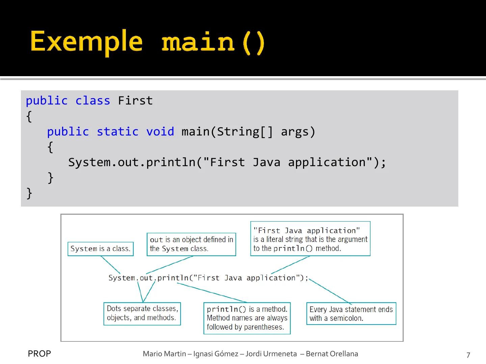

</details>

## Página 8

```text
Multiplataforma
       -

          Combina           compilació            i interpretació.
       -

          Sintaxi       procedural          similar      al  C
       -

          Orientat         a  Objectes
       -


      PROP                   Mario Martin – Ignasi Gómez – Jordi Urmeneta – Bernat Orellana    8
```

<details>
<summary>Ver página original</summary>

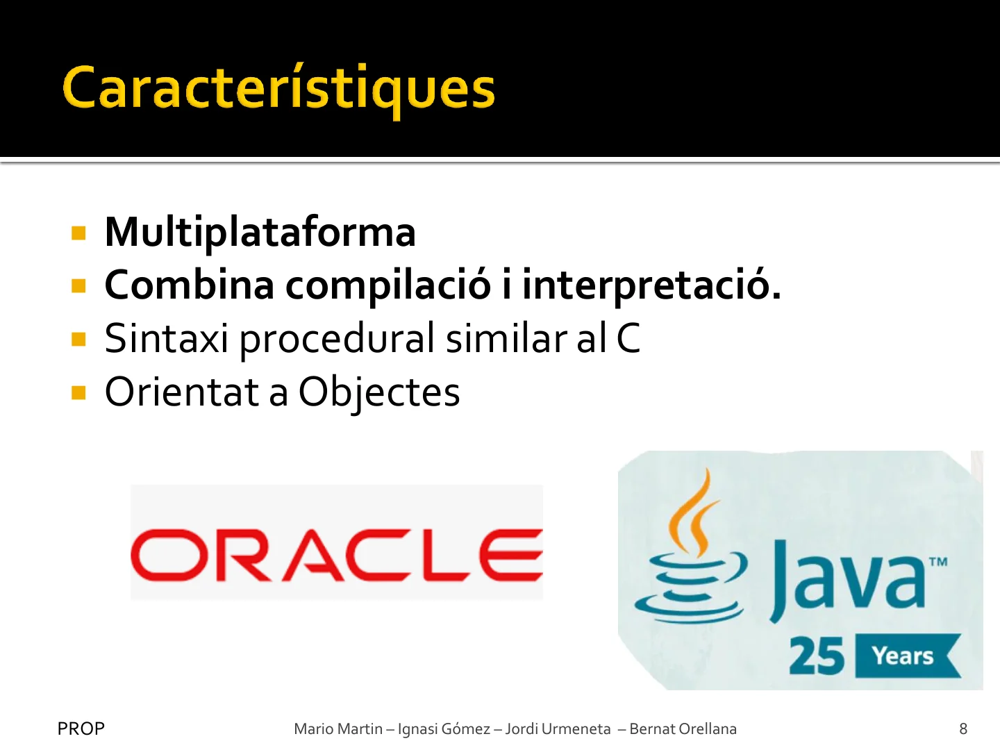

</details>

## Página 9

```text
*.java


                                                                     *.class


      PROP                   Mario Martin – Ignasi Gómez – Jordi Urmeneta – Bernat Orellana    9
```

<details>
<summary>Ver página original</summary>

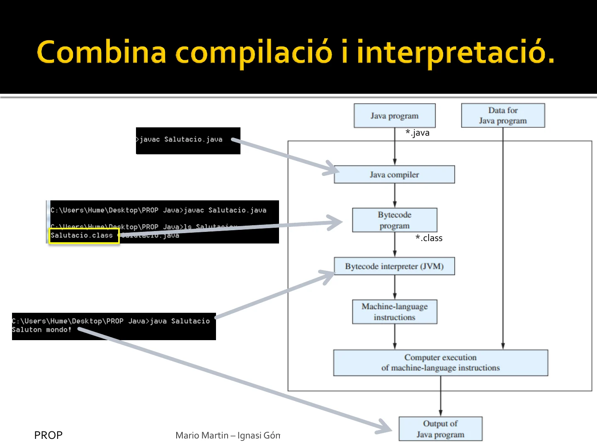

</details>

## Página 10

```text
Multiplataforma
       -

          Combina           compilació          i interpretació.
       -

          Sintaxi        procedural           similar       al  C
       -

          Orientat         a  Objectes
       -


      PROP                   Mario Martin – Ignasi Gómez – Jordi Urmeneta – Bernat Orellana    10
```

<details>
<summary>Ver página original</summary>

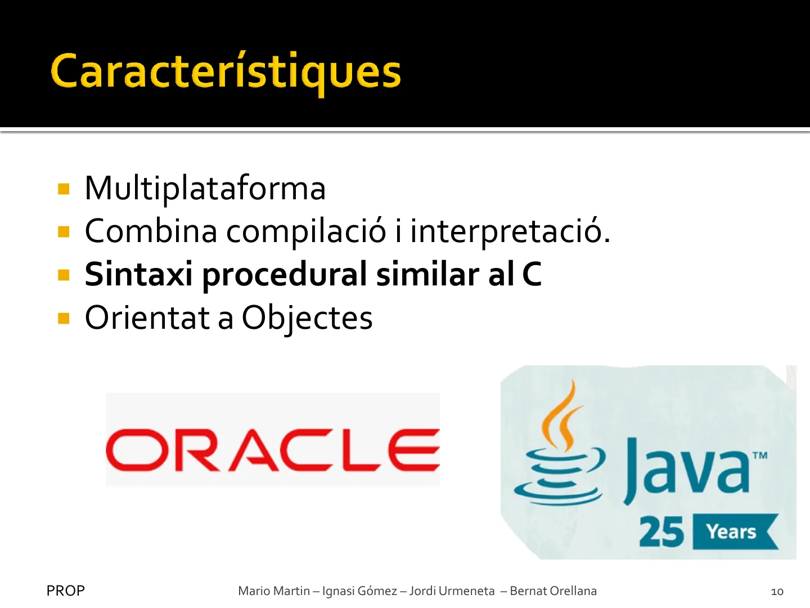

</details>

## Página 11

```text
PROP                   Mario Martin – Ignasi Gómez – Jordi Urmeneta – Bernat Orellana    11
```

<details>
<summary>Ver página original</summary>

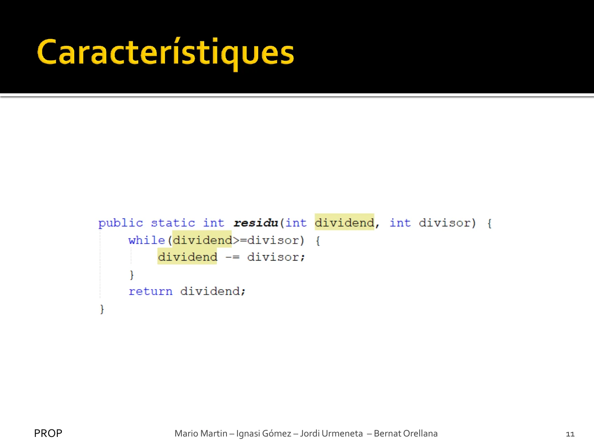

</details>

## Página 12

```text
Numèrics           (primitius)
       -


      PROP                   Mario Martin – Ignasi Gómez – Jordi Urmeneta – Bernat Orellana    12
```

<details>
<summary>Ver página original</summary>

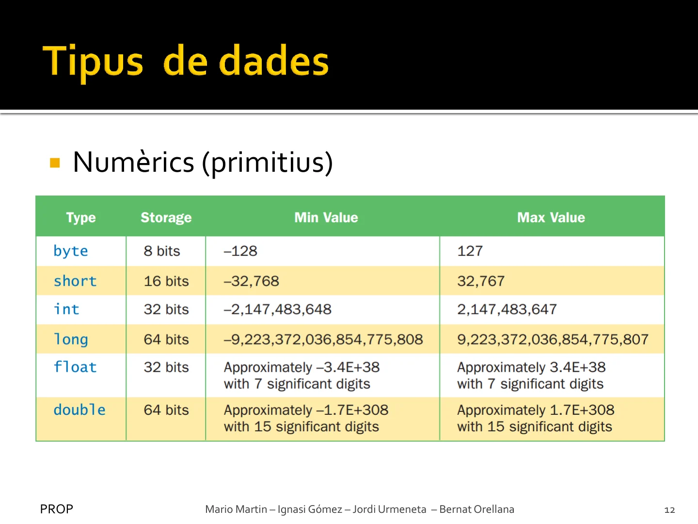

</details>

## Página 13

```text
-  Booleans

           -  Tipus boolean
           -  Literals: true, false

       -  Caràcters
           -  Tipus char
           -  Literals: 'x'

       -  Strings
           -  Classe String

           -  Indexades amb base zero
           -  Literals: "paraula"
           -  És immutable  (
                             el valor no es modifica, per canviar una cadena
                             )
              sempre se’n crea una de nova
           -  Operador de concatenació:  +
           -  Múltiples mètodes de manipulació:

       -  Dates

           -  Classe Date
           -  Valors: Date d = new Date();


      PROP                   Mario Martin – Ignasi Gómez – Jordi Urmeneta – Bernat Orellana    13
```

<details>
<summary>Ver página original</summary>

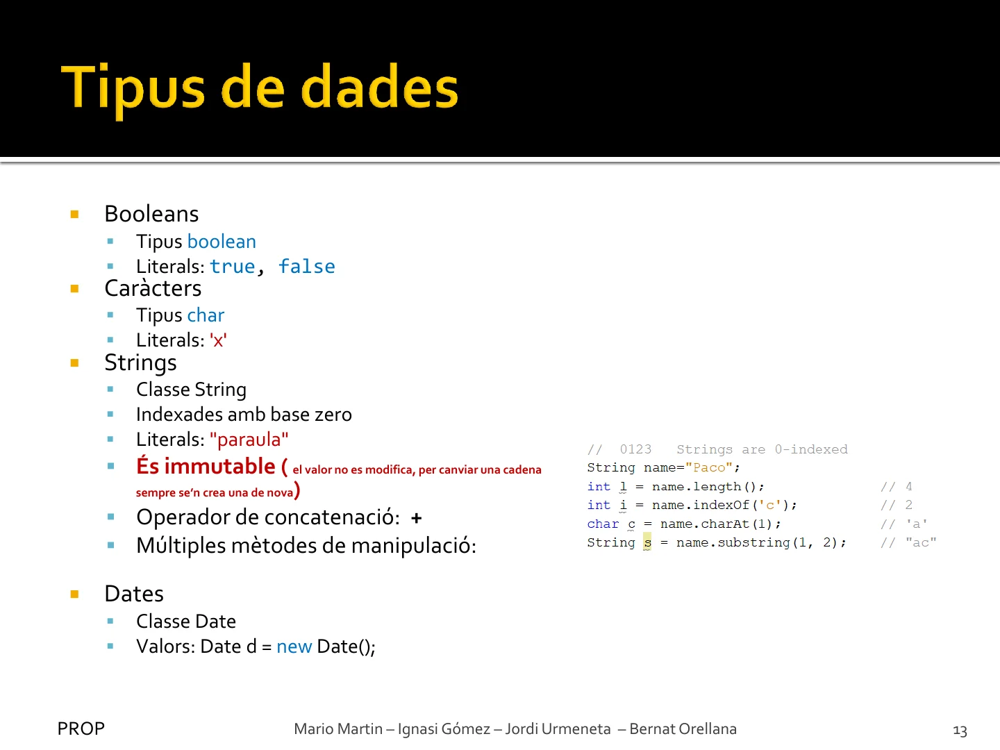

</details>

## Página 14

```text
Classe       String:
       -


      PROP                   Mario Martin – Ignasi Gómez – Jordi Urmeneta – Bernat Orellana    14
```

<details>
<summary>Ver página original</summary>

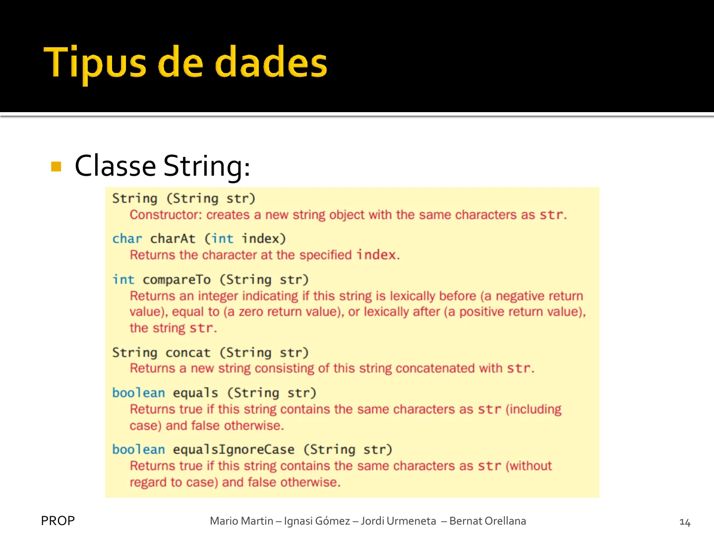

</details>

## Página 15

```text
PROP                   Mario Martin – Ignasi Gómez – Jordi Urmeneta – Bernat Orellana    15
```

<details>
<summary>Ver página original</summary>

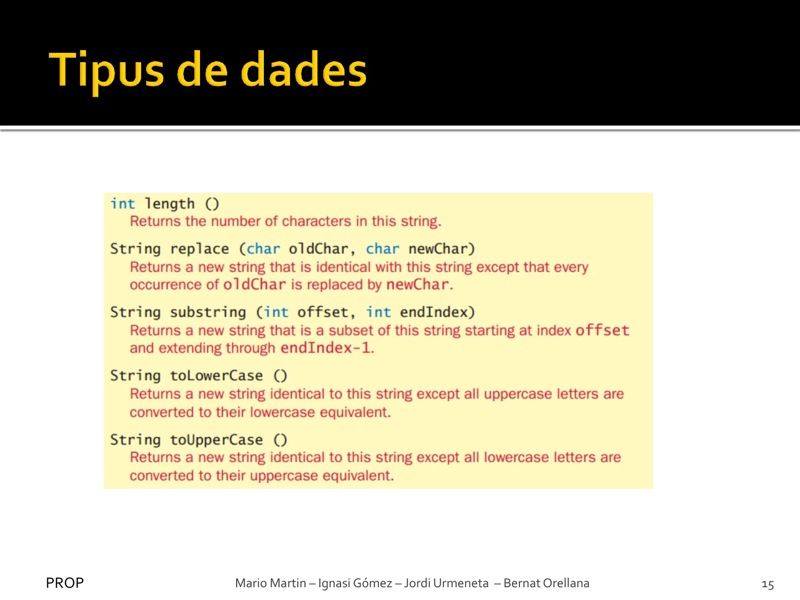

</details>

## Página 16

```text
Definicions:
       -


        tipus[]    nomtaula     = new   tipus[entermida];


        tipus[][]     nommatriu     = new   tipus[entermida1]       [entermida2];


      PROP                   Mario Martin – Ignasi Gómez – Jordi Urmeneta – Bernat Orellana    16
```

<details>
<summary>Ver página original</summary>

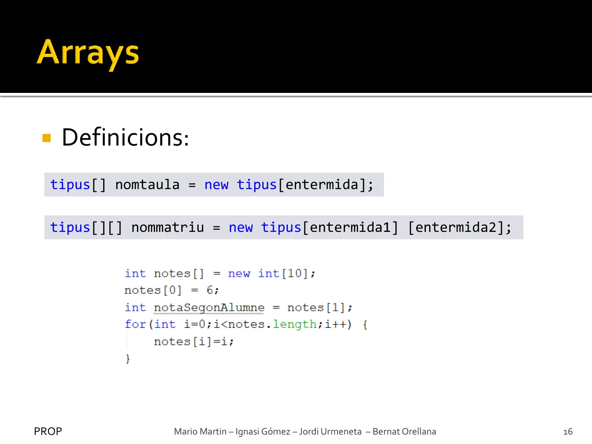

</details>

## Página 17

```text
-   Condicionals:                            -   Iteracions:


       if  (cond)   {                          while   (cond)   {
        ....                                    ....

       }                                       }

       else   {
       ...

       }
                                               for  (int   var=   ini;   var<fin;    var++){

                                               ...
       if  (cond1)    {  ...}
                                               }
       else   if  (cond2)    {...}
       else   if  (cond3)    {....}

       ....                                    do  {
       else   {....}                           ...

                                               } while    (cond);


                             Mario Martin – Ignasi Gómez – Jordi Urmeneta – Bernat Orellana    17
```

<details>
<summary>Ver página original</summary>

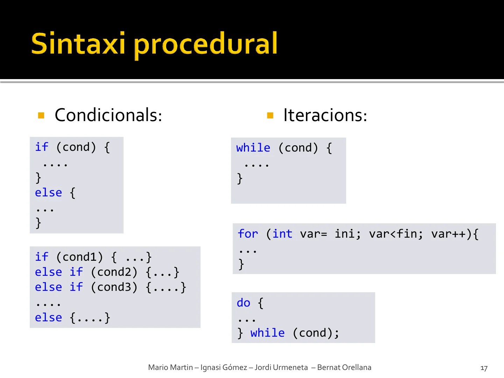

</details>

## Página 18

```text
Print:
       -


      PROP                   Mario Martin – Ignasi Gómez – Jordi Urmeneta – Bernat Orellana    18
```

<details>
<summary>Ver página original</summary>

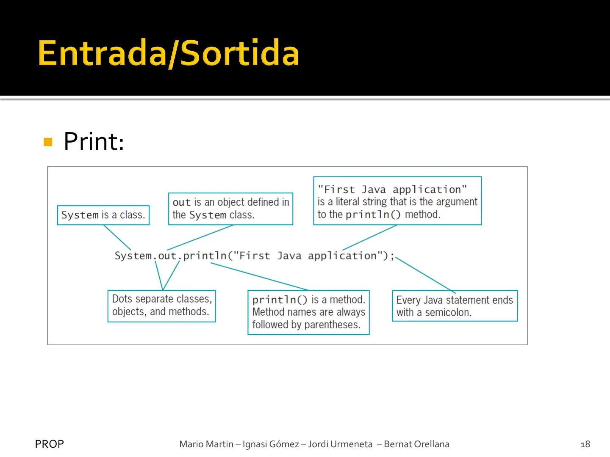

</details>

## Página 19

```text
Classe       Scanner.
       -

           -  Mètodes:


      PROP                   Mario Martin – Ignasi Gómez – Jordi Urmeneta – Bernat Orellana    19
```

<details>
<summary>Ver página original</summary>

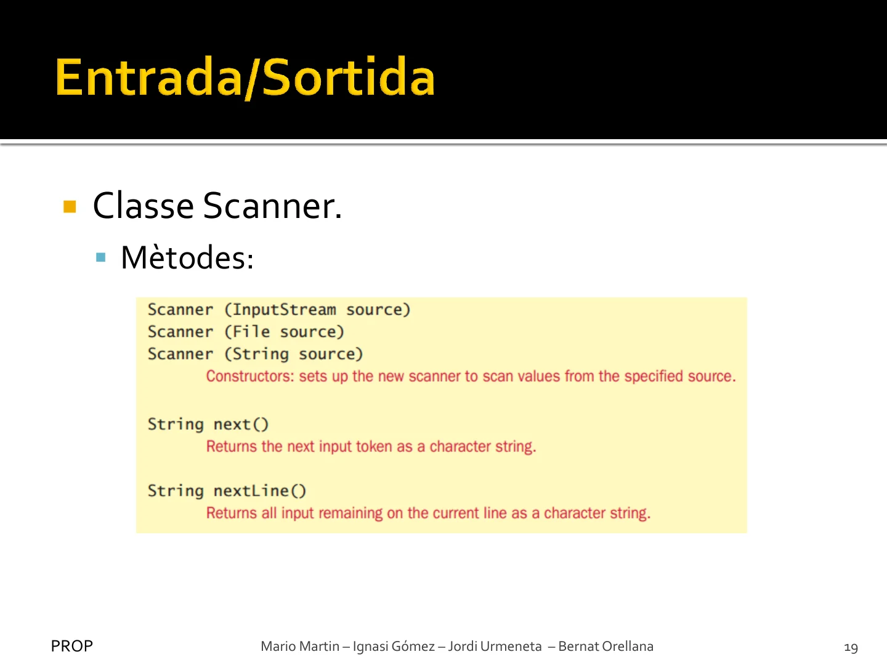

</details>

## Página 20

```text
PROP                   Mario Martin – Ignasi Gómez – Jordi Urmeneta – Bernat Orellana   20
```

<details>
<summary>Ver página original</summary>

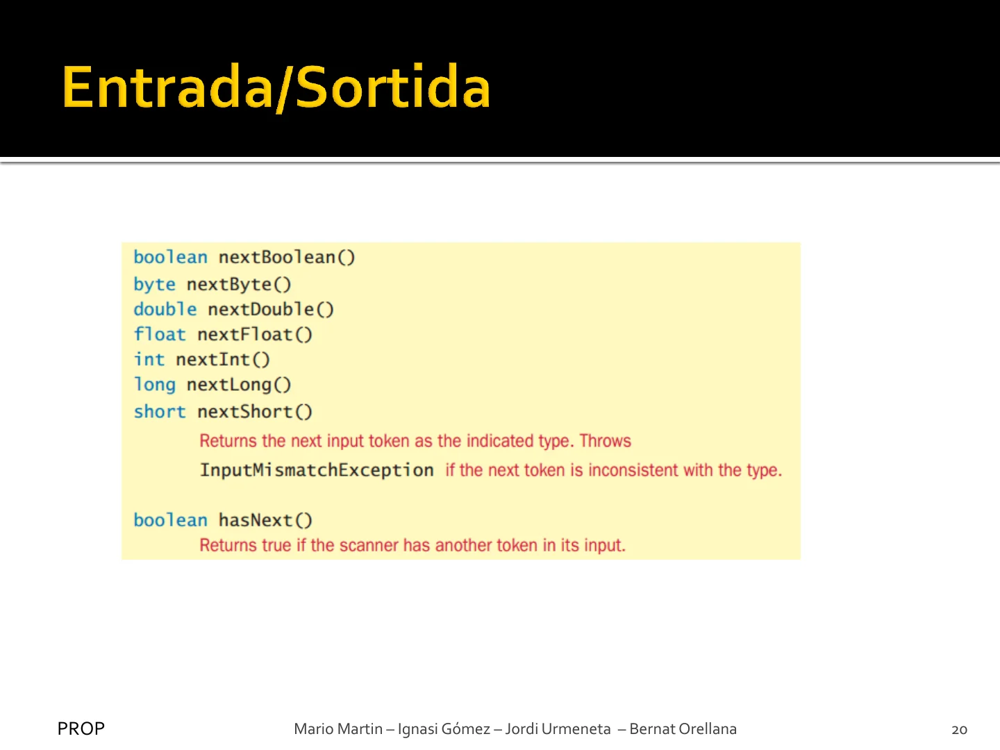

</details>

## Página 21

```text
Creació        objecte       per    fer   lectura       de   teclat
       -

            Scanner        scan     =   new    Scanner        (System.in);


      PROP                   Mario Martin – Ignasi Gómez – Jordi Urmeneta – Bernat Orellana    21
```

<details>
<summary>Ver página original</summary>

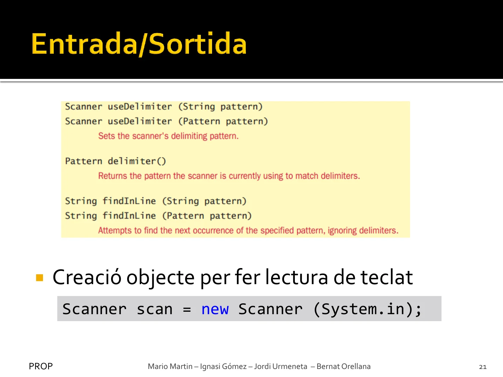

</details>

## Página 22

```text
Exemple:
       -


      PROP                   Mario Martin – Ignasi Gómez – Jordi Urmeneta – Bernat Orellana   22
```

<details>
<summary>Ver página original</summary>

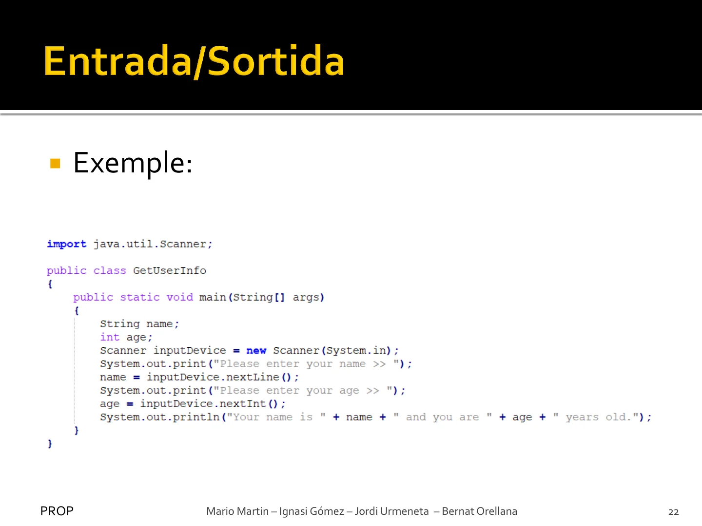

</details>

## Página 23

```text
Multiplataforma
       -

          Combina           compilació          i interpretació.
       -

          Sintaxi       procedural          similar      al  C
       -

          Orientat         a  Objectes
       -


      PROP                   Mario Martin – Ignasi Gómez – Jordi Urmeneta – Bernat Orellana    23
```

<details>
<summary>Ver página original</summary>

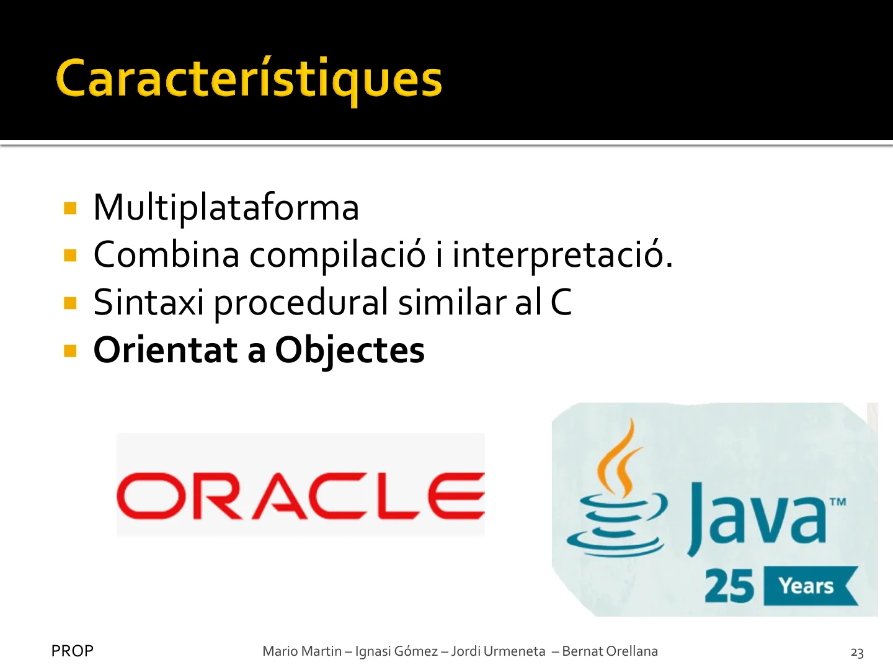

</details>

## Página 24

```text
-  Tres    elements:

           -  Classes:   Descripció     de  classes   genèriques


           -  Objectes:    Instancies     particulars    de  les classes

           -  Aplicacions:     Programa      principal   que   utilitza  objectes


       -  Veurem        conceptes        relacionats       a  la POO      avançada


           -  Encapsulació

           -  Herència    (sobre-escriptura,       sobre-càrrega,...)


           -  Polimorfisme

           -  Descripció    de   interfícies


           -  ....


      PROP                   Mario Martin – Ignasi Gómez – Jordi Urmeneta – Bernat Orellana   24
```

<details>
<summary>Ver página original</summary>

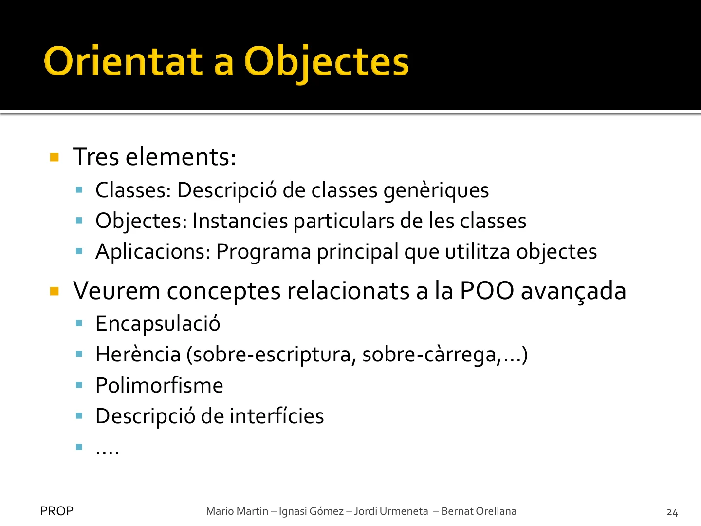

</details>

## Página 25

```text
Descriuen          objectes         amb      propietats         comuns
       -

          (és   com      una     plantilla      )


          Una      classe     té:
       -

           -  Atributs


              ▪ Característiques       que   defineixen     l’objecte

              ▪ Diferencia     objectes    de  la mateixa     classe

              ▪ Defineixen      l’estat  de  l’objecte


              ▪ Poden     ser variables    o  mètodes     que   calculin   els  valors


           -  Mètodes:       Accions      que    es  poden      dur   a  terme     amb

              les  dades     de   l’objecte.


      PROP                   Mario Martin – Ignasi Gómez – Jordi Urmeneta – Bernat Orellana    25
```

<details>
<summary>Ver página original</summary>

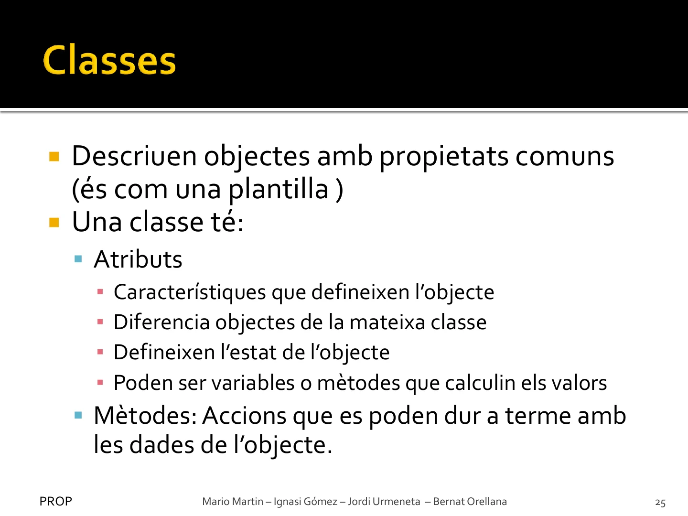

</details>

## Página 26

```text
PROP                   Mario Martin – Ignasi Gómez – Jordi Urmeneta – Bernat Orellana   26
```

<details>
<summary>Ver página original</summary>

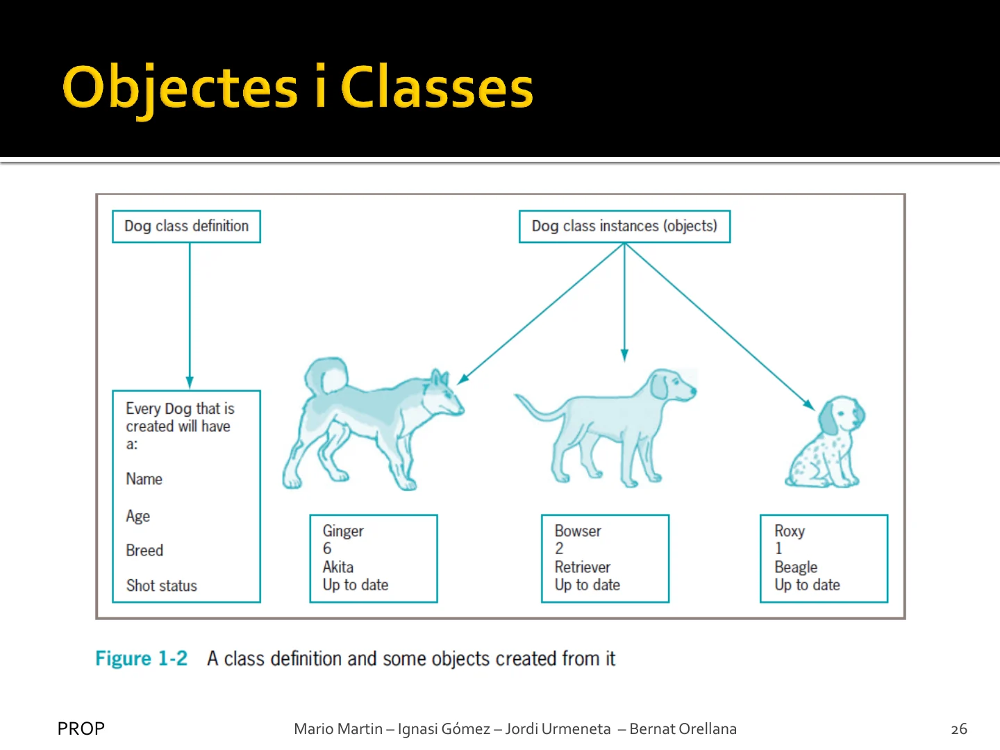

</details>

## Página 27

```text
Objectes
       -

           -  Instàncies      especifiques         i concretes       de  les  classes


           -  Per   crear   un   objecte      usem     l’operador


                         new    {nomClasse}()


              , que  crea   una  instància    de  la classe   indicada.    L’operador

                new    pot  requerir    de  paràmetres      segons    el cas:


      PROP                   Mario Martin – Ignasi Gómez – Jordi Urmeneta – Bernat Orellana    27
```

<details>
<summary>Ver página original</summary>

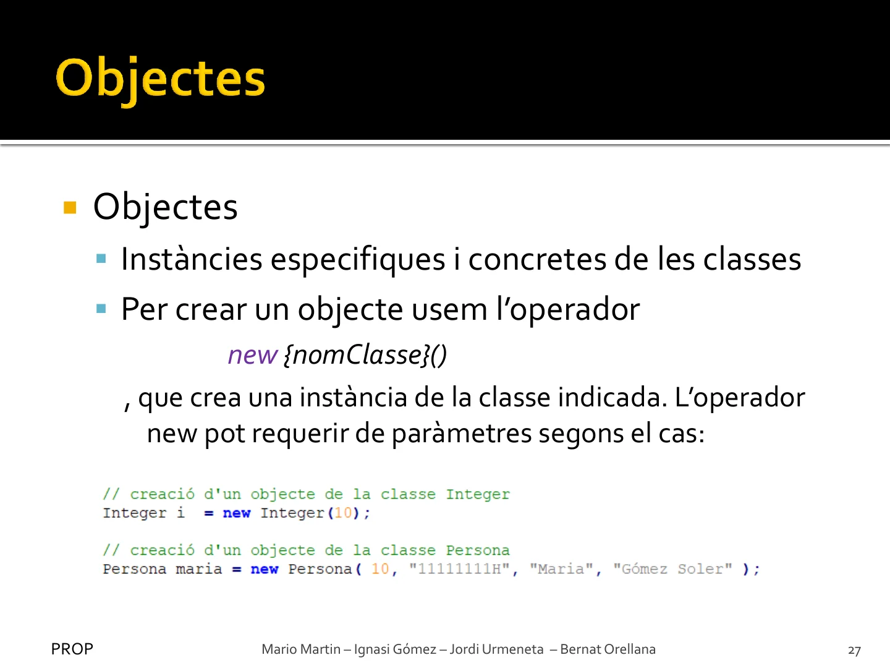

</details>

## Página 28

```text
Els   package        permeten         organitzar         les  classes      en
       -
          estructures         d’arbre.


          El  package        és   com     un   nom      de   domini       invertit     al
       -
          que     pertany       la classe.      Per   exemple:


                   package    edu.upc.epsevg.prop.lab.sessio_0;

                   public   class    Persona   {}


          Si  no    poseu      package,        s’assumeix         el  package        per
       -
          defecte       (buit)

          El  nom      complet        de   la  classe     es  composa          del   nom
       -

          del   package        concatenat          amb      el nom      de   la  classe.

           -  edu.upc.epsevg.prop.lab.sessio_0.Persona


      PROP                   Mario Martin – Ignasi Gómez – Jordi Urmeneta – Bernat Orellana   28
```

<details>
<summary>Ver página original</summary>

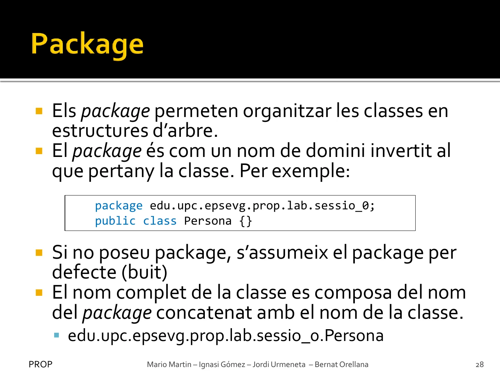

</details>

## Página 29

```text
-  Llegir un  sencer, N,  pel teclat.


       -  Llegir N  paraules  pel teclat, sense  repeticions.   Si es repeteix una  paraula
          es mostra   un missatge   d’error i la paraula s’ignora.


       -  Mirar  quines  d’aquestes   parelles de  paraules  son “encastables”    (totes les
          parelles  possibles)  i quina paraula  en sortiria d’encastar-les.  Dos  paraules

          són  encastables   quan  existeix un  sufix d’una que  al temps   és prefix de
          l’altre. Per exemple:


           -  Gat i tortuga són encastables i en sortiria “tortugat”

              ▪ Un altra opció es combinar-les al revés per tenir “gatortuga”

           -  Timbal i Taula no ho són


       -  La  sortida  del  programa     seran  totes  les paraules   encastades     ( les
          dues   possibilitats  en  cada   cas), una  per  línia.


       -  El programa     no  ha  de  ser case-sensitive.


      PROP                   Mario Martin – Ignasi Gómez – Jordi Urmeneta – Bernat Orellana   29
```

<details>
<summary>Ver página original</summary>

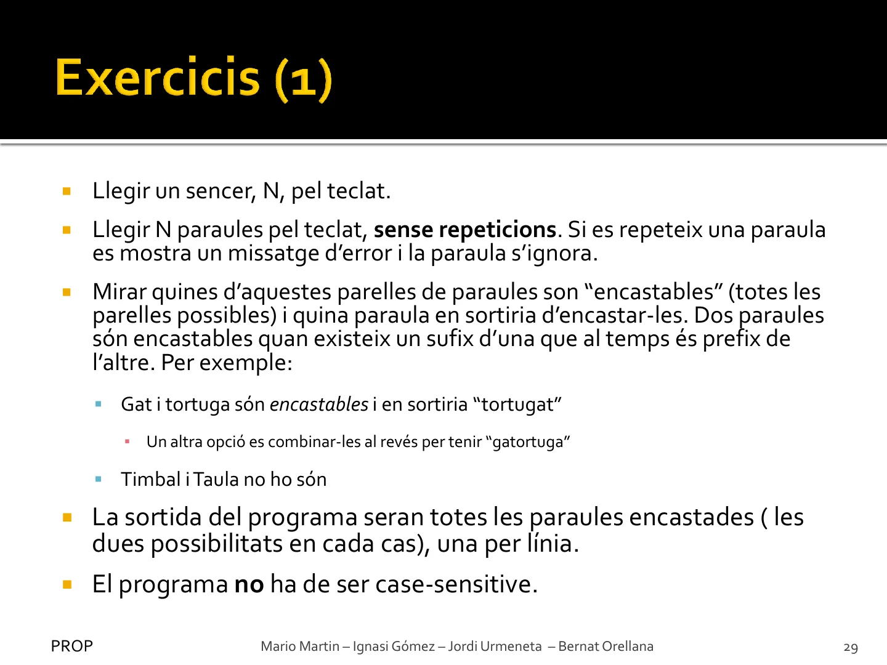

</details>

## Página 30

```text
-  Llegir un sencer, N, pel teclat.

       -  Llegir una matriu NxN de l’entrada estàndard, usant un format:


           -  numero, numero,...... numero [enter ]
                                        0
           -  numero, numero,...... numero [enter ]
                                        1
           -  ...                                                           Matriu  simètrica

           -  numero, numero,...... numero [enter ]
                                        N-1
       -  Feu una funció per mostrar una matriu per sortida estàndard rebent
          com a paràmetre int m[][]

       -  Mostreu per sortida estàndard la matriu transposada.

       -  Mostreu  per sortida estàndard  si la matriu és simètrica
          (igual a la seva transposada)


       -  Mostra  per la sortida estàndard si la matriu és ortogonal
            la seva inversa coincideix amb la seva transposada.  
                                                                             Matriu  ortogonal
          M*MT   = I


      PROP                   Mario Martin – Ignasi Gómez – Jordi Urmeneta – Bernat Orellana    30
```

<details>
<summary>Ver página original</summary>

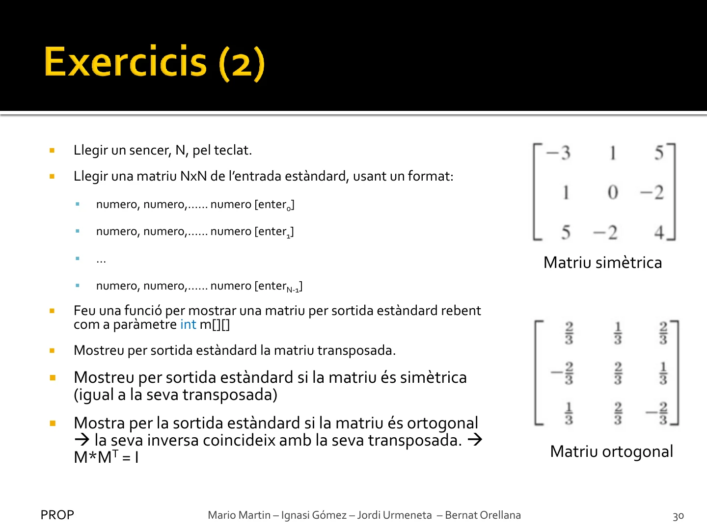

</details>
