# Java: sesión 3

Fuente local: `Java (3).pdf`. Ámbito: Java y programación orientada a objetos.

Transcripción del texto disponible en el PDF, en su idioma original y por páginas. Los bloques de texto conservan ejemplos, símbolos y disposición sin reinterpretarlos. La vista original de cada página conserva diagramas, tablas, capturas y texto integrado en imágenes. La extracción automática puede contener errores de orden o caracteres; contrastar los detalles con esa vista.

[Índice de documentación](README.md)

## Página 1

```text
PROP    2021-2022    Q2
                                        Mario Martin – Ignasi Gómez Sebastià – Bernat Orellana
```

<details>
<summary>Ver página original</summary>

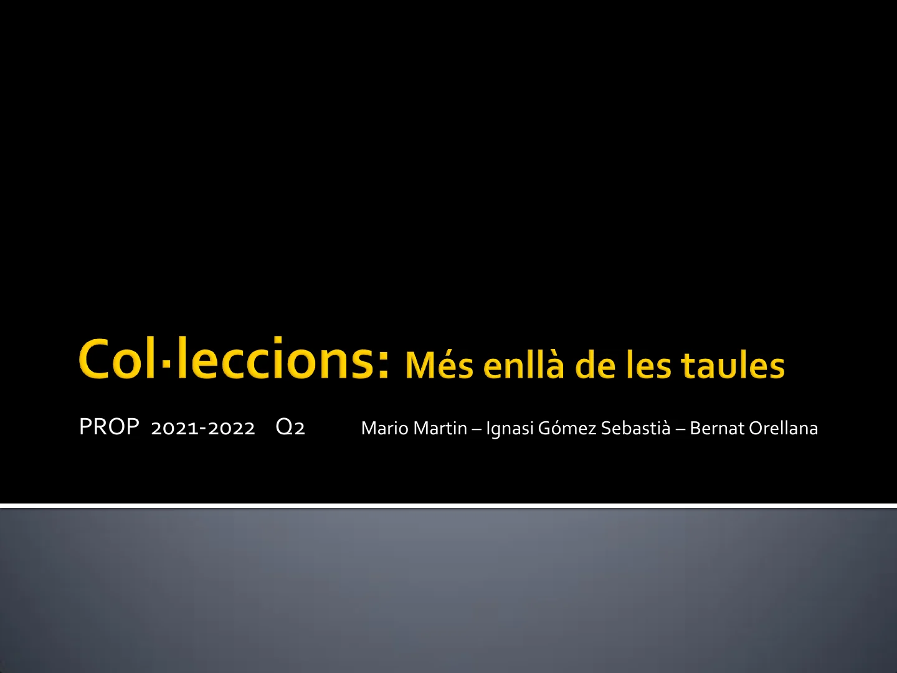

</details>

## Página 2

```text
PROP 2021-22 Q1          Mario Martin – Ignasi Gómez Sebastià - Bernat Orellana           2
```

<details>
<summary>Ver página original</summary>

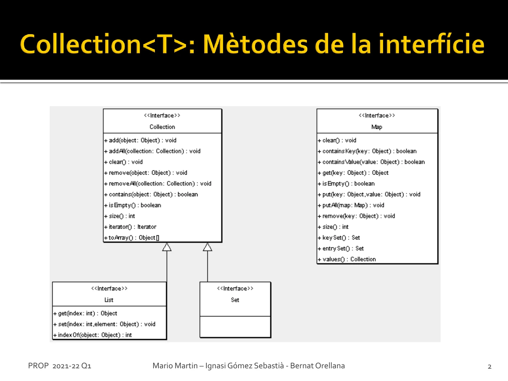

</details>

## Página 3

```text
-  Crear    una    classe    que   implementi         una   cua   a  partir

          d’una    ArrayList


           -  Crear     cua     buida

           -  Afegir      element

           -  Obtenir       un    element       de    la   cua

              ▪ Returneu      null    si  la   cua   es  buida


       -  Crear    una    classe    que   implementi         una   pila  a  partir

          d’una     LinkedList

           -  Crear     pila      buida

           -  Afegir      element


           -  Obtenir       un    element       de    la   pila

              ▪ Returneu      null    si  la   cua   es  buida

     PROP 2021-22 Q1          Mario Martin – Ignasi Gómez Sebastià - Bernat Orellana           3
```

<details>
<summary>Ver página original</summary>

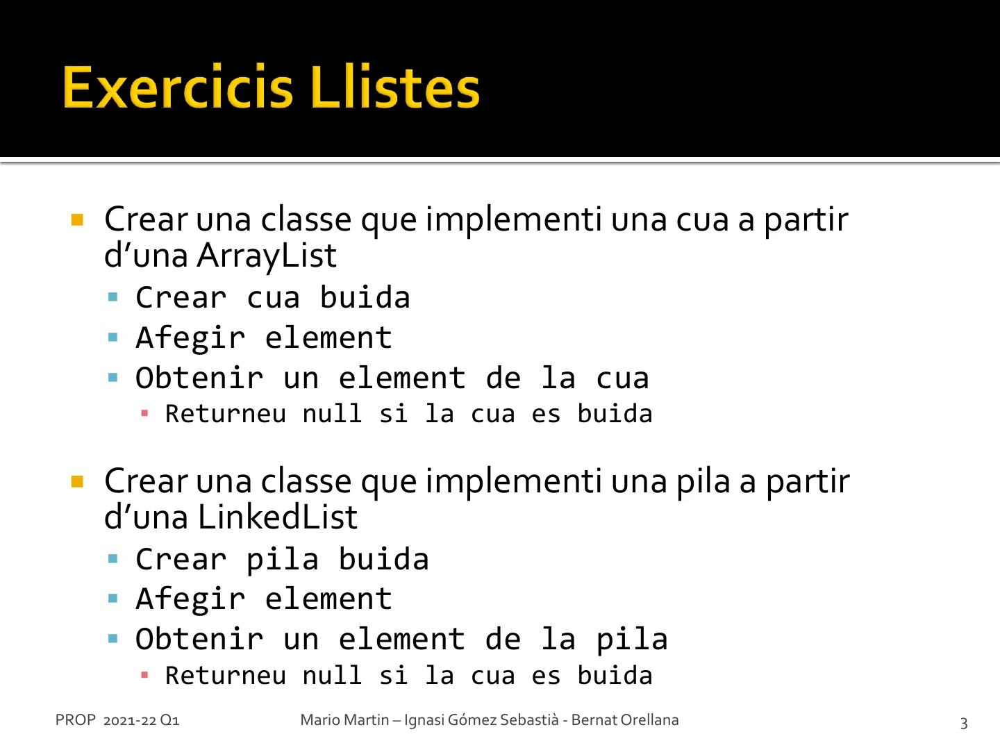

</details>

## Página 4

```text
Una  agrupació   d’objectes  que  no és una  col·lecció
```

<details>
<summary>Ver página original</summary>

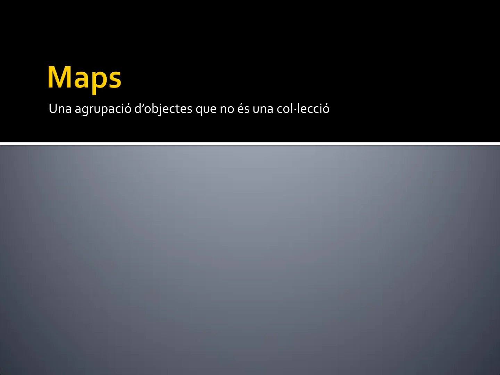

</details>

## Página 5

```text
Implementació                de   memòria           associativa
       -

          Parelles        <clau,valor>
       -

          S’obté       el  valor     associat       a  una     clau    no    pel   índex
       -
          sinó     per    un   càlcul     (de    hash)      sobre      la  clau.


          Per    exemple.          Volem       guardar        freqüències           de
       -

          paraules


           -  <String,      Integer>


           -  Accedim       a  nombre       de   vegades       que    apareix     la

              paraula     per   la  mateixa      paraula      (no   per   un   índex

              com    en   una    taula)


     PROP 2021-22 Q1          Mario Martin – Ignasi Gómez Sebastià - Bernat Orellana           5
```

<details>
<summary>Ver página original</summary>

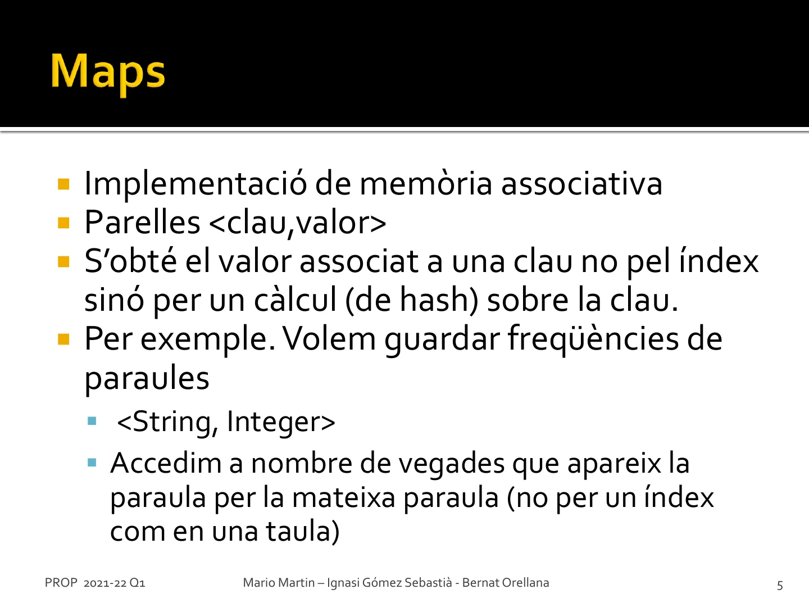

</details>

## Página 6

```text
PROP 2021-22 Q1          Mario Martin – Ignasi Gómez Sebastià - Bernat Orellana           6
```

<details>
<summary>Ver página original</summary>

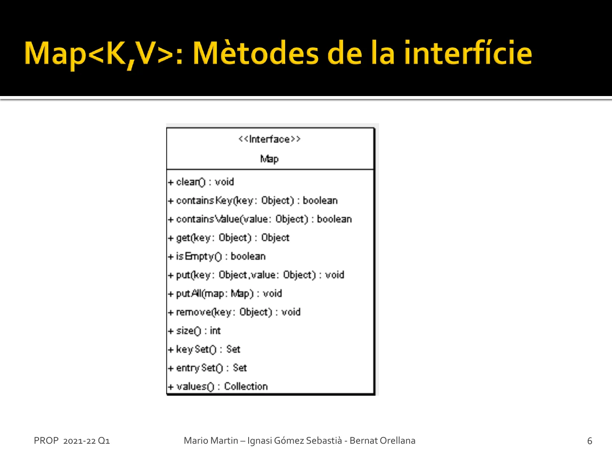

</details>

## Página 7

```text
-   clear()                           Elimina      totes    les  associacions

   -   containsKey(k)                    Si  conté     una    assoc.    per   a  k

   -   containsValue(v)                  Si  conté     una    assoc.    per   a  v

   -   get(k)                            Valor     associat     amb     k   ( o  null)

   -   isEmpty()                         Si  esta    buit

   -   put(k,v)                           Associar      v  amb     k

   -   remove(k)                         Eliminar       associacions        per   a  k


   -   size()                            Nombre        de   parelles


   -   keySet()                          Conjunt       de   claus

   -   values()                          Col·lecció       de  valors


     PROP 2021-22 Q1          Mario Martin – Ignasi Gómez Sebastià - Bernat Orellana           7
```

<details>
<summary>Ver página original</summary>

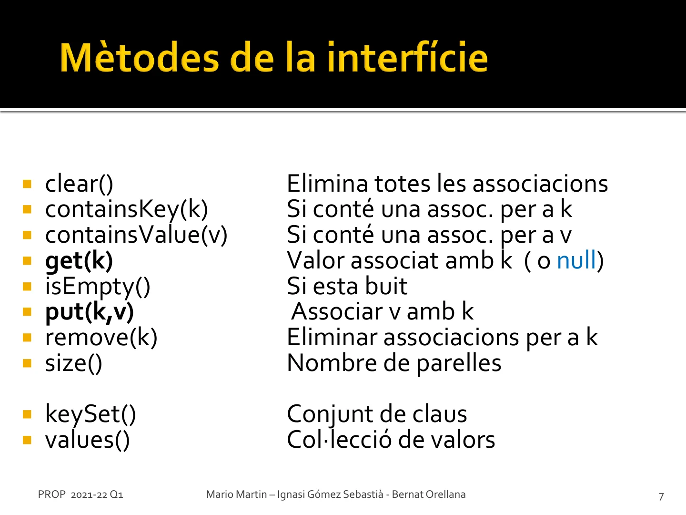

</details>

## Página 8

```text
Diverses         implementacions                 de    la  interfície
       -
          Map<T>:


           -  HashMap           :    Implementació            del  Map     amb     taules


              de  hast.    [Més    usat]


           -  TreeMap           :Implementació             del   Map     amb     arbres


              balancejats.       Manté       un  ordre.


          Exemple:
       -


    Map<String,Integer>              noms     =  new    HashMap<String,Integer>;

    Map   map    =  new    HashMap();


     PROP 2021-22 Q1          Mario Martin – Ignasi Gómez Sebastià - Bernat Orellana           8
```

<details>
<summary>Ver página original</summary>

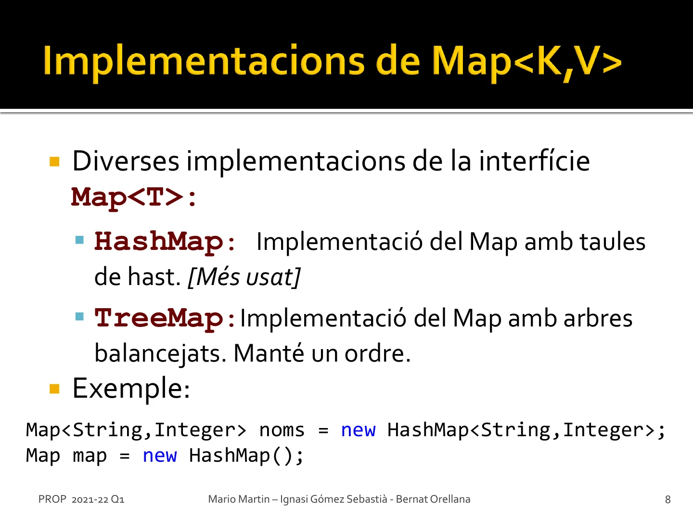

</details>

## Página 9

```text
-  Per  poder   fer servir  el Map,  la classe  que   es fa servir com    a clau ha

          de  tenir  implementats      de els mètodes:


          equals()       (  per    defecte      compara       punters      )
          hashCode()        (   hash    punters       )


       -  En  les classes   habituals   estan  implementades,       en  les pròpies   s’han
          de  implementar


       -  Condició       de   coherència:

           -  Donats    dos   objectes      A,  B,
            A.equals(B)==true              A.hashCode()==B.hashCode()

             “Si   dos   objectes      són   iguals,     han   de   tenir    el   mateix

                                               hash.”
           NOTA:    Al  revés    no   cal   que   sigui    cert.


     PROP 2021-22 Q1          Mario Martin – Ignasi Gómez Sebastià - Bernat Orellana           9
```

<details>
<summary>Ver página original</summary>

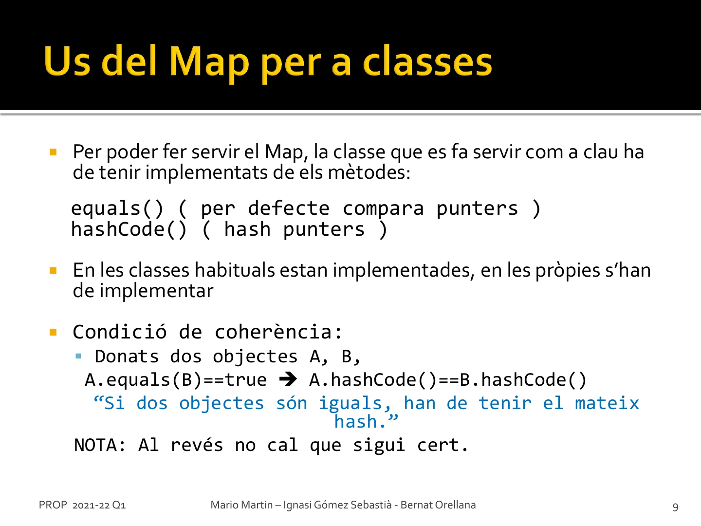

</details>

## Página 10

```text
public    class   Person   {
        public   String    name;

        boolean    equals(Object      o)  {
             return    (o  instanceof     Person   &&  ((Person)o).name.equals(name));

        }

        public   int   hashCode()     {
             return    name.hashCode();

        }

  }


     PROP 2021-22 Q1          Mario Martin – Ignasi Gómez Sebastià - Bernat Orellana           10
```

<details>
<summary>Ver página original</summary>

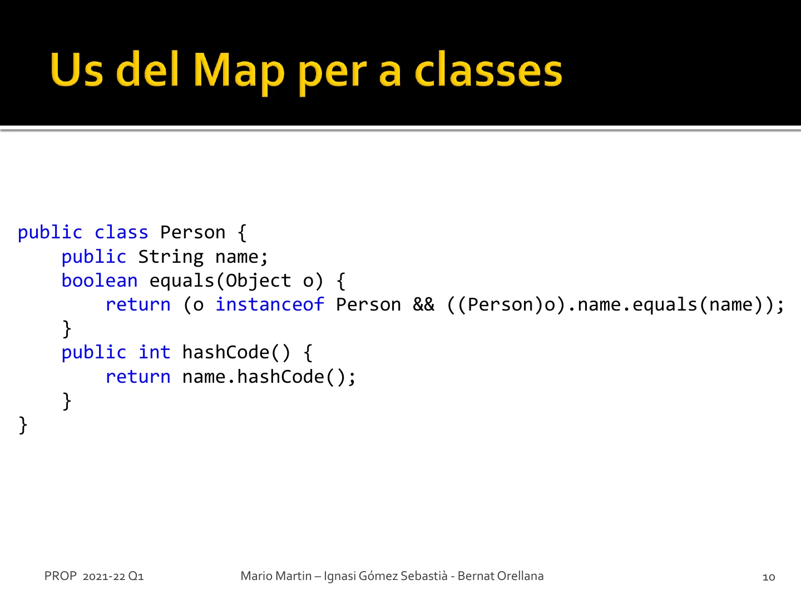

</details>

## Página 11

```text
Fer    un    programa          que     llegeix      un   text    per    el
       -

          canal      d’entrada         estàndard          i mostra        per


          pantalla        la  freqüència          de    cada     paraula


          diferent        del   text


          Fer       servir           un     mapa         clau        valor         per
       -

          guardar             paraules              i    freqüències


     PROP 2021-22 Q1          Mario Martin – Ignasi Gómez Sebastià - Bernat Orellana           11
```

<details>
<summary>Ver página original</summary>

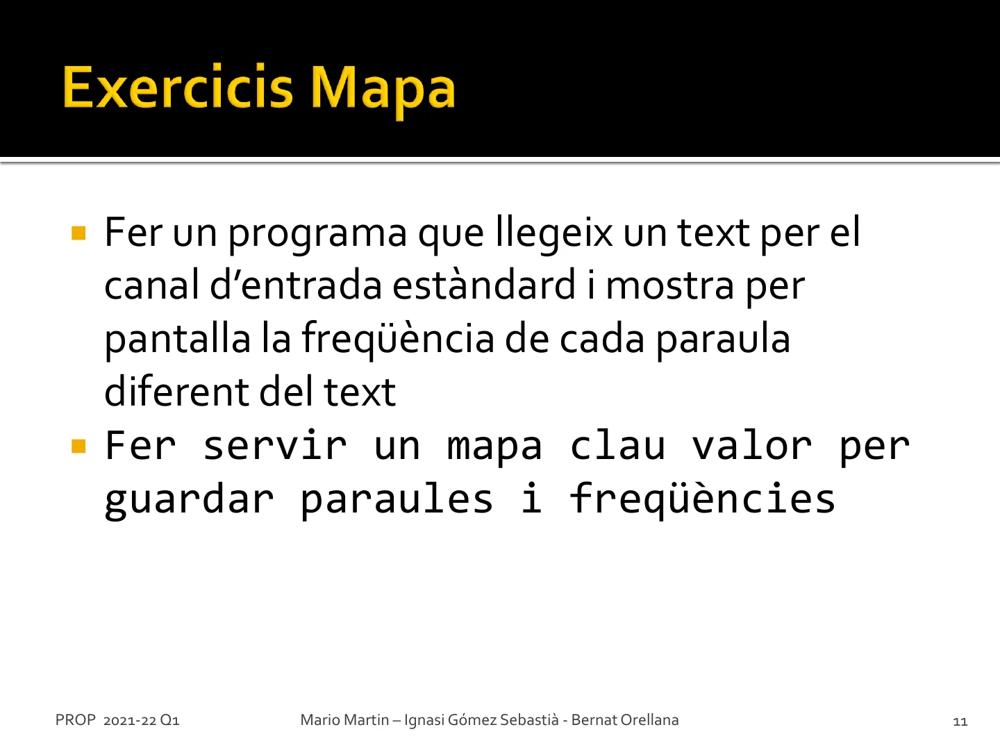

</details>

## Página 12

```text
Recorrent  les col·leccions
```

<details>
<summary>Ver página original</summary>

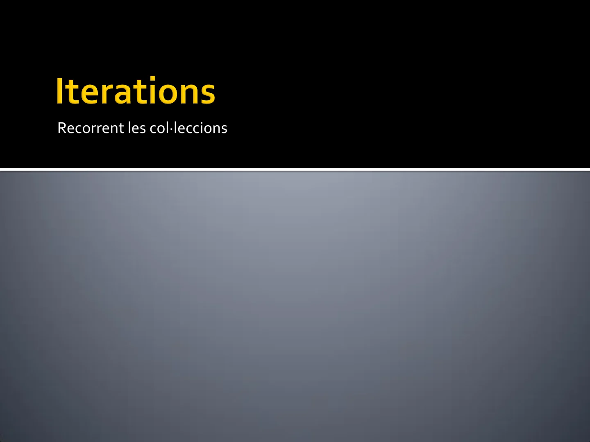

</details>

## Página 13

```text
Les    col·leccions          i els   Maps       són    extensions           de
       -

          la  classe      iterables.


          A   la  classe      hi  ha   mètodes          definits       per    recórrer
       -

          els   elements          que     componen            l’objecte       de    la


          classe


     PROP 2021-22 Q1          Mario Martin – Ignasi Gómez Sebastià - Bernat Orellana           14
```

<details>
<summary>Ver página original</summary>

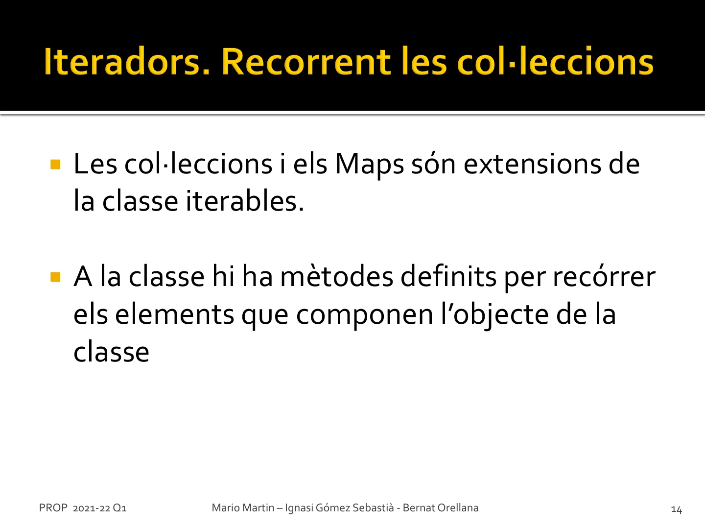

</details>

## Página 14

```text
-   Mètodes       implementats


            boolean     hasNext(      );
            Object     next(    );

            void    remove(     );


      -   Mètodes       implementats            addicionals       pels

          ListIteration


             boolean     hasPrevious();

             Object    previous();

            int   nextIndex(       );

            int   previousIndex(         );


     PROP 2021-22 Q1          Mario Martin – Ignasi Gómez Sebastià - Bernat Orellana           15
```

<details>
<summary>Ver página original</summary>

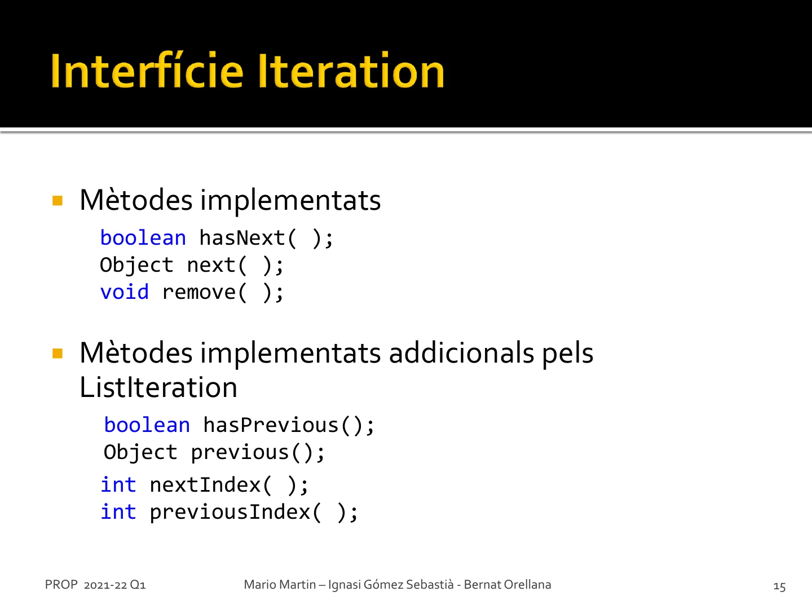

</details>

## Página 15

```text
-  Exemple      de  mètode     que   imprimeix      tots  els elements      d’una   col·lecció:


     static     void   printAll      (Collection       coll)    {

       Iterator     iter    =  coll.iterator(         );

       while    (iter.hasNext(        ))   {
           System.out.println(iter.next(                 )  );

       }

     }


  -  Observeu      que   el codi  és  polimòrfic,     és a  dir, que  funcionarà      per

     qualsevol     col·lecció.


  -  Hi  ha  constructores      de   iteradors   específics    per   llistes:

        ListIterator    listIterator(    );

       ListIterator    listIterator(int     index);

     la darrera    comença      en  la posició   index   fins  al final de  la llista

     PROP 2021-22 Q1          Mario Martin – Ignasi Gómez Sebastià - Bernat Orellana           16
```

<details>
<summary>Ver página original</summary>

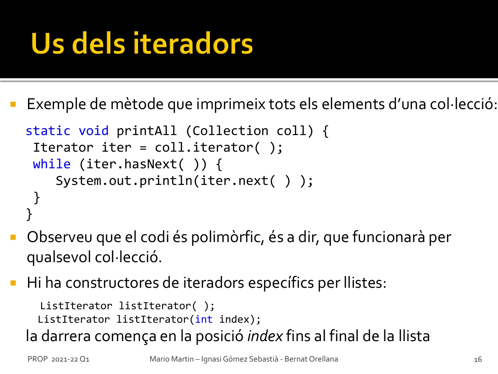

</details>

## Página 16

Esta página no contiene texto extraíble. Su contenido se conserva en la vista original.

<details>
<summary>Ver página original</summary>


</details>

## Página 17

```text
PROP 2021-22 Q1          Mario Martin – Ignasi Gómez Sebastià - Bernat Orellana           18
```

<details>
<summary>Ver página original</summary>

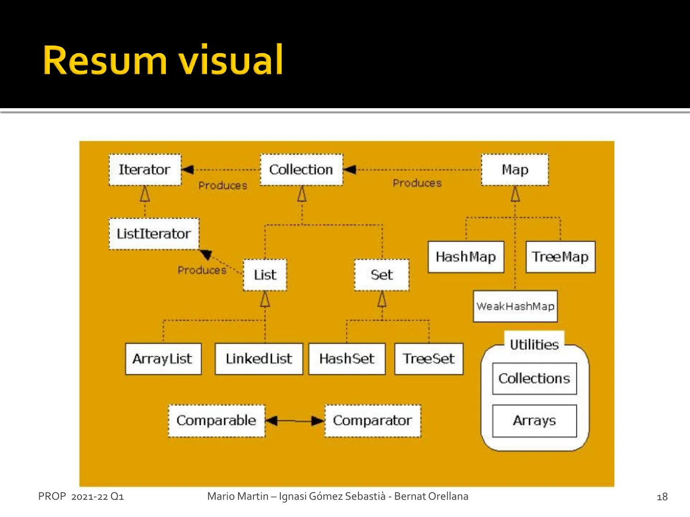

</details>

## Página 18

```text
Cues
       -

          Piles
       -

          ...
       -


     PROP 2021-22 Q1          Mario Martin – Ignasi Gómez Sebastià - Bernat Orellana           19
```

<details>
<summary>Ver página original</summary>

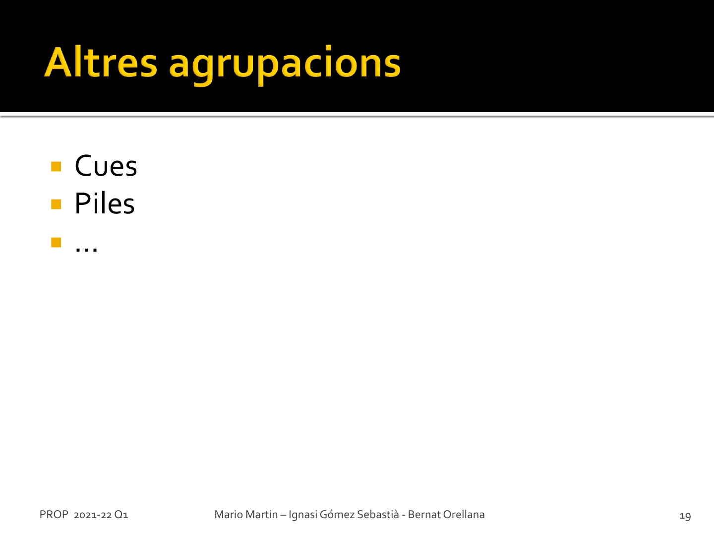

</details>

## Página 19

```text
public          interface              Queue<E>             extends

         Collection<E>                   {


              E    element();


              E    peek();

              boolean            offer(E           e);


              E    remove();

              E    poll();


     }


     PROP 2021-22 Q1          Mario Martin – Ignasi Gómez Sebastià - Bernat Orellana          20
```

<details>
<summary>Ver página original</summary>

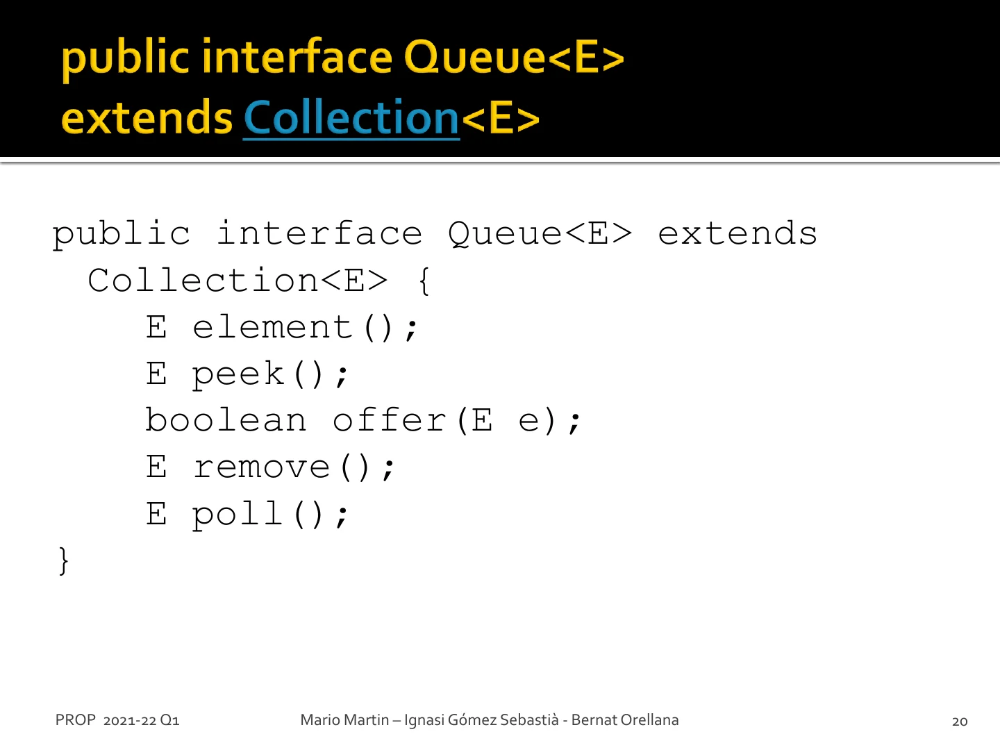

</details>

## Página 20

```text
-  La    classe       java.util.Collections                              té


          molts       mètodes          útils   per    treballar       amb


          col·leccions


     PROP 2021-22 Q1          Mario Martin – Ignasi Gómez Sebastià - Bernat Orellana           21
```

<details>
<summary>Ver página original</summary>

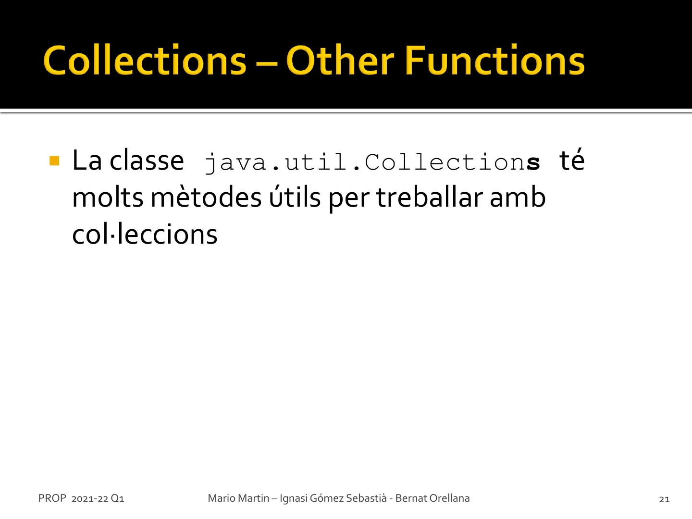

</details>

## Página 21

```text
-  Són    mètodes        estàtics     que    implementen           algorismes

        usuals     en   llistes:


        -  sort: Ordena     fent servir  mergesort

        -  shuffle:  Barreja   aleatòriament     els elements     de la llista

        -  reverse:   Inverteix  l’ordre

        -  rotate:  Rota   la llista el nombre   de  vegades    que  vulguem


        -  fill: Reescriu  tots  els elements    de  la llista amb  l’element    que  volem.

        -  copy:   Copia  una   llista sobre  una  altra

        -  binarySearch:     Cerca   fent  servir cerca  binaria

        -  indexOfSubList:      Retorna    el índex  de  la primera   subllista  trobada


        -  lastIndexOfSubList:       Retorna   el índex  de  la darrera   subllista  trobada

        -  max:   Retorna    el màxim    de la llista

        -  min:  Retorna    el mínim    de la llista
     PROP 2021-22 Q1          Mario Martin – Ignasi Gómez Sebastià - Bernat Orellana           22
```

<details>
<summary>Ver página original</summary>

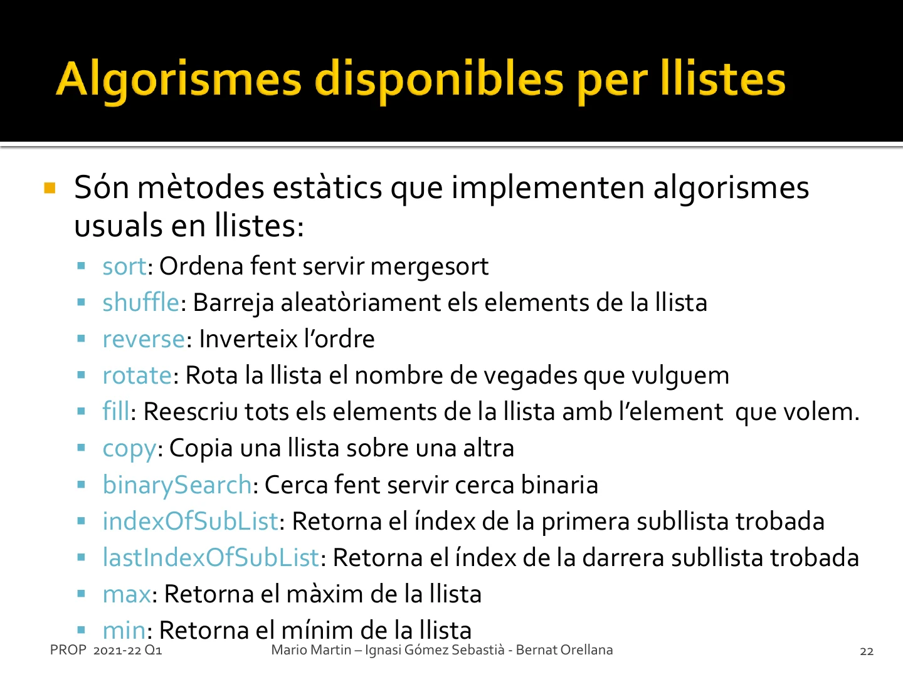

</details>

## Página 22

```text
Alguns       dels    algorismes         requereixen          com     per
       -
          exemple         la  ordenació,         buscar      un   màxim       o


          mínim,       etc.   requereixen           poder     comparar          els

          diferents       elements         de   la  col·lecció:       cal  definir     un

          mecanisme            de   comparació.


       -
          A   tal  efecte,      ens   caldrà      programar          un   mètode
          que,     donats      2  elements,         retorni     un   enter:


           -  Negatiu:     quan    el primer     sigui   menor     que   el  segon

           -  Zero:   quan    siguin    iguals

           -  Positiu


     PROP 2021-22 Q1          Mario Martin – Ignasi Gómez Sebastià - Bernat Orellana           23
```

<details>
<summary>Ver página original</summary>

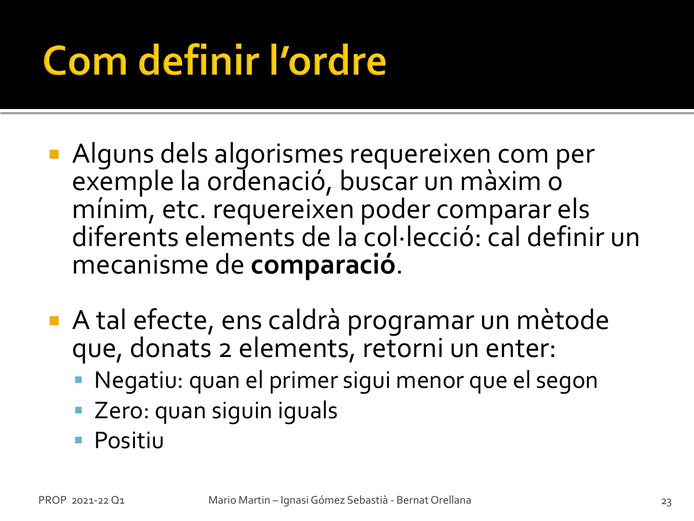

</details>

## Página 23

```text
-  Aquest       mètode       es  pot   definir     de  dues     maneres:


           -  Ordre   “natural”     dels   objectes:     Donada     una   classe   de
              sobre   la que   volem    ordenar/comparar         (p.ex   Persona),    fem

              que  implementi       Comparable.      Per  tant,   dins  de  la mateixa

              classe  és  defineix    el comportament         per  defecte    que

              s’usarà   per  comparar      els seus   objectes    (p.ex.  com    es

              comparen      les persones     per   defecte).


           -  Ordre   “personalitzat”        amb    Comparator.        Ens  pot

              interessar    definir  criteris  d’ordenació      diferents    segons    les
              circumstàncies.      En   aquest   cas   usem    una  tercera    classe   que

              exerceix   les  funcions    de  comparació:       aquesta    classe

              implemente       Comparator.      Podem      tenir  tants  Comparators

              com   diferents    tipus  d’ordre    volguem     tenir.


     PROP 2021-22 Q1          Mario Martin – Ignasi Gómez Sebastià - Bernat Orellana          24
      PROP   2013-14 Q2       Mario Martin                                                24
```

<details>
<summary>Ver página original</summary>

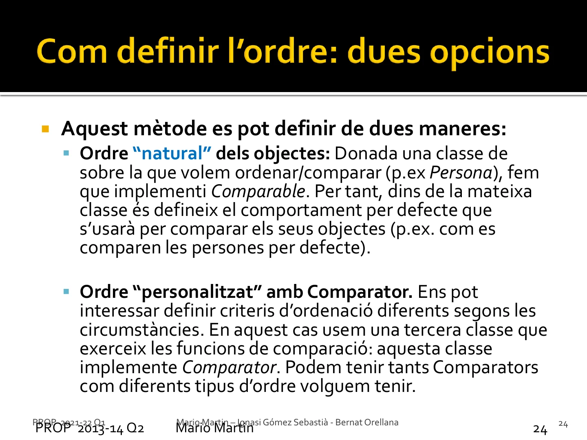

</details>

## Página 24

```text
La    classe     que
       -

          volem       comparar


          implementa


          Comparable,             que


          ens     suposa


          implementar


          alhora       el  mètode

          compareTo()


     PROP 2021-22 Q1          Mario Martin – Ignasi Gómez Sebastià - Bernat Orellana           25
```

<details>
<summary>Ver página original</summary>

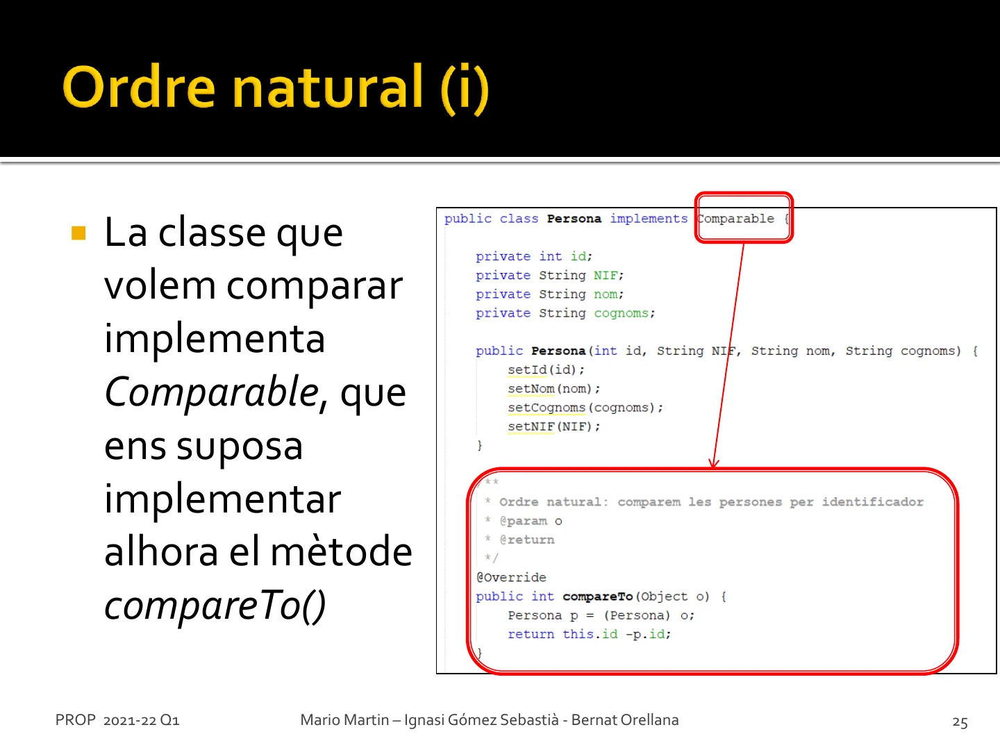

</details>

## Página 25

```text
PROP 2021-22 Q1          Mario Martin – Ignasi Gómez Sebastià - Bernat Orellana          26
```

<details>
<summary>Ver página original</summary>

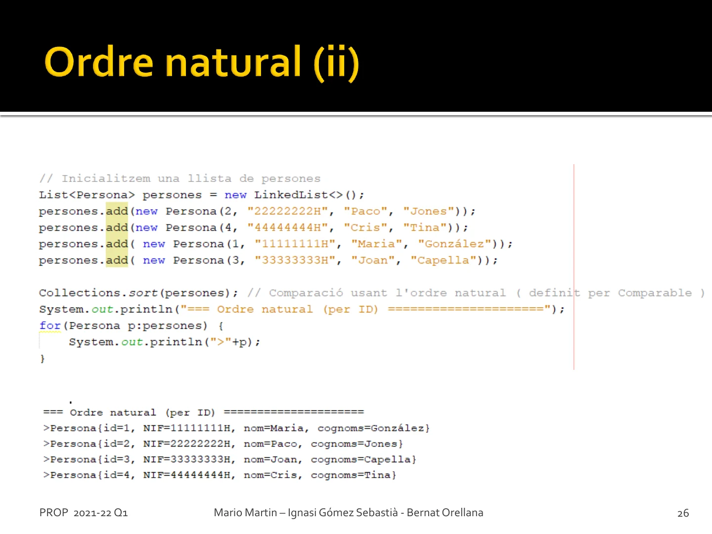

</details>

## Página 26

```text
-  Externament          a  la

          classe    persona,

          definim      una   classe

          que    implementi

          Comparator.         En   el

          mètode       compare

          programem          el

          criteri   de

          comparació         que

          ens   interessi,     en

          aquest     cas   la

          comparació         per

          cognom.


     PROP 2021-22 Q1          Mario Martin – Ignasi Gómez Sebastià - Bernat Orellana           27
```

<details>
<summary>Ver página original</summary>

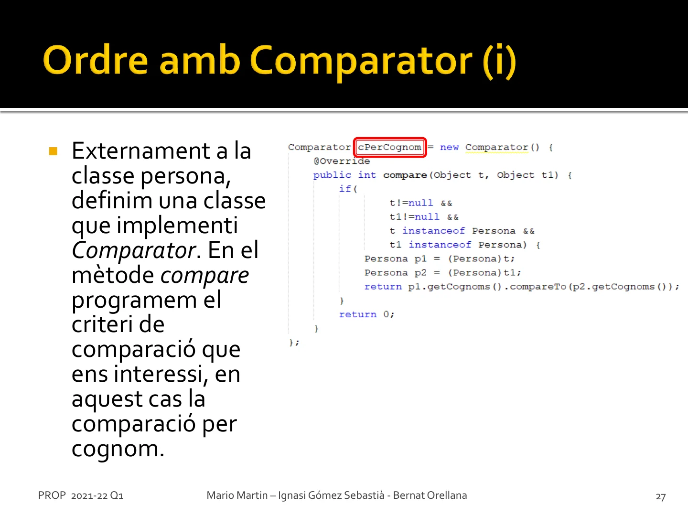

</details>

## Página 27

```text
Per    usar     el
       -

          comparator,             li


          passem         com      a


          paràmetre


          addicional          a


          l’algorisme          que


          el  requereixi.


     PROP 2021-22 Q1          Mario Martin – Ignasi Gómez Sebastià - Bernat Orellana          28
```

<details>
<summary>Ver página original</summary>

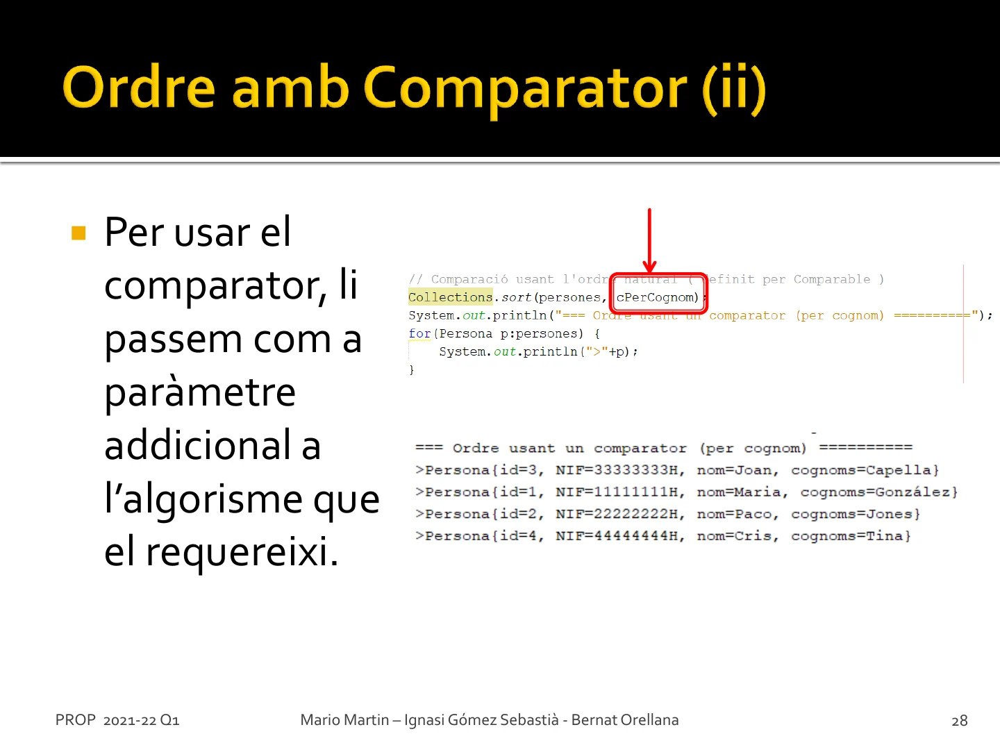

</details>

## Página 28

```text
Crear     classe     futbolista
       -

           -  Nom


           -  Gols


           -  Assistències

          Crear     una     col·lecció      de   futbolistes        i:
       -
          Ordenar        per    nom      ascendent         (ordre     natural)
       -

          Ordenar        per    nom      descendent          (ordre      natural)
       -
          Ordenar        (useu     un    Comparator           a  mida):
       -

              ▪  Nombre     de  gols

              ▪ En  cas  d’empat    nombre    d’assistències


              ▪ En  cas  d’empat    nom

     PROP 2021-22 Q1          Mario Martin – Ignasi Gómez Sebastià - Bernat Orellana          29
```

<details>
<summary>Ver página original</summary>

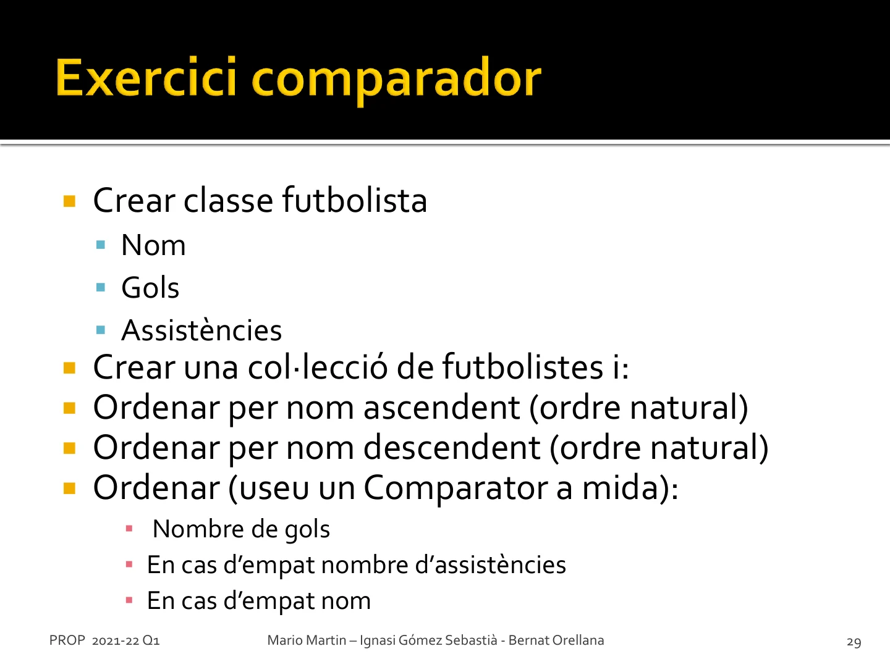

</details>
